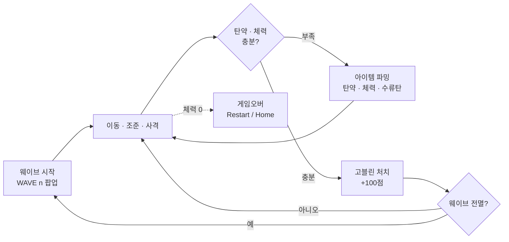

# 01. 게임 컨셉 제안서 — Goblin Defense (가제)

> 문서 세트: **01 컨셉** · [02 시스템-전투](02_System_Weapon.md) · [02 시스템-게임 흐름](02_System_GameFlow.md) · [03 전투·개체](03_Combat_Entity.md) · [04 레벨 디자인](04_LevelDesign.md) · [05 밸런스](05_Balance.md) · [시뮬레이션](Simulation.html)

---

## 한 줄 정의 (Elevator Pitch)
> **몰려오는 고블린 떼를 총과 수류탄으로 막아내며, 탄약과 체력을 아슬아슬하게 관리하는 모바일 3인칭 웨이브 슈터.**

| 항목 | 내용 |
|---|---|
| 장르 | 3인칭 슈팅(TPS) · 웨이브 디펜스 |
| 플랫폼 | 모바일 (가로 화면), PC 키보드 · 마우스 테스트 지원 |
| 엔진 | Unity 6 (6000.6.3f1) · C# · NavMesh · Cinemachine |
| 플레이 시간 | 한 판 10 ~ 15분 (10웨이브 기준, 제안 밸런스) |
| 타깃 유저 | 짧고 강렬한 액션을 원하는 모바일 유저, 슈팅 입문자 |

## 핵심 재미 (Core Fun)
| 키워드 | 무엇이 재미있나 | 코드 근거 |
|---|---|---|
| **물량 압박** | 웨이브마다 늘어나는 적이 사방에서 좁혀 옴 | `GoblinSpawn` 웨이브 생성 |
| **자원 긴장감** | 탄창 25발 · 재장전 1.8초 동안 무방비 | `Gun` 상태(Ready / Empty / Reloading) |
| **한 방 역전** | 몰린 적을 수류탄 한 개로 쓸어버림 | `Grenade` 반경 6 즉사 |
| **파밍 판단** | 5초 뒤 사라지는 아이템을 주우러 갈지, 버틸지 | `ItemSpawn` 수명 5초 |

## 코어 루프


| 루프 | 주기 | 현재 | 제안 |
|---|---|---|---|
| 순간 루프 | 1 ~ 3초 | 조준 → 사격 → 처치 | 처치 시 타격감 강화 (넉백, 히트 스톱) |
| 세션 루프 | 1 ~ 2분 | 웨이브 방어 → 다음 웨이브 | 웨이브 사이 3초 휴식 + 정비 |
| 장기 루프 | 여러 판 | **없음** | 코인 → 총기 업그레이드 → 더 높은 웨이브 도전 |

## 레퍼런스 대비 차별점
| 레퍼런스 (장르 대표작) | 가져온 점 | 이 게임의 차이 |
|---|---|---|
| 좀비 웨이브 모드 (콘솔 FPS 장르) | 웨이브마다 늘어나는 적, 점수 | 모바일 한 손 조작에 맞춘 **짧은 세션** |
| 탑다운 물량 서바이벌 (뱀서라이크 장르) | 물량을 한 번에 쓸어버리는 쾌감 | 자동 공격이 아닌 **직접 조준 · 재장전** |
| 모바일 배틀로얄 TPS | 조이스틱 + 화면 버튼 + 드래그 시점 | PvP가 아닌 **혼자 하는 PvE 방어** |

## 화면 구성 (와이어프레임)
```
┌─────────────────────────────────────────────────────────┐
│ Score : 1200          WAVE 3        Wave : 3  Enemy 12 ⚙│
│                                                         │
│                     ┼ (조준점)                           │
│                                                         │
│   (조이스틱)                         [스코프] [수류탄 x3] │
│     ◯                                [재장전]  [점프]    │
│ ▬▬▬▬▬ HP            🔫 18/100              ( 발사 )     │
└─────────────────────────────────────────────────────────┘
```

## 개발 현황
| 구분 | 상태 |
|---|---|
| 구현 완료 | 이동 · 3단 점프 · 사격 · 재장전 · 스코프 · 수류탄 · 고블린 AI · 웨이브 · 아이템 4종 · 설정(음량 · 일시정지) · 씬 이동 |
| 구조 | 이벤트(`static event Action`) 기반으로 매니저 간 결합 제거, 상속(`LivingEntity`) · 인터페이스(`IDamageable`, `IItem`) · ScriptableObject 데이터 |
| 다음 목표 | 웨이브 밸런스 재설계 · 고블린 종류 차별화 · 클리어 화면 · 업그레이드 (→ 04 · 05 문서) |
