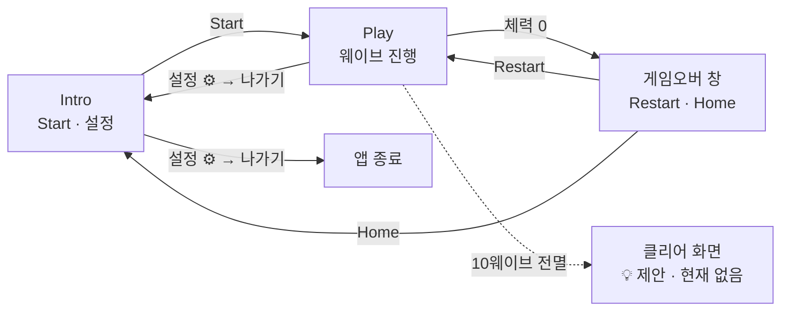
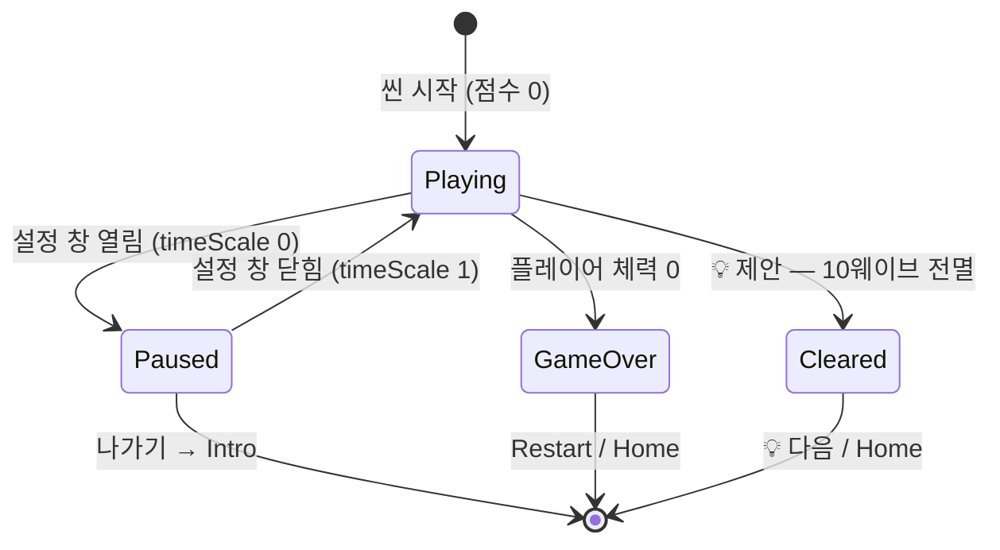

# 02-2. 시스템 기획서 — 게임 흐름 (씬 · 웨이브 · 게임오버 · 설정)

> 문서 세트: [01 컨셉](01_Concept.md) · [02 시스템-전투](02_System_Weapon.md) · **02 시스템-게임 흐름** · [03 전투·개체](03_Combat_Entity.md) · [04 레벨 디자인](04_LevelDesign.md) · [05 밸런스](05_Balance.md)
> 관련 코드: `GM.cs` · `GoblinSpawn.cs` · `UIM.cs` · `SM.cs` · `SceneChange.cs` · `SettingsMenu.cs` · `SettingsData.cs`

---

## 1. 화면 흐름도 (Scene Flow)
빌드 씬: `0 Intro` → `1 Play` (`Main` 씬은 빌드에서 빠져 있는 예전 버전)



## 2. Play 씬 상태 머신


| 상태 | 입력 | 고블린 | 점수 | 시간 |
|---|---|---|---|---|
| Playing | 정상 | 추적 · 공격 | 쌓임 | 1배 |
| Paused | 전부 0 (`PlayerInput`) | 멈춤 | – | 0배 (`Time.timeScale`) |
| GameOver | 전부 0 | 정지 + 대기 동작, 공격 · 공격음 없음 | **더 안 쌓임** | 1배 |

## 3. 웨이브 로직 (`GoblinSpawn`)
```
매 프레임
├─ IF 게임오버 → 아무것도 안 함
└─ IF 남은 고블린 = 0 AND 웨이브 < 10
    ├─ 웨이브 +1 → onWaveStarted(웨이브) 알림 → UI "WAVE n" 페이드 팝업 + 웨이브 글자 깜빡임
    ├─ 생성 수 = 10 × 2^(웨이브-1)
    ├─ 생성 수만큼 반복
    │   ├─ 고블린 데이터 3종 중 랜덤, 스폰 지점 3곳 중 랜덤
    │   ├─ 생성 + 스폰 이펙트(NavMesh 바닥에, 3초 뒤 제거)
    │   └─ 사망 알림 구독
    └─ onEnemyCountChanged(웨이브, 남은 수) 알림 → UI "Wave : n / Enemy Left : m"

고블린 사망
├─ 목록에서 제거, 10초 뒤 시체 제거
├─ onGoblinKilled 알림 → GM 점수 +100
└─ onEnemyCountChanged 알림
```

## 4. 게임오버 로직
```
PlayerHealth 체력 ≤ 0 → Die()
├─ 사망 소리 · 사망 애니메이션, 이동 · 사격 컴포넌트 끔
└─ onDeath → GM.EndGame()
    ├─ isGameOver = true (이후 AddScore 무시)
    └─ onGameOver 알림 (구독자가 각자 처리)
        ├─ UIM: 게임오버 창과 자식(글자 · Restart · Home) 전부 켬
        ├─ SM: 게임오버 소리
        ├─ GoblinSpawn: 웨이브 생성 중단
        └─ Goblin(전체): 길 찾기 중단 · 그 자리 정지 · 대기 애니메이션 · 공격 중단
```

## 5. 설정 · 일시정지 로직
```
⚙ 버튼 → SettingsMenu.Open()
├─ 클릭음 알림 → 창 켜기 → 저장된 음량을 슬라이더에 (알림 없이) 반영 → "70%" 표시
└─ onOpenChanged(true) → GM.SetPause(true) → timeScale 0

음량 슬라이더 → SettingsData.SetMasterVolume(v) → 0~1로 제한 → AudioListener.volume → PlayerPrefs
소리 버튼    → SetSoundOn(!현재) → 꺼짐이면 volume 0 → 아이콘 교체
X 버튼       → 저장 → onOpenChanged(false) → timeScale 1
나가기       → 저장 → Play 씬: Intro로 / Intro 씬: 앱 종료
```

## 6. 씬 이동 로직 (`SceneChange`)
```
Start / Restart / Home 버튼
├─ IF 이미 이동 중 → 무시 (중복 클릭 방지)
└─ ELSE → onChangeRequested 알림(SM 클릭음) → 0.3초 실제 시간 대기(멈춘 상태에서도 동작)
         → timeScale 1로 복구 → 씬 로드
```

## 7. 이벤트 연결표 (누가 알리고 누가 듣나)
| 이벤트 | 알리는 쪽 | 듣는 쪽 |
|---|---|---|
| `GM.onScoreChanged(int)` | GM | UIM (점수 글자 톡 · 깜빡임) |
| `GM.onGameOver` | GM | UIM, SM, GoblinSpawn, Goblin |
| `GoblinSpawn.onWaveStarted(int)` | GoblinSpawn | UIM |
| `GoblinSpawn.onEnemyCountChanged(int,int)` | GoblinSpawn | UIM |
| `GoblinSpawn.onGoblinKilled` | GoblinSpawn | GM (+100) |
| `Gun.onAmmoChanged(int,int)` | Gun | UIM |
| `PlayerGrenade.onGrenadeCntChanged(int)` | PlayerGrenade | ItemCntUI |
| `Coin.onCollected(int)` | Coin | GM (+200) |
| `SettingsMenu.onOpenChanged(bool)` | SettingsMenu | GM (일시정지) |
| `SettingsMenu.onButtonClicked` | SettingsMenu | SM (클릭음) |
| `SettingsMenu.onGoHomeRequested` | SettingsMenu | SceneChange |
| `SceneChange.onChangeRequested` | SceneChange | SM (클릭음) |

> 설계 의도: 초기 코드는 `GM` · `Gun` · `GoblinSpawn`이 `UIM.ins.UpdateXXX()`를 직접 불러 서로 묶여 있었다. 지금은 "알림만 보내고 필요한 쪽이 구독"하므로, UI를 바꿔도 게임 규칙 코드는 건드리지 않는다.

## 8. 예외 처리 (Edge Case)
> ✅ 처리됨 · ⚠️ 문제 · 💡 제안

| # | 상황 | 현재 동작 | 상태 | 처리 방안 |
|---|---|---|---|---|
| 1 | **10웨이브 전멸** | 조건(`웨이브 < 10`)이 거짓이 되어 아무 일도 안 일어남 → 빈 맵에 멈춤 | ⚠️ | 💡 Cleared 상태 추가 → 클리어 창(점수 · 다음 · Home) |
| 2 | **웨이브 사이 휴식 없음** | 마지막 고블린이 죽은 다음 프레임에 바로 다음 웨이브 | ⚠️ | 💡 3초 휴식 + "NEXT WAVE 3, 2, 1" (재장전 · 파밍 시간) |
| 3 | **한 웨이브를 한 프레임에 전부 생성** | 6웨이브 320마리를 `Instantiate`로 한 번에 → 프레임 멈춤 | ⚠️ | 💡 0.2초 간격 나눠 생성 + 오브젝트 풀링 |
| 4 | 게임오버 후 코인 · 처치 점수 | `isGameOver`면 `AddScore` 무시 | ✅ | – |
| 5 | 게임오버 순간 고블린 공격 중 | 공격 · 공격음 중단 | ✅ | – |
| 6 | 씬 이동 버튼 연타 | `isChanging`으로 1번만 | ✅ | – |
| 7 | 일시정지 상태에서 씬 이동 | 실제 시간으로 대기, 이동 전 timeScale 1 | ✅ | – |
| 8 | 멈춘 채로 GM이 사라짐 | `OnDestroy`에서 timeScale 1 | ✅ | – |
| 9 | GM이 씬에 2개 | 나중 것 삭제 | ✅ | – |
| 10 | **소리 끔 상태에서 음량 슬라이더 조절** | `SetMasterVolume`이 꺼짐 여부와 상관없이 volume을 바꿈 → 소리가 다시 남 | ⚠️ | 💡 `isSoundOn`이 false면 volume 0 유지 |
| 11 | **소리 끔 설정이 재시작 후 사라짐** | 시작 시 `Load()`가 음량만 읽고 `Settings_SoundOn`은 안 읽음 | ⚠️ | 💡 `Load()`에서 `isSoundOn`도 불러오기 |
| 12 | 최고 점수 · 최고 웨이브 저장 | 없음 | 💡 | `PlayerPrefs`에 저장, 게임오버 창에 "BEST" 표시 |
| 13 | 앱이 백그라운드로 감 (모바일) | 처리 없음 → 그대로 진행 | 💡 | `OnApplicationPause`에서 설정 창 열기(자동 일시정지) |
