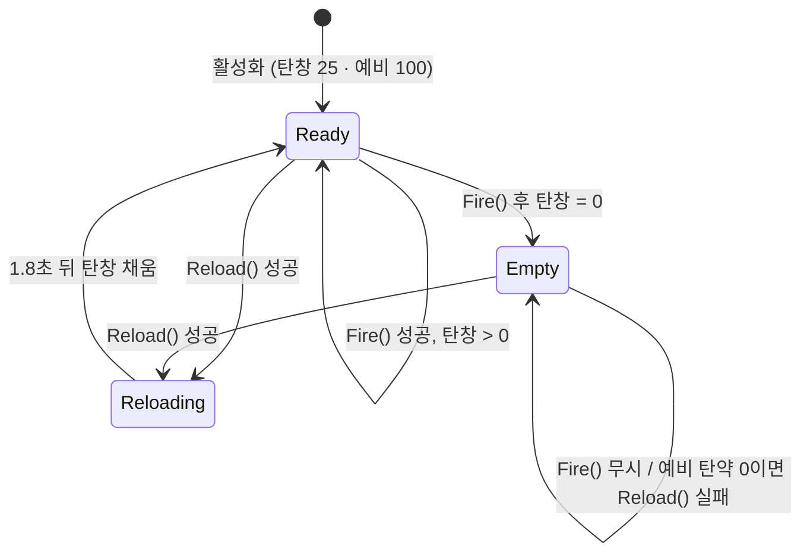

# 02-1. 시스템 기획서 — 전투 시스템 (사격 · 재장전 · 수류탄 · 스코프 · 아이템)

> 문서 세트: [01 컨셉](01_Concept.md) · **02 시스템-전투** · [02 시스템-게임 흐름](02_System_GameFlow.md) · [03 전투·개체](03_Combat_Entity.md) · [04 레벨 디자인](04_LevelDesign.md) · [05 밸런스](05_Balance.md)
> 관련 코드: `Gun.cs` · `PlayerShooter.cs` · `PlayerInput.cs` · `PlayerGrenade.cs` · `Grenade.cs` · `Scope.cs` · `ItemSpawn.cs` · `PlayerHealth.cs`

---

## 1. 시스템 개요
| 기능 | 한 줄 설명 | 수치 출처 |
|---|---|---|
| 사격 | 화면 중앙 조준점이 가리키는 곳으로 레이캐스트 발사 | `GunData` (ScriptableObject) |
| 재장전 | 1.8초 동안 사격 불가, 예비 탄약에서 탄창 채움 | `GunData.reloadTime` |
| 수류탄 | 앞으로 포물선 투척, 부딪히거나 2.5초 뒤 폭발 | `Grenade`, `PlayerGrenade` |
| 스코프 | 전용 카메라로 확대 조준, 조준점 UI 교체 | `Scope` |
| 아이템 | 플레이어 주변에 2 ~ 7초마다 생성, 5초 뒤 사라짐 | `ItemSpawn`, `IItem` |

## 2. 입력 → 행동 매핑
| 입력 (모바일 / PC) | 판정 방식 | 행동 |
|---|---|---|
| 발사 버튼 누르고 있기 / `F` | 누르는 동안 매 프레임 `fire = true` | `Gun.Fire()` (연사 간격으로 제한) |
| 재장전 버튼 / `R` | 누른 순간 한 프레임만 `true` | `Gun.Reload()` |
| 수류탄 버튼 / `G` | 누른 순간 한 프레임만 `true` | `PlayerGrenade.ThrowGrenade()` |
| 스코프 버튼(토글) / 마우스 오른쪽 누르기 | 상태 유지 | `Scope.Apply(on)` |
| 게임오버 · 일시정지 중 | **모든 입력 0 / false** | 행동 없음 |

## 3. 총 상태 머신 (FSM)


## 4. 작동 로직
### 4-1. 사격 `Gun.Fire()`
```
발사 입력 발생
├─ IF 총 상태 ≠ Ready            → 무시 (Empty · Reloading)
├─ IF 마지막 발사 후 0.12초 미만  → 무시 (연사 간격)
└─ ELSE
    ├─ 조준 카메라 선택: 스코프 켜짐 → 스코프 카메라 / 꺼짐 → 메인 카메라
    ├─ 화면 중앙(0.5, 0.5)으로 레이 → Player 레이어 제외하고 맞은 지점 = 조준점 (없으면 50m 앞)
    ├─ 총구 → 조준점 방향으로 50m 레이캐스트
    │   ├─ IF 맞은 대상에 IDamageable 있음 → OnDamage(25)
    │   └─ 궤적 끝 = 맞은 지점 (없으면 50m 앞)
    ├─ 연출: 총구 불꽃 · 탄피 · 발사음 · 궤적선 0.03초
    ├─ 탄창 -1 → IF 탄창 = 0 → 상태 Empty
    └─ onAmmoChanged(탄창, 예비) 알림 → UI 갱신
```

### 4-2. 재장전 `Gun.Reload()`
```
재장전 입력 발생
├─ IF 발사 입력이 같은 프레임에 눌려 있음 → 재장전 입력 무시 (PlayerShooter: if fire else if reload)
├─ IF 상태 = Reloading            → 실패 (false)
├─ IF 예비 탄약 ≤ 0               → 실패
├─ IF 탄창이 이미 가득(25)        → 실패
└─ ELSE → 성공 (true)
    ├─ 상태 Reloading, 재장전 소리, 재장전 애니메이션 트리거
    ├─ (옵션) 상체 애니메이션 레이어 Weight 0 → 1 로 부드럽게
    ├─ 1.8초 대기
    ├─ 채울 양 = min(25 - 탄창, 예비 탄약) → 탄창 += 채울 양, 예비 -= 채울 양
    └─ 상태 Ready, onAmmoChanged 알림
```

### 4-3. 수류탄
```
수류탄 입력 발생
├─ IF 보유 수류탄 ≤ 0 → 무시
└─ ELSE
    ├─ 보유 -1 → onGrenadeCntChanged 알림 (UI 숫자 톡 튀기)
    ├─ 투척 지점에서 생성 → 힘 = 앞 × 12 + 위 × 4 (Impulse, 포물선)
    └─ 폭발 조건 (먼저 오는 것 1번만 — hasExploded)
        ├─ 바닥 · 고블린 등에 충돌 (단, 플레이어 자신은 무시) → 즉시 폭발
        └─ 던진 뒤 2.5초 경과 → 폭발
            ├─ 반경 6 안의 Goblin 레이어 전부 → 살아 있으면 9999 데미지 (즉사)
            ├─ 폭발 이펙트 생성(2초 뒤 제거) · 폭발음
            └─ 수류탄 제거
```

### 4-4. 아이템 생성 · 획득
```
매 프레임
└─ IF 지난 생성 후 (2 ~ 7초 랜덤) 경과 AND 플레이어 있음
    ├─ 플레이어 주변 반경 5 안 랜덤 점 → NavMesh 위 가장 가까운 점 + 0.5m 위
    ├─ 4종 중 균등 랜덤 1개 생성 → 5초 뒤 제거
    └─ 다음 생성 시간 다시 랜덤

플레이어가 아이템에 닿음 (OnTriggerEnter)
├─ IF 플레이어 사망 OR 일시정지 → 무시
└─ ELSE → IItem.Use(): 탄약 +30 / 체력 +50 / 수류탄 +1 (최대 50) / 코인 → 점수 +200
```

## 5. 예외 처리 (Edge Case)
> ✅ 코드에서 처리됨 · ⚠️ 처리 안 됨(문제) · 💡 제안

| # | 상황 | 현재 동작 | 상태 | 처리 방안 |
|---|---|---|---|---|
| 1 | 재장전 중 재장전 연타 | `Reloading`이면 거부 | ✅ | – |
| 2 | 재장전 중 발사 | `Ready`가 아니면 무시 | ✅ | – |
| 3 | 탄창 가득일 때 재장전 | 거부 | ✅ | – |
| 4 | **탄창 0에서 발사 버튼** | 아무 반응 없음 (빈 소리 · 안내 없음) | ⚠️ | 💡 빈 탄창 "딸깍" 소리 + 재장전 버튼 깜빡임, 옵션으로 자동 재장전 |
| 5 | **예비 탄약 0에서 재장전** | 조용히 실패 | ⚠️ | 💡 "탄약 없음" 토스트 + 탄약 팩 위치 표시 |
| 6 | 발사 버튼을 누른 채 재장전 | 재장전 입력 무시 (`if fire else if reload`) | ⚠️ | 💡 재장전 입력을 우선 처리하고 발사 입력 잠금 |
| 7 | **수류탄 연타** | 쿨다운 없음 → 한 프레임에 1개씩 연속 투척 가능 | ⚠️ | 💡 투척 쿨다운 0.5초 + 버튼 비활성 표시 |
| 8 | 보유 수류탄 0에서 투척 | 무시 | ✅ | 💡 버튼 회색(Disabled) 처리 |
| 9 | 충돌 폭발과 시간 폭발이 겹침 | `hasExploded`로 1번만 | ✅ | – |
| 10 | 콜라이더가 여러 개인 고블린 | `dead` 검사로 1번만 피해 | ✅ | – |
| 11 | 수류탄이 플레이어에 닿음 | 충돌 무시, 플레이어 피해 없음 | ✅ | 의도된 설계 (자폭 없음) |
| 12 | 스코프 조준 레이가 플레이어 몸에 맞음 | Player 레이어 제외 | ✅ | – |
| 13 | **체력 팩으로 최대 체력 초과** | `RestoreHealth`에 상한 없음 → 150, 200… | ⚠️ | 💡 `min(health + 50, startingHealth)`, 최대 체력일 땐 줍지 않음 |
| 14 | 탄약 · 코인 무한 누적 | 상한 없음 | 💡 | 예비 탄약 상한 300 제안 (→ 05 밸런스) |
| 15 | 일시정지 · 사망 중 아이템 접촉 | 획득 무시 | ✅ | – |
| 16 | **아이템 생성 위치에 NavMesh 없음** | `SamplePosition` 실패 결과를 검사하지 않음 → 맵 원점 근처에 생성될 수 있음 | ⚠️ | 💡 실패 시 그 회차 생성 건너뛰기 |
| 17 | 게임오버 · 일시정지 중 입력 | `PlayerInput`이 모든 값 0 | ✅ | – |
| 18 | 스코프 확대값 `zoomFov` | 변수만 있고 쓰이지 않음 (스코프 카메라로 대체) | 💡 | 미사용 변수 정리 |

## 6. UI 피드백 요구사항
| 이벤트 | 화면 | 소리 | 상태 |
|---|---|---|---|
| 발사 | 총구 불꽃 · 탄피 · 궤적선 | 발사음 | ✅ |
| 탄 수 변경 | `18/100` 글자 | – | ✅ |
| 재장전 | 상체 재장전 애니메이션 | 재장전음 | ✅ / 💡 원형 진행 게이지 |
| 빈 탄창 | – | – | 💡 빈 소리 + 버튼 깜빡임 |
| 수류탄 개수 변경 | 개수 글자 톡 튀기 (`IPop`) | – | ✅ |
| 체력 감소 | 체력바 깜빡임 (`IBlink`) | 피격음 | ✅ |
| 체력 회복 | 체력바 톡 튀기 | 획득음 | ✅ |
