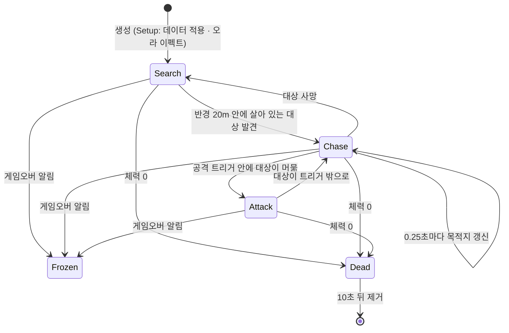

# 03. 전투 · 캐릭터 · 몬스터 상세 기획서

> 문서 세트: [01 컨셉](01_Concept.md) · [02 시스템-전투](02_System_Weapon.md) · [02 시스템-게임 흐름](02_System_GameFlow.md) · **03 전투·개체** · [04 레벨 디자인](04_LevelDesign.md) · [05 밸런스](05_Balance.md)
> 관련 코드: `PlayerMovement.cs` · `CamLook.cs` · `LivingEntity.cs` · `PlayerHealth.cs` · `Goblin.cs` · `GoblinData.cs` · `GunData.cs` · `Grenade.cs`
> 표기: **현재** = 코드에 있는 값 · **💡 제안** = 앞으로 바꿀 값

---

## 1. 조작 방식 (모바일 기준)
| 영역 | 조작 | 세부 규칙 |
|---|---|---|
| 화면 왼쪽 | `DynamicJoystick` 이동 | 손가락을 댄 곳에 조이스틱이 생김. 앞뒤 · 좌우 값이 그대로 블렌드 애니메이션 값 |
| 화면 오른쪽 빈 곳 | 드래그로 시점 회전 (`CamLook`) | 조이스틱 · 버튼 위에서 **시작한** 손가락은 시점 회전에서 제외 |
| 오른쪽 버튼 | 발사(누르고 있기) · 재장전 · 수류탄 · 점프 · 스코프(토글) | PC 테스트: F · R · G · Space · 마우스 오른쪽 |

## 2. 플레이어 기본 스펙
| 항목 | 현재 | 비고 |
|---|---|---|
| 체력 | 100 | `LivingEntity.startingHealth` |
| 이동 속도 | 5 m/s | 바라보는 방향 기준 앞뒤 · 좌우 이동 (Rigidbody 속도 직접 지정) |
| 점프 | 위로 Impulse 5, **최대 3단** | 바닥 판정: 발밑 레이캐스트 0.6m, 땅에 닿고 떨어지는 속도가 아닐 때 횟수 초기화 |
| 피격 | 피격음 + 체력바 깜빡임 | 경직 · 넉백 없음 |
| 사망 | 사망음 · 사망 애니메이션 · 이동 / 사격 끔 | 콜라이더는 남김 (지면 아래로 꺼지는 버그 방지) |

## 3. 무기 상세 명세
### 3-1. 기본 소총 `WPN_001`
| 항목 | 값 | 계산 |
|---|---|---|
| 데미지 | 25 | |
| 연사 간격 | 0.12초 | 초당 8.3발 |
| 탄창 / 시작 예비 | 25 / 100 | 시작 총 125발 |
| 재장전 | 1.8초 | |
| 사거리 | 50m | 레이캐스트 (탄속 없음, 즉시 명중) |
| DPS | **208** | 25 ÷ 0.12 |
| 지속 DPS (재장전 포함) | **130** | 625 ÷ (3.0초 연사 + 1.8초 재장전) |
| 판정 | 화면 중앙 조준점 → 총구에서 그 지점으로 레이 | 스코프 켜면 스코프 카메라 기준 |
| 연출 요구 | 총구 불꽃 · 탄피 파티클 · 궤적선 0.03초 · 발사음 · 재장전음 | |

### 3-2. 수류탄 `GRN_001`
| 항목 | 값 |
|---|---|
| 시작 / 최대 보유 | 3 / 50 |
| 투척 | 앞 × 12 + 위 × 4 Impulse (포물선) |
| 폭발 시점 | **무언가에 부딪히는 즉시** 또는 2.5초 뒤 중 먼저 |
| 범위 · 데미지 | 반경 6m · 9999 (범위 안 고블린 즉사) |
| 아군 피해 | 없음 |
| 연출 요구 | 폭발 파티클(2초) · 폭발음(음량 조절 가능) |
| 💡 제안 | 투척 쿨다운 0.5초, 투척 전 궤적 · 범위 미리보기 원 |

### 3-3. 스코프
| 항목 | 값 |
|---|---|
| 켜기 | 스코프 카메라 활성 + 스코프 UI, 조준점 UI 숨김 |
| 조준 | 스코프 카메라 중앙 기준 레이 |
| 💡 제안 | 스코프 중 이동 속도 50%, 반동 감소 |

## 4. 몬스터 — 고블린
### 4-1. 기본 스펙 (현재)
| 항목 | 값 | 비고 |
|---|---|---|
| 체력 | 100 | 소총 4발 = 0.36초 |
| 공격력 / 간격 | 20 / 0.5초 | 플레이어를 1마리가 **2초**에 처치 (5타) |
| 이동 속도 | 2 m/s | 플레이어(5)보다 느림 → 거리 벌리기 가능 |
| 탐지 범위 | 반경 20m | `OverlapSphere`, 0.25초마다 |
| 처치 점수 | +100 | |
| 데이터 | `Goblin Data` · `1` · `2` 3종 | ⚠️ **세 데이터의 수치 · 색이 모두 같음** → 종류 차이 없음 |

### 4-2. AI 상태 머신 (현재)

| 상태 | 행동 | 애니메이션 | 소리 · 이펙트 |
|---|---|---|---|
| Search | 제자리 정지, 0.25초마다 주변 탐색 | 대기 (`HasTarget` false) | 바닥 오라 |
| Chase | NavMesh로 대상 위치 추적 | 달리기 (`HasTarget` true) | 바닥 오라 |
| Attack | 0.5초마다 즉시 피해 20 (**선딜 없음**) | `Attack` 트리거 | 공격음 |
| 피격 | 체력 감소만 (경직 · 넉백 없음) | – | 피 파티클(1초) · 피격음 |
| Frozen | 길 찾기 중단, 속도 0, 공격 안 함 | 대기 | – |
| Dead | 콜라이더 · NavMesh 끔 | `Die` 트리거 | 사망음, 오라 제거 |

### 4-3. 💡 제안 — 공격 패턴 개선
| 항목 | 현재 | 제안 | 이유 |
|---|---|---|---|
| 공격 선딜 (Wind-up) | 없음 (닿는 순간 피해) | **0.3초** 팔 드는 동작 후 판정, 그동안 빨간 테두리 | 플레이어가 보고 피할 수 있어야 "억울한 피격"이 줄어듦 |
| 공격 사거리 | 트리거 콜라이더 크기 | **1.2m** 숫자로 명시 | 기획 · 개발 · 아트가 같은 기준을 보도록 |
| 피격 반응 | 없음 | 0.2초 넉백 1m + 흰색 번쩍임 | 타격감, 몰린 적에게 숨 돌릴 틈 |
| 후딜 | 없음 | 공격 후 0.4초 이동 정지 | 공격 뒤 반격 타이밍 제공 |
| 대상 놓침 | 한 번 찾으면 계속 추적 | 유지 (웨이브 디펜스 특성상 적절) | – |

### 4-4. 💡 제안 — 고블린 4종 (데이터 3종의 수치를 실제로 나누기)
| ID | 이름 | 체력 | 공격 / 간격 | 속도 | 점수 | 역할 | 아트 요구 |
|---|---|---|---|---|---|---|---|
| `MOB_N` | 일반 고블린 | 100 | 20 / 0.5초 | 2.0 | 100 | 기본 물량 | 기본 초록 |
| `MOB_R` | 날쌘 고블린 | 60 | 10 / 0.5초 | 3.5 | 80 | 거리 벌리기를 방해 | 작고 노란 톤, 빠른 달리기 |
| `MOB_B` | 덩치 고블린 | 300 | 35 / 0.8초 | 1.4 | 300 | 탄약 소모 유도 → 수류탄 사용 | 1.5배 크기, 붉은 톤 |
| `MOB_K` | 고블린 대장 | 1500 | 50 / 1.0초 | 1.2 | 2000 | 10웨이브 보스 | 2배 크기, 왕관, 등장 연출 |

> 수치 계산(처치 시간, 플레이어 처치 타수)은 [05 밸런스](05_Balance.md)와 `05_Balance/goblin.csv`에 있음.

## 5. 이펙트 · 사운드 요구사항 목록
| 대상 | 이펙트 | 사운드 | 현재 |
|---|---|---|---|
| 소총 발사 | 총구 불꽃, 탄피, 궤적선 | 발사음 | ✅ |
| 소총 재장전 | 상체 애니메이션 | 재장전음 | ✅ |
| 수류탄 폭발 | 폭발 파티클 | 폭발음 | ✅ |
| 고블린 생성 | 바닥 생성 이펙트(3초) | – | ✅ / 💡 생성음 |
| 고블린 상시 | 바닥 오라(반복) | – | ✅ |
| 고블린 피격 | 피 파티클 | 피격음 | ✅ / 💡 흰 번쩍임 |
| 고블린 공격 | – | 공격음 | ✅ / 💡 선딜 경고 테두리 |
| 고블린 사망 | 사망 애니메이션 | 사망음 | ✅ |
| 플레이어 피격 | 체력바 깜빡임 | 피격음 | ✅ / 💡 화면 가장자리 붉게 |
| 아이템 획득 | 개수 · 체력바 톡 튀기 | 획득음 | ✅ |
| 웨이브 시작 | "WAVE n" 페이드 팝업 | – | ✅ / 💡 시작음 |
| 게임오버 | 게임오버 창 | 게임오버음 | ✅ |
