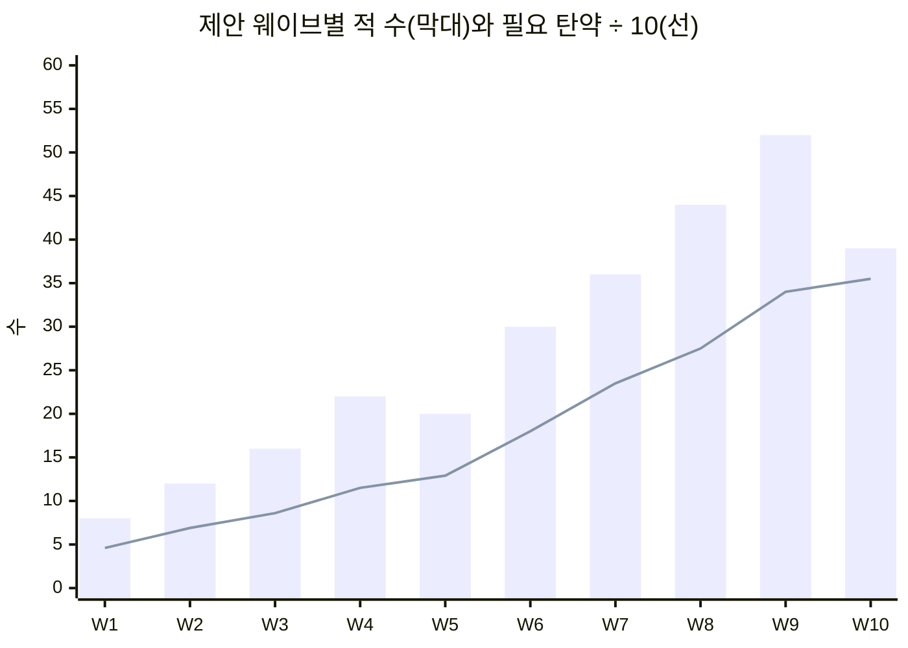

# 04. 레벨 디자인 기획서 — Play 스테이지 · 10웨이브

> 문서 세트: [01 컨셉](01_Concept.md) · [02 시스템-전투](02_System_Weapon.md) · [02 시스템-게임 흐름](02_System_GameFlow.md) · [03 전투·개체](03_Combat_Entity.md) · **04 레벨 디자인** · [05 밸런스](05_Balance.md)
> 관련 코드 · 데이터: `GoblinSpawn.cs` · `ItemSpawn.cs` · `Scenes/Play.unity` · `05_Balance/wave.csv`

---

## 1. 스테이지 콘셉트
| 항목 | 내용 |
|---|---|
| 이름 | 고블린 숲 공터 (Play 씬) |
| 분위기 | 해 질 녘 숲속 공터, 고블린 소굴 입구가 한쪽에 모여 있음 |
| 플레이 목표 | 10웨이브를 버티고 고블린 대장 처치 |
| 동선 의도 | 소굴(스폰) 반대편으로 물러나며 쏘다가, 몰리면 수류탄 → 다시 전진하며 아이템 파밍 |

## 2. 맵 레이아웃 (탑뷰)
**현재 배치 (`Play.unity`)** — 스폰 지점 3곳이 `[Spawners]` 아래 **한 줄**로 놓여 있음 (x = -19.66 / 0 / 7.39, 같은 z). 고블린은 항상 맵 한쪽에서만 나옴.

```
                 (북) 고블린 소굴 쪽
   SP3(-19.7)          SP1(0)      SP2(+7.4)
      ●━━━━━━━━━━━━━━━━━━●━━━━━━━━━━━●         ← 스폰 라인
      ┊                                ┊
      ┊        ▓▓  엄폐물      ▓▓       ┊
      ┊                                ┊
      ┊               ◎ 플레이어 시작    ┊
      ┊        ( 아이템: 플레이어 반경 5m 안 )
                 (남) 후퇴 공간
```
> 엄폐물 · 플레이어 시작 위치는 도식이에요. 포트폴리오에는 Unity 씬 뷰 탑다운 캡처를 이 자리에 넣으세요.

**💡 제안 배치** — 북쪽 소굴(A · B · C) + 동 · 서 측면 스폰(D · E)을 웨이브 단계에 따라 하나씩 열어 "한쪽만 보면 되는" 단계에서 "사방을 봐야 하는" 단계로 넘어가게 함.

```
        A ●        B ●        C ●        ← 1웨이브부터
   D ●                              ● E  ← 6웨이브부터 열림 (측면 기습)
            ▓▓        ▓▓
                 ◎
            ▓▓        ▓▓
```

## 3. 몬스터 스폰 테이블
### 3-1. 현재 (코드)
| 규칙 | 값 |
|---|---|
| 시작 조건 | 남은 고블린 0 → 즉시 다음 웨이브 |
| 마리 수 | `10 × 2^(웨이브-1)` → 10, 20, 40, 80, 160, 320, 640, 1280, 2560, 5120 |
| 생성 방식 | 한 프레임에 전부, 스폰 3곳 중 랜덤, 데이터 3종 중 랜덤(수치 같음) |
| 문제 | 6웨이브부터 수백 마리 동시 생성 → 성능 · 난이도 모두 한계, 누적 10,230마리 |

### 3-2. 💡 제안 (`05_Balance/wave.csv`)
| 웨이브 | 단계 | 일반 | 날쌘 | 덩치 | 대장 | 합계 | 열린 스폰 | 의도 |
|---|---|---|---|---|---|---|---|---|
| 1 | 학습 | 8 | – | – | – | 8 | A · B · C | 조준 · 사격 적응 |
| 2 | 학습 | 12 | – | – | – | 12 | A · B · C | 첫 재장전 타이밍 경험 |
| 3 | 성장 | 12 | 4 | – | – | 16 | A · B · C | 빠른 적 등장 → 거리 관리 |
| 4 | 성장 | 14 | 8 | – | – | 22 | A · B · C | 탄약 팩 파밍 필요해짐 |
| 5 | **1차 위기** | 12 | 6 | 2 | – | 20 | A · B · C | 덩치 등장 → **수류탄 사용 유도** |
| 6 | 성장 | 18 | 10 | 2 | – | 30 | + D · E | 측면 스폰 개방 (사방 경계) |
| 7 | 위기 | 20 | 12 | 4 | – | 36 | 전체 | |
| 8 | 위기 | 24 | 16 | 4 | – | 44 | 전체 | |
| 9 | 최고조 | 28 | 18 | 6 | – | 52 | 전체 | 가장 많은 물량 |
| 10 | **보스** | 20 | 12 | 6 | 1 | 39 | 전체 | 물량은 줄이고 대장에 집중 |

### 3-3. 💡 웨이브 안 시간대별 스폰 (예: 5웨이브)
한 번에 다 나오지 않고 **묶음(그룹)으로 나눠** 나오게 해서 웨이브 안에서도 긴장 → 완화 → 긴장 리듬을 만듦.

| 시간 | 스폰 | 위치 | 의도 |
|---|---|---|---|
| 0:00 | 일반 6 | A · B | 워밍업 |
| 0:05 | 일반 6 | B · C | 재장전 1회 유도 |
| 0:10 | 날쌘 6 | A · C 양끝 | 좌우로 시선 분산 |
| 0:16 | 덩치 2 + 남은 적과 합류 | B (정면) | 몰린 순간 **수류탄으로 한 번에 정리하는 쾌감** |

> 구현 메모: `GoblinSpawn.SpawnWave()`를 "그룹 목록을 시간 순서로 실행하는 코루틴"으로 바꾸면 됨 (데이터는 ScriptableObject 웨이브 표).

## 4. 난이도 곡선
**제안 웨이브별 적 수 · 필요 탄약 (명중률 70% 가정)**



- 5웨이브와 10웨이브는 **적 수는 줄이고 강한 적을 넣어** 톱니 모양 곡선 → 매 웨이브가 단순히 "더 많이"가 아니라 "다르게" 어려워짐
- 웨이브 사이 3초 휴식(💡 [02 게임 흐름](02_System_GameFlow.md) 예외 #2)이 곡선의 "숨 고르기" 구간

**현재 곡선과 비교** — 현재는 2배씩 늘어 10웨이브가 5,120마리라 같은 그래프에 그리면 1 ~ 5웨이브가 바닥에 붙어 보이지 않음. 실제 플레이 가능한 구간은 4 ~ 5웨이브까지.

## 5. 아이템 · 오브젝트 배치
| 대상 | 현재 | 💡 제안 |
|---|---|---|
| 아이템 생성 | 플레이어 반경 5m, 2 ~ 7초마다, 5초 수명, 4종 균등 | 웨이브 휴식 3초 동안 탄약 팩 1개 확정 생성 |
| 엄폐물 | 맵 오브젝트 (NavMesh로 고블린이 돌아옴) | 스폰 라인과 플레이어 사이에 2 ~ 3개, 고블린 동선을 갈라 "몰리는 지점" 만들기 |
| 기믹 | 없음 | 폭발 통(맞으면 반경 4m 폭발) 2개 — 수류탄이 없을 때의 대체 수단 |

## 6. 검증 방법
[`Simulation.html`](Simulation.html)의 슬라이더(첫 웨이브 마리 수 · 증가 배율)로 현재 곡선과 완만한 곡선을 직접 플레이해 비교할 수 있음. 오른쪽 표의 빨간 줄은 "시작 탄약 125발로는 부족한 웨이브"를 뜻함.
