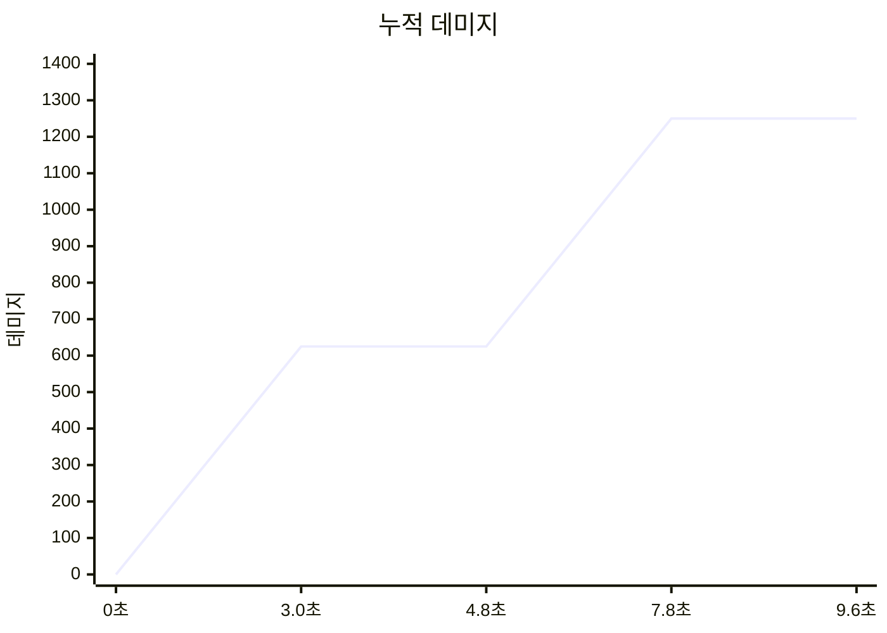
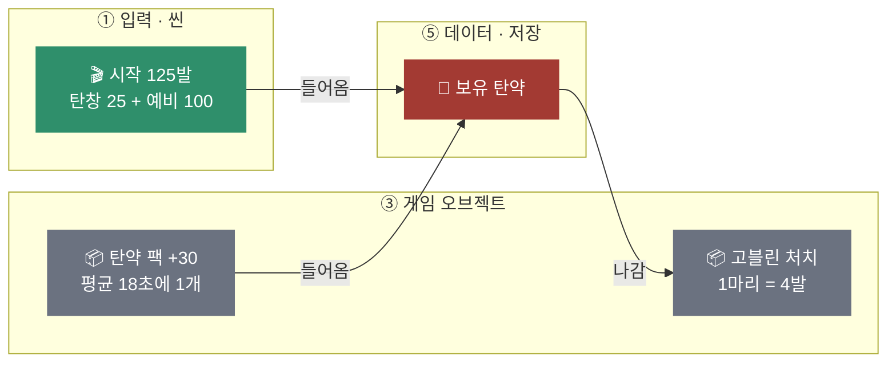
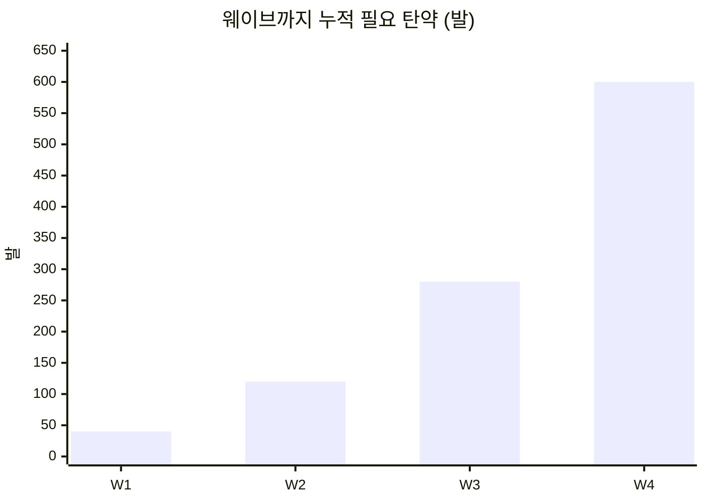

# 밸런스 · 데이터

> 문서 세트: [목차](Proposal.md) · [컨셉](Concept.md) · [시스템-전투](System_Weapon.md) · [시스템-게임 흐름](System_GameFlow.md) · [전투·개체](Combat_Entity.md) · [레벨 디자인](LevelDesign.md) · **밸런스** · [needFix](needFix.md)
> 데이터 파일 (JSON · Unity `JsonUtility`로 바로 읽는 구조): [`weapon.json`](Balance/weapon.json) · [`goblin.json`](Balance/goblin.json) · [`item.json`](Balance/item.json) · [`wave.json`](Balance/wave.json)
> 값은 `Play` 씬 · 프리팹 · ScriptableObject에 저장된 실제 값 기준

---

## 1. 무기 (`weapon.json`)
| ID | 이름 | 데미지 | 연사 간격 | 탄창 | 예비 | 재장전 | DPS | 탄창 비우는 시간 | 지속 DPS |
|---|---|---|---|---|---|---|---|---|---|
| `WPN_001` | 소총 | 25 | 0.12초 | 25 | 100 | 1.8초 | **208.3** | 3.0초 | **130.2** |
| `GRN_001` | 수류탄 | 100 (반경 6m) | – | 시작 3 | 최대 100 | – | – | – | – |

```
DPS        = 데미지 ÷ 연사 간격               = 25 ÷ 0.12 = 208.3
지속 DPS   = 탄창 데미지 ÷ (탄창 시간 + 재장전) = 625 ÷ (3.0 + 1.8) = 130.2
```

**[선그래프] 누적 데미지 (탄창 2개)**

> 읽는 법: 선이 올라가는 동안 쏘고, 평평한 동안(재장전 1.8초)은 데미지가 늘지 않아요. 평균 130 DPS.

> 재장전이 전체 화력을 37% 줄여요 (208 → 130).

## 2. 고블린 (`goblin.json`)
| ID | 데이터 | 체력 | 공격 | 간격 | 속도 | 점수 | 처치 탄수 | 처치 시간 | 플레이어에게 주는 DPS | 플레이어 처치 타수 |
|---|---|---|---|---|---|---|---|---|---|---|
| `MOB_001~003` | Goblin Data · 1 · 2 (같은 값) | 100 | 20 | 0.5 | 2.0 | 100 | 4 | 0.36초 | 40 | 5 |

```
처치 탄수   = 올림(체력 ÷ 25) = 4
처치 시간   = (처치 탄수 - 1) × 0.12초 = 0.36초    (첫 발은 바로 나감)
플레이어 처치 타수 = 올림(100 ÷ 20) = 5 → 2.0초 (0, 0.5, 1.0, 1.5, 2.0)
수류탄     = 100 ≥ 체력 100 → 반경 안 고블린 처치
```

**[타임라인] 누가 먼저 쓰러지나 (고블린 1마리 vs 플레이어)**

```mermaid
gantt
  title 처치 시간 비교
  
  dateFormat x
  axisFormat %S.%L초
  section 소총 → 고블린 (4발)
  처치까지 0.36초 :active, k1, 0, 360ms
  1발 :milestone, a1, 0, 0ms
  2발 :milestone, a2, 120, 0ms
  3발 :milestone, a3, 240, 0ms
  4발 처치 :milestone, a4, 360, 0ms
  section 고블린 → 플레이어 (5타)
  처치까지 2.0초 :crit, k2, 0, 2000ms
  1타 :milestone, b1, 0, 0ms
  2타 :milestone, b2, 500, 0ms
  3타 :milestone, b3, 1000, 0ms
  4타 :milestone, b4, 1500, 0ms
  5타 처치 :milestone, b5, 2000, 0ms
```

> 읽는 법: 왼쪽 → 오른쪽이 시간이에요. 마름모 = 한 번 맞히는 순간. 소총은 0.36초면 고블린을 쓰러뜨리고, 고블린 1마리는 플레이어를 쓰러뜨리는 데 2.0초가 걸려요.

## 3. 아이템 (`item.json`)
| ID | 이름 | 효과 | 확률 | 수명 |
|---|---|---|---|---|
| `ITM_AMMO` | 탄약 팩 | 예비 +30 | 25% | 5초 |
| `ITM_HP` | 체력 팩 | 체력 +50 (상한 없음) | 25% | 5초 |
| `ITM_GRN` | 수류탄 팩 | 수류탄 +5 (최대 100) | 25% | 5초 |
| `ITM_COIN` | 코인 | 점수 +200 | 25% | 5초 |

```
아이템 평균 생성 간격 = (2 + 7) ÷ 2 = 4.5초
종류별 평균 간격      = 4.5 ÷ 25% = 18초    -> 탄약 팩 분당 약 3.3개 = 약 100발
연속 사격 소비        = 탄창 25발 ÷ (3.0 + 1.8초) × 60 = 분당 최대 약 312발
```

**[구성도] 탄약 흐름**

> 읽는 법: 상자 = 씬 · 스크립트 · 오브젝트, 화살표 위 글 = 보내는 신호나 하는 일이에요. ①②③은 일어나는 순서예요.

## 4. 웨이브 (`wave.json`)

**[막대그래프] 웨이브까지 누적 필요 탄약 (발)**

> 읽는 법: 시작 탄약은 125발이라 W3(280발)부터 탄약 팩이 필요해요.

| 웨이브 | 마리 수 | 누적 | 이번 웨이브 필요 탄약 (모두 명중) | 누적 필요 탄약 |
|---|---|---|---|---|
| 1 | 10 | 10 | 40 | 40 |
| 2 | 20 | 30 | 80 | 120 |
| 3 | 40 | 70 | 160 | 280 |
| 4 | 80 | 150 | 320 | 600 |
| 5 | 160 | 310 | 640 | 1,240 |
| 6 | 320 | 630 | 1,280 | 2,520 |
| 7 | 640 | 1,270 | 2,560 | 5,080 |
| 8 | 1,280 | 2,550 | 5,120 | 10,200 |
| 9 | 2,560 | 5,110 | 10,240 | 20,440 |
| 10 | 5,120 | 10,230 | 20,480 | 40,920 |

```
필요 탄약 = 마리 수 × 4발     (빗나감 0, 수류탄 사용 0 기준)
시작 탄약 125발 → 2웨이브까지(누적 120발)는 아이템 없이 가능, 3웨이브(누적 280발)부터 탄약 팩 필요
10웨이브 누적 40,920발 ÷ 탄약 팩 분당 약 100발 = 약 409분
```
