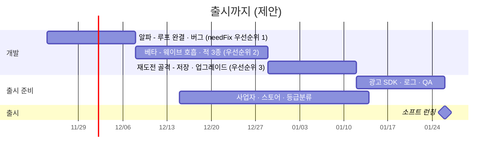

# 사업 검토 — game-TPS

> 문서 세트: [목차](Proposal.md) · 기획: [컨셉](Concept.md) · [시스템-전투](System_Weapon.md) · [시스템-게임 흐름](System_GameFlow.md) · [전투·개체](Combat_Entity.md) · [레벨 디자인](LevelDesign.md) · [밸런스](Balance.md) · 사업·운영: **사업 검토** · [요구사항·로드맵](Requirements.md) · [Business Model](Monetization.md) · [서버·데이터](Server_Data.md) · [리소스](Resources.md) · [로그·지표](Analytics.md) · [QA·출시](QA_Release.md) · [라이브 운영](LiveOps.md) · [사업화·법무](Business_Legal.md) · [needFix](needFix.md)

> **문서 정보** · 문서 번호 `D01-BIZ` · 버전 v1.0 · 상태 `Draft` · 담당 대표 · 기획자 · 최종 수정 2026-11-21 · 관련 문서 [컨셉](Concept.md) · [Business Model](Monetization.md) · [사업화·법무](Business_Legal.md)

**변경 이력**

| 버전 | 날짜 | 변경 내용 | 사유 | 결정자 | 영향 범위 |
|---|---|---|---|---|---|
| v1.0 | 2026-11-21 | 최초 작성 | — | 대표 | — |

---

## 1. 이 문서의 역할
이 게임을 **출시까지 만들 가치가 있는지** 판단하는 문서예요. 나중에 사업계획서 · 정부지원사업(창업지원 등) 신청서의 원본으로도 써요.
게임 내용은 [컨셉](Concept.md)에, 정해야 할 것은 [needFix](needFix.md)에 있어요. 이 문서의 숫자는 **목표 · 가정**이고, 출시 후 [로그 · 지표](Analytics.md)로 확인해요.

## 2. 한 장 요약
| 항목 | 내용 | 상태 |
|---|---|---|
| 게임 이름 | 미정 (프로젝트 이름 game-TPS) | ⚠️ 정할 것 → [F-01](needFix.md#8-기획서-기준-적용-후-정할-것) |
| 한 줄 정의 | 몰려오는 고블린 웨이브를 소총과 수류탄으로 막아내는 모바일 3인칭 웨이브 슈터 | 확정 ([컨셉](Concept.md)) |
| 최종 방향 | 한 판 2 ~ 4분, "정비 → 소탕" 반복, 수류탄 · 소총 손맛 중심 | needFix §7 결정 |
| 장르 | 3인칭 슈팅 · 웨이브 디펜스 (하이브리드 캐주얼 ~ 미드코어 경계) | 제안 |
| 플랫폼 | Android 먼저 → iOS (모바일 조작이 이미 구현됨) | 제안 |
| 타깃 | 짧은 시간 액션을 원하는 모바일 슈팅 유저, 출퇴근 · 쉬는 시간 플레이 | 확정 ([컨셉](Concept.md)) |
| 수익 모델 | 보상형 광고 + 소액 인앱결제 (가챠 없음) → [Business Model](Monetization.md) | 제안 |

## 3. 경쟁작 비교
> 이름 대신 **유형**으로 적었어요. 실제 게임 3개를 골라 스토어 평점 · 리뷰에서 장단점을 채워 주세요 → [F-02](needFix.md#8-기획서-기준-적용-후-정할-것)

| 유형 | 보통의 BM | 강점 | 이 게임의 차별점 |
|---|---|---|---|
| 좀비 · 웨이브 디펜스 TPS | 광고 + 무기 · 캐릭터 판매 | 물량 쾌감 | **필드에서 탄약을 주워야 하는 자원 관리**, 수류탄 한 방 정리 |
| 탑다운 생존 슈터 (뱀서류) | 광고 + 소액 결제 | 자동 공격 · 간편함 | 3인칭 직접 조준 · 재장전 판단 |
| 모바일 배틀로얄 TPS | 시즌 패스 · 스킨 | 멀티 경쟁 | 혼자 3분, 서버 없이 바로 시작 |

## 4. 목표 지표 (KPI) — 가정
| 지표 | 목표 (예시값) | 확인 방법 |
|---|---|---|
| D1 재접속률 | 30% | [로그](Analytics.md) `evt_session_start` |
| D7 재접속률 | 8% | 같은 이벤트 |
| 한 판 평균 시간 | 2 ~ 4분 | `evt_run_end.play_sec` (needFix S-21) |
| 첫 판 3웨이브 도달률 | 70% | `evt_wave_start` |
| 보상형 광고 시청률 (DAU 대비) | 30% | `evt_ad_reward` |
| 결제 전환율 | 1 ~ 2% | `evt_purchase` |

> 목표값은 캐주얼 모바일 게임에서 흔히 쓰는 출발점이에요. 소프트 런칭(일부 국가 먼저 출시) 결과로 다시 정해요.

## 5. 개략 예산 (1인 개발 기준)
| 항목 | 내용 | 금액 |
|---|---|---|
| 인건비 | 1인 (기획 · 개발 겸임) | 기간 × 본인 기준 |
| 에셋 | 현재 무료 · 구매 에셋 사용 → [리소스](Resources.md) 라이선스 확인 필요 | 추가 구매 시 기록 |
| 스토어 등록 | Google Play 개발자 등록비(1회) · Apple Developer Program(연간) | 공식 페이지 금액 확인 |
| 서버 | 출시 1차는 서버 없음 → 유료 재화 도입 시 BaaS ([서버 · 데이터](Server_Data.md)) | 무료 구간 → 사용량 비례 |
| 마케팅 | 소프트 런칭 광고 테스트 | 미정 |
| 사업자 · 법무 | [사업화 · 법무](Business_Legal.md) | 세무 · 법무 상담 비용 |

## 6. 개략 일정
**[타임라인] 출시까지 (제안)**

> 읽는 법: 왼쪽 → 오른쪽이 날짜예요. 막대 = 작업 기간, 마름모 = 출시 순간. 날짜는 제안이고 [요구사항 · 로드맵](Requirements.md)에서 관리해요.

## 7. 리스크와 대응
| 리스크 | 영향 | 대응 |
|---|---|---|
| 웨이브가 2배씩 늘어 끝까지 못 감 (밸런스 §4) | 첫 판에서 "불공평" 이탈 | needFix S-15 곡선 간소화, 한 판 2 ~ 4분 |
| 큰 웨이브를 한 프레임에 생성 | 저사양 폰에서 멈춤 · 나쁜 리뷰 | S-11 풀링, 동시 최대 고블린 수 · 목표 FPS 정하기 ([QA](QA_Release.md)) |
| 판이 끝나면 남는 것이 없음 | 낮은 D1 · D7 | S-13 기록 저장 · S-18 업그레이드 |
| 에셋 라이선스 불명확 | 출시 후 삭제 요청 · 분쟁 | [리소스](Resources.md) 라이선스 표 완성 전 출시 금지 |
| 1인 개발 일정 지연 | 출시 지연 | Must만 먼저 ([요구사항](Requirements.md)), 6절 리텐션 기능은 보류 |

## 8. 결정 (Gate P0 → P1)
- [ ] 게임 이름 확정 (F-01)
- [ ] 경쟁작 3개 확정 (F-02)
- [ ] 수익 모델 확정 ([Business Model](Monetization.md))
- [ ] 출시 목표일 확정
