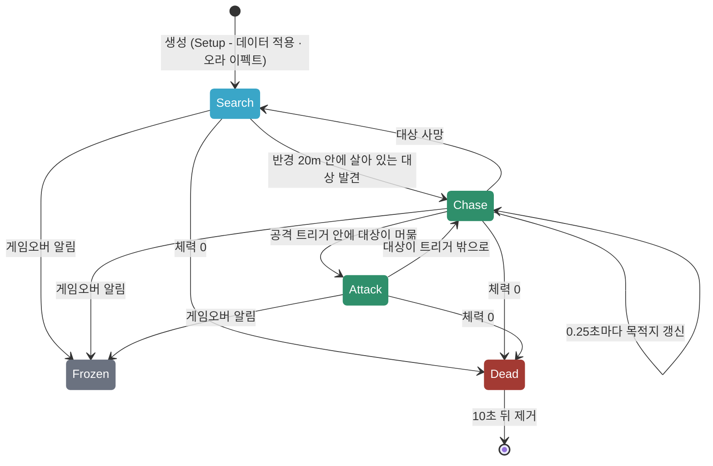
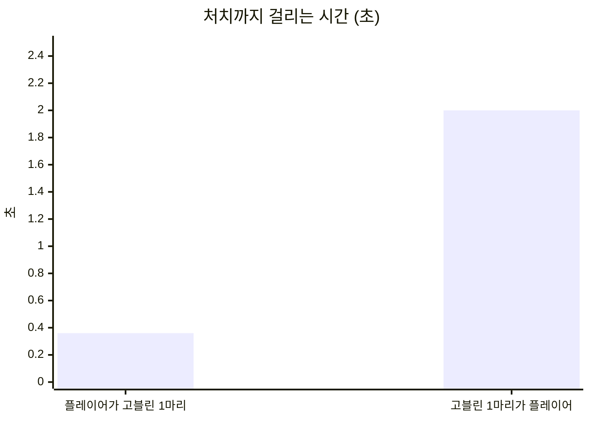
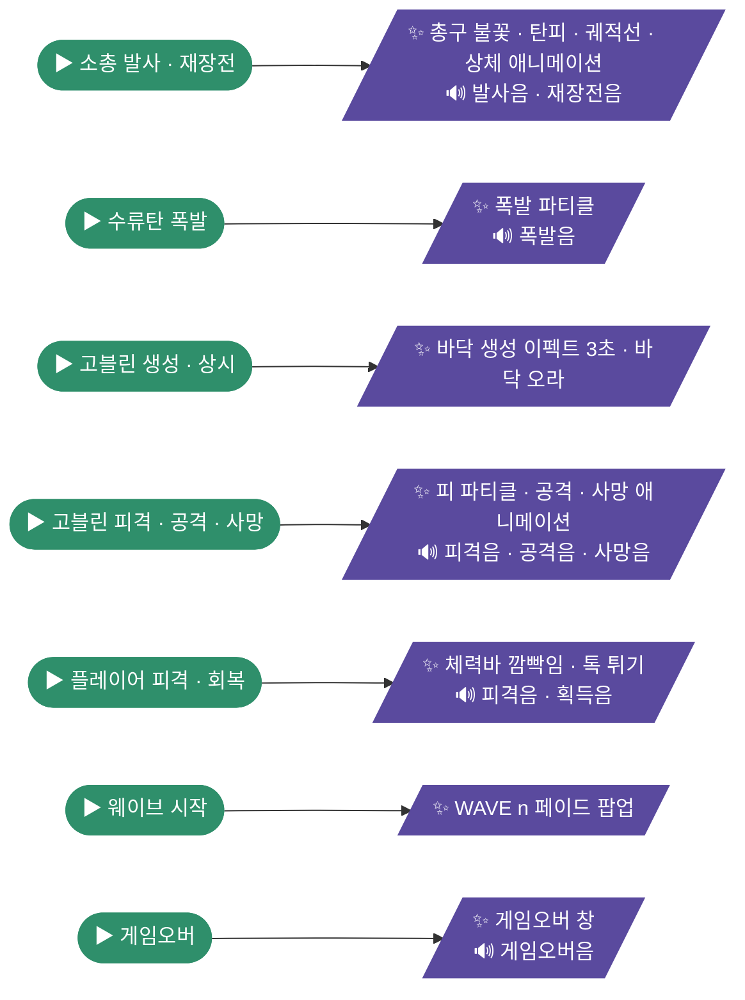

# 전투 · 캐릭터 · 몬스터

> 문서 세트: [목차](Proposal.md) · [컨셉](Concept.md) · [시스템-전투](System_Weapon.md) · [시스템-게임 흐름](System_GameFlow.md) · **전투·개체** · [레벨 디자인](LevelDesign.md) · [밸런스](Balance.md) · [Suggestions](Suggestions.md)
> 값은 `Play` 씬 · 프리팹 · ScriptableObject에 저장된 실제 값 기준 (코드 기본값과 다르면 함께 표시)

---

## 1. 조작
| 영역 | 조작 | 세부 규칙 |
|---|---|---|
| 조이스틱 | 이동 | `DynamicJoystick`, 앞뒤 · 좌우 값이 블렌드 애니메이션 값 |
| 화면 드래그 | 시점 회전 (`CamLook`) | 터치 감도 0.2 · 마우스 감도 3 · 위아래 -40 ~ 70도, 조이스틱 · 버튼 위에서 시작한 손가락은 제외 |
| 버튼 | 발사(누르고 있기) · 재장전 · 수류탄 · 점프 · 스코프(토글) | PC 테스트: F · R · G · Space · 마우스 오른쪽 |

## 2. 플레이어
```
jump (최대 2단)
        1     2
     *     *     *
   *               *
 P                   *
 -----------------------
   ^ 발밑 레이로 바닥 판정 -> 착지하면 횟수 0
```
| 항목 | 씬 값 | 코드 기본값 |
|---|---|---|
| 체력 | 100 | 100 |
| 이동 속도 | 5 m/s (바라보는 방향 기준 앞뒤 · 좌우) | 5 |
| 점프 힘 | **3** (Impulse) | 5 |
| 최대 점프 | **2단** | 3 |
| 바닥 판정 | `groundCheck` + 0.1에서 아래로 0.3m 레이 (`groundCheckRadius` **0.2**) | 0.5 |
| 피격 | 피격음 + 체력바 깜빡임 (경직 · 넉백 없음) | – |
| 사망 | 사망음 · 사망 애니메이션 · 이동 / 사격 끔 (콜라이더는 남김) | – |

## 3. 무기
### 3-1. 소총 `WPN_001` (`Gun Data`)
| 항목 | 값 | 계산 |
|---|---|---|
| 데미지 | 25 | |
| 연사 간격 | 0.12초 | 초당 8.3발 |
| 탄창 / 시작 예비 | 25 / 100 | 시작 총 125발 |
| 재장전 | 1.8초 | |
| 사거리 | 50m | 레이캐스트 (즉시 명중) |
| DPS | **208** | 25 ÷ 0.12 |
| 지속 DPS (재장전 포함) | **130** | 625 ÷ (3.0초 + 1.8초) |
| 연출 | 총구 불꽃 · 탄피 · 궤적선 0.03초 · 발사음 · 재장전음 | |

### 3-2. 수류탄 `GRN_001`
| 항목 | 씬 · 프리팹 값 | 코드 기본값 |
|---|---|---|
| 시작 / 최대 보유 | 3 / **100** | 3 / 50 |
| 투척 | 앞 × 12 + 위 × 4 Impulse | 같음 |
| 폭발 시점 | 무언가에 부딪히는 즉시 또는 2.5초 뒤 중 먼저 | 같음 |
| 범위 · 데미지 | 반경 6m · **100** | 6m · 9999 |
| 아군 피해 | 없음 | – |
| 연출 | 폭발 파티클(2초) · 폭발음 | – |

### 3-3. 스코프
| 항목 | 값 |
|---|---|
| 켜기 | 스코프 카메라 활성 + 스코프 UI, 조준점 UI 숨김 |
| 조준 | 스코프 카메라 중앙 기준 레이 |
| `zoomFov` | 20 (씬 값) — 코드에서 사용하지 않음 |

## 4. 고블린
### 4-1. 스펙
| 항목 | 값 | 근거 |
|---|---|---|
| 체력 | 100 (소총 4발 = 0.36초 · 수류탄 1번) | `Goblin Data` 3종 |
| 공격력 / 간격 | 20 / 0.5초 (플레이어 처치까지 5타 = 2.0초) | `Goblin Data`, 프리팹 |
| 이동 속도 | 2 m/s (NavMesh) | `Goblin Data` |
| 탐지 범위 | 반경 20m, 0.25초마다 | `Goblin.UpdatePath` |
| 처치 점수 | +100 | `GM.OnGoblinKilled` |
| 데이터 | `Goblin Data` · `1` · `2` — 세 데이터의 체력 · 공격력 · 속도 · 색이 모두 같음 | `ScriptableData/Play` |

**탐지 · 공격 범위 (위에서 본 모습)**
```
          . - - - - - - - - - .
        /                       \
       |      .---------.        |    큰 원 = 탐지 반경 20m (0.25초마다 검사)
       |     |  g    P   |       |    작은 원 = 공격 트리거 (닿아 있는 동안 0.5초마다 20 피해)
       |      '---------'        |
        \                       /
          ' - - - - - - - - - '

한 번 찾은 대상은 계속 추적 (0.25초마다 목적지 갱신)
```

### 4-2. AI 상태 머신

**[상태도] AI 상태 머신**

> 읽는 법: 상자 = 상태, 화살표 위 글 = 상태가 바뀌는 조건이에요. 검은 점에서 시작해요.

| 상태 | 행동 | 애니메이션 | 소리 · 이펙트 |
|---|---|---|---|
| Search | 제자리 정지, 0.25초마다 주변 탐색 | 대기 (`HasTarget` false) | 바닥 오라 |
| Chase | NavMesh로 대상 위치 추적 | 달리기 (`HasTarget` true) | 바닥 오라 |
| Attack | 0.5초마다 즉시 피해 20 (공격 전 예고 동작 없음) | `Attack` 트리거 | 공격음 |
| 피격 | 체력 감소만 (경직 · 넉백 없음) | – | 피 파티클(1초) · 피격음 |
| Frozen | 길 찾기 중단, 속도 0, 공격 안 함 | 대기 | – |
| Dead | 콜라이더 · NavMesh 끔 | `Die` 트리거 | 사망음, 오라 제거 |

**[타임라인] 고블린 1마리가 플레이어를 공격할 때 (체력 100)**

```mermaid
gantt
  title 고블린 1마리의 공격

  dateFormat x
  axisFormat %S.%L초
  section 공격
  1타 -20 → 80 :milestone, h1, 0, 0ms
  2타 -20 → 60 :milestone, h2, 500, 0ms
  3타 -20 → 40 :milestone, h3, 1000, 0ms
  4타 -20 → 20 :milestone, h4, 1500, 0ms
  5타 -20 → 0 사망 :crit, milestone, h5, 2000, 0ms
```

> 읽는 법: 닿아 있는 동안 0.5초마다 20씩 피해 → 2.0초에 체력 0. 왼쪽 → 오른쪽이 시간이에요. 막대 = 이어지는 동안, 마름모 = 그 순간. 빨간 막대는 위험하거나 못 움직이는 시간이에요.

**[막대그래프] 처치까지 걸리는 시간 (초)**

> 읽는 법: 플레이어는 0.36초에 고블린 1마리를, 고블린 1마리는 2.0초에 플레이어를 처치해요.

## 5. 이펙트 · 사운드
**[흐름도] 이펙트 · 사운드 (일이 생기면 → 보이고 들리는 것)**

> 읽는 법: 초록 = 이런 일이 생기면 → 보라 = ✨ 보이는 것 · 🔊 들리는 것이에요.

| 대상 | 이펙트 | 사운드 |
|---|---|---|
| 소총 발사 · 재장전 | 총구 불꽃 · 탄피 · 궤적선 / 상체 애니메이션 | 발사음 · 재장전음 |
| 수류탄 폭발 | 폭발 파티클 | 폭발음 |
| 고블린 생성 · 상시 | 바닥 생성 이펙트(3초) · 바닥 오라 | – |
| 고블린 피격 · 공격 · 사망 | 피 파티클 · 공격 애니메이션 · 사망 애니메이션 | 피격음 · 공격음 · 사망음 |
| 플레이어 피격 · 회복 | 체력바 깜빡임 · 톡 튀기 | 피격음 · 획득음 |
| 웨이브 시작 | "WAVE n" 페이드 팝업 | – |
| 게임오버 | 게임오버 창 | 게임오버음 |
