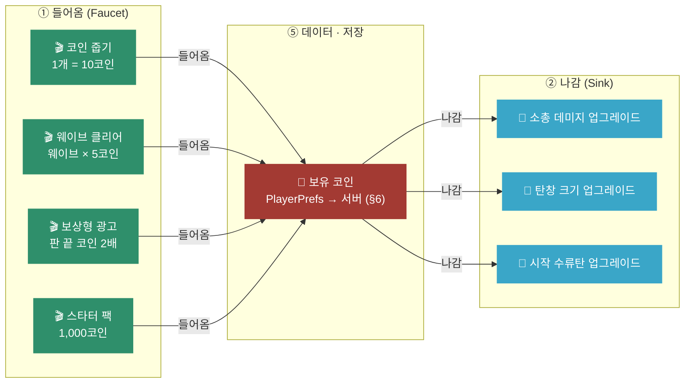

# Business Model — game-TPS

> 문서 세트: [목차](Proposal.md) · 기획: [컨셉](Concept.md) · [시스템-전투](System_Weapon.md) · [시스템-게임 흐름](System_GameFlow.md) · [전투·개체](Combat_Entity.md) · [레벨 디자인](LevelDesign.md) · [밸런스](Balance.md) · 사업·운영: [사업 검토](Business.md) · [요구사항·로드맵](Requirements.md) · **Business Model** · [서버·데이터](Server_Data.md) · [리소스](Resources.md) · [로그·지표](Analytics.md) · [QA·출시](QA_Release.md) · [라이브 운영](LiveOps.md) · [사업화·법무](Business_Legal.md) · [needFix](needFix.md)

> **문서 정보** · 문서 번호 `D07-BM` · 버전 v1.0 · 상태 `Draft` · 담당 기획자 · 대표 · 최종 수정 2026-11-21 · 관련 문서 [밸런스](Balance.md) · [서버·데이터](Server_Data.md)

**변경 이력**

| 버전 | 날짜 | 변경 내용 | 사유 | 결정자 | 영향 범위 |
|---|---|---|---|---|---|
| v1.0 | 2026-11-21 | 최초 작성 | — | 기획자 | — |

---

## 1. 목적
**어떻게 돈을 벌고, 게임 안 재화가 어떻게 돌지** 정하는 문서예요. 상점 · 광고 · 결제 구현의 기준이에요.
> 지금 구현: **수익화 없음.** 코인은 줍는 순간 점수 +200만 주고 사라져요 ([밸런스](Balance.md) §3). 아래는 모두 제안(`Draft`)이에요.

## 2. Business Model 구조와 선택 이유
| 항목 | 결정 (제안) | 이유 |
|---|---|---|
| 주 수익원 | **보상형 광고** | 한 판 2 ~ 4분 · 게임오버가 잦음 → "광고 보고 부활"이 자연스러운 자리 |
| 보조 수익원 | **소액 인앱결제** (광고 제거 · 스타터 팩) | 하이브리드 캐주얼에서 흔한 구성, 서버 부담이 적음 |
| 넣지 않는 것 | 가챠 · 랜덤 박스 · 고액 패키지 | 1인 개발 · 서버 없음, 확률 공개 의무 · 운영 부담 ([사업화 · 법무](Business_Legal.md)) |
| 공정성 원칙 | 결제로 **판 안의 실력 차이를 사지 않게** | 혼자 하는 게임이지만 "돈 내야 깨는 게임" 리뷰를 막기 위해 |

## 3. 재화 순환 (Faucet & Sink)
코인을 **판이 끝나도 남는 재화**로 바꿔요 (needFix [S-18](needFix.md)).

**[구성도] 코인 흐름 (제안)**

> 읽는 법: 왼쪽 초록 = 코인이 생기는 곳, 가운데 빨강 = 쌓이는 곳, 오른쪽 파랑 = 쓰는 곳이에요.

**한 판 코인 수급 (계산)**
```
코인 아이템 평균 간격   = 18초 (밸런스 §3: 아이템 4.5초마다 · 코인 25%)
3분 한 판 줍는 코인      = 180 ÷ 18 = 약 10개 × 10코인 = 100코인   (5초 안에 다 줍는다고 가정)
웨이브 클리어 보너스     = (1 + 2 + 3 + 4 + 5) × 5 = 75코인         (5웨이브 도달 가정)
한 판 평균              = 약 175코인  /  광고 2배 시 약 350코인
```

**업그레이드 비용 (needFix §7 결정: 2 ~ 3개 스탯 · 단순 계단식)**
| 단계 | 1 | 2 | 3 | 4 | 5 |
|---|---|---|---|---|---|
| 비용 (코인) | 300 | 600 | 1,000 | 1,500 | 2,100 |
| 무과금 필요 판 수 | 약 2 | 약 4 | 약 6 | 약 9 | 약 12 |

> 의도: **초반 2판에 첫 업그레이드**를 맛보게 하고, 한 스탯 만렙(누적 5,500코인)까지 약 31판 = 하루 5판 기준 약 6일. 3개 스탯 전부는 약 3주. 실제 한 판 코인은 [로그](Analytics.md) `evt_run_end.coin_earned`로 확인 후 조정해요.

## 4. 상품 목록 (제안)
| 상품 ID | 이름 | 가격 | 구성 | 구매 제한 | 노출 조건 |
|---|---|---|---|---|---|
| `PRD_NOADS_001` | 광고 제거 | ₩3,300 | 전면 광고 제거 (보상형 광고는 그대로 선택 가능) | 1회 | 설정 · 상점 상시 |
| `PRD_STARTER_001` | 스타터 팩 | ₩1,200 | 1,000코인 + 첫 업그레이드 1단계 즉시 | 1회 | 첫 게임오버 3번째 이후 1회 팝업, 같은 날 재노출 금지 |
| `PRD_COIN_001` | 코인 묶음 | ₩2,500 | 2,500코인 | 없음 | 상점 |

> 상품 ID는 스토어 콘솔(Google Play Console · App Store Connect)에 **같은 이름**으로 등록해요. 한 번 정하면 바꾸지 않아요.

## 5. 광고 지면
| 지면 ID | 종류 | 위치 | 보상 | 하루 최대 | 규칙 |
|---|---|---|---|---|---|
| `AD_REVIVE` | 보상형 | 게임오버 창 | 체력 50%로 부활 | 판당 1회 | 끝까지 봐야 보상 |
| `AD_COIN_X2` | 보상형 | 판 결과 창 | 이번 판 코인 2배 | 판당 1회 | |
| `AD_INTER` | 전면 | 게임오버 → 다시 시작 사이 | — | 3판에 1번 | 첫 3판은 없음, 광고 제거 구매 시 없음 |

## 6. 결제 예외 처리
| 상황 | 처리 |
|---|---|
| 결제 후 앱이 꺼져 상품 미지급 | 다음 실행 때 스토어의 미처리 구매를 조회해 지급 후 완료 처리 |
| 영수증 위조 · 메모리 조작 | 코인 · 결제를 기기에만 저장하면 막을 수 없음 → [서버 · 데이터](Server_Data.md) §3에서 서버 판정 시점 결정 |
| 스토어 환불 | 환불된 구매의 코인 회수 (부족하면 0까지), 광고 제거는 해제 |
| 광고 로드 실패 · 오프라인 | 광고 버튼 비활성 + "지금은 광고를 볼 수 없어요", 보상 없음 |
| 광고 시청 중 앱 종료 | 보상 없음 (부활 기회는 남겨 둠) |

## 7. 매출 시뮬레이션 (가정)
```
일 매출 = 보상형 광고 + 전면 광고 + 인앱결제 (수수료 뺀 금액)

예) DAU 1,000명
  보상형  : 1인당 하루 1.0회 × 1,000 ÷ 1,000 × eCPM ₩10,000  = ₩10,000
  전면    : 1인당 하루 0.5회 × 1,000 ÷ 1,000 × eCPM ₩3,000   = ₩1,500
  인앱결제 : 하루 결제자 0.1% (1명) × ARPPU ₩3,000 × (1 − 0.15) = ₩2,550
  합계 약 ₩14,050 / 일  →  약 ₩42만 / 월
```
> eCPM(광고 1,000회당 수익)은 국가 · 광고 네트워크마다 크게 달라요. **위 값은 계산 방법을 보여 주는 가정**이고, 소프트 런칭 데이터로 바꿔 넣어요. 스토어 수수료는 소규모 개발자 프로그램 기준 15%로 가정했어요 (조건 확인 → [사업화 · 법무](Business_Legal.md)).

## 8. 법 · 플랫폼 확인
| 항목 | 이 게임 | 상태 |
|---|---|---|
| 확률형 아이템 확률 공개 | 가챠 · 랜덤 박스가 없으면 해당 없음. 넣게 되면 공개 의무 | 해당 없음 (현재 계획) |
| 스토어 수수료 | 실수령액 기준으로 계산 (§7) | 확인 필요 |
| 청약철회 표시 | 코인 · 즉시 지급 상품은 구매 화면에 청약철회 제한을 미리 알림 | 구현 전 |
| 미성년자 결제 | 법정대리인 동의 없는 결제 취소 요청 시 처리 절차 ([라이브 운영](LiveOps.md)) | 구현 전 |
| 광고 · 개인정보 | 광고 SDK가 기기 광고 ID를 쓰므로 개인정보처리방침 · 스토어 데이터 보안 항목에 적기 | 구현 전 |
