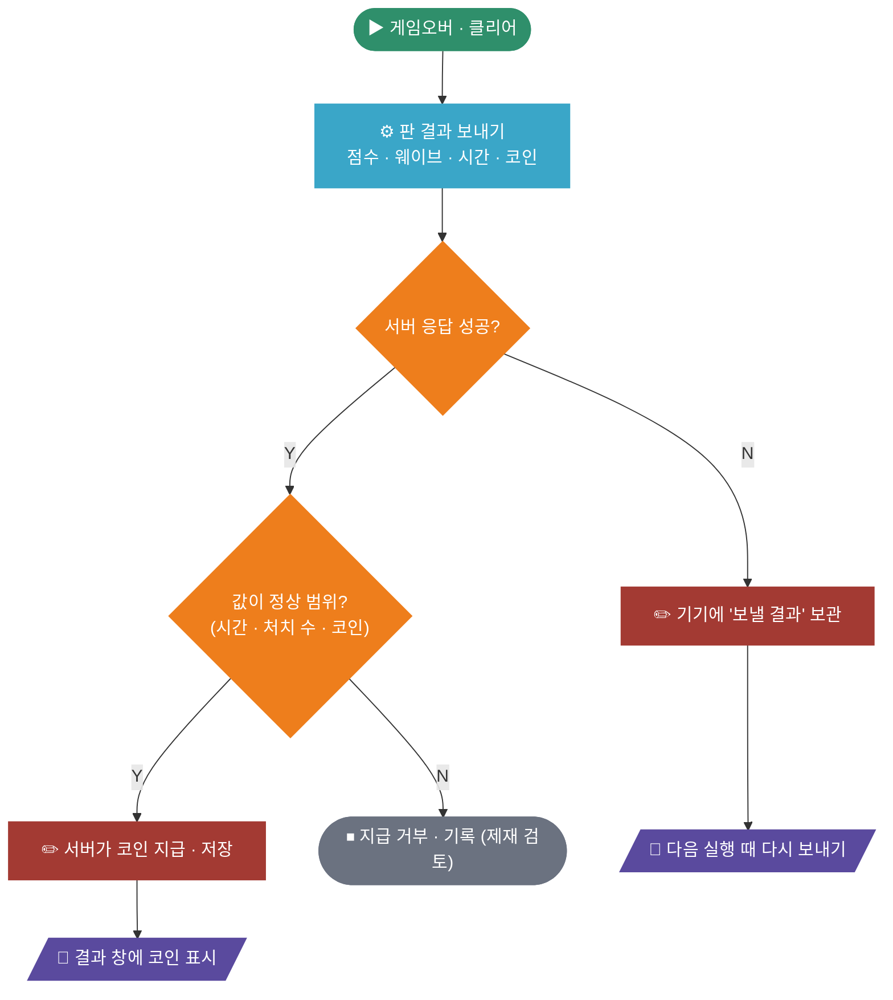

# 서버 · 데이터 연동 — game-TPS

> 문서 세트: [목차](Proposal.md) · 기획: [컨셉](Concept.md) · [시스템-전투](System_Weapon.md) · [시스템-게임 흐름](System_GameFlow.md) · [전투·개체](Combat_Entity.md) · [레벨 디자인](LevelDesign.md) · [밸런스](Balance.md) · 사업·운영: [사업 검토](Business.md) · [요구사항·로드맵](Requirements.md) · [Business Model](Monetization.md) · **서버·데이터** · [리소스](Resources.md) · [로그·지표](Analytics.md) · [QA·출시](QA_Release.md) · [라이브 운영](LiveOps.md) · [사업화·법무](Business_Legal.md) · [needFix](needFix.md)

> **문서 정보** · 문서 번호 `D08-SERVER` · 버전 v1.0 · 상태 `Draft` · 담당 서버 개발자 · 최종 수정 2026-11-21 · 관련 문서 [시스템-게임 흐름](System_GameFlow.md) · [Business Model](Monetization.md)

**변경 이력**

| 버전 | 날짜 | 변경 내용 | 사유 | 결정자 | 영향 범위 |
|---|---|---|---|---|---|
| v1.0 | 2026-11-21 | 최초 작성 | — | 서버 개발자 | — |

---

## 1. 이 문서의 역할
**어떤 데이터를 어디에 저장하고, 무엇을 서버가 판정할지** 정하는 문서예요. 치팅과 데이터 유실을 막는 기준이에요.

## 2. 지금 저장하는 것 (코드 기준)
서버는 없고, 기기(`PlayerPrefs`)에 **설정만** 저장해요.

| 키 | 타입 | 저장하는 곳 | 내용 |
|---|---|---|---|
| `Settings_MasterVolume` | float | `SettingsData` | 전체 음량 |
| `Settings_SoundOn` | int (0 / 1) | `SettingsData` | 소리 켜기 · 끄기 (불러오기 누락 → needFix [S-12](needFix.md)) |
| `SoundEnabled` · `MasterVolume` · `HoverScale` · `ClickScale` | int · float | UI 에셋 패키지 스크립트 | 버튼 효과음 · 크기 설정 (게임 설정과 **키가 따로** 있음 → [F-05](needFix.md#8-기획서-기준-적용-후-정할-것)) |

> 점수 · 웨이브 · 코인은 저장하지 않아요 (needFix [S-13](needFix.md)).

## 3. 저장 위치 · 판정 주체 (제안)
| 데이터 | 1차 출시 (서버 없음) | 결제 도입 후 | 이유 |
|---|---|---|---|
| 설정 (음량 · 소리) | 기기 | 기기 | 조작돼도 문제 없음 |
| 최고 점수 · 최고 웨이브 | 기기 | 기기 (랭킹을 만들면 서버) | 혼자 보는 기록이면 기기로 충분 |
| 코인 · 업그레이드 단계 | 기기 | **서버** | 기기 저장은 메모리 · 파일 조작으로 바뀔 수 있음. 결제로 사는 재화와 섞이면 막아야 함 |
| 광고 제거 구매 여부 | 스토어 구매 기록 조회 | 스토어 + 서버 | 재설치 · 기기 변경 시 복원 |
| 판 결과 (점수 · 코인 획득) | 기기 | **서버 검증** | 판 시간 · 처치 수가 비정상이면 보상 거부 |

> **원칙:** 유료 재화 · 결제가 들어가는 순간부터 서버가 필요해요. 1인 개발이면 직접 서버 대신 **BaaS**(Firebase · PlayFab · Unity Gaming Services 등)도 선택지예요 → 무엇을 쓸지 [F-06](needFix.md#8-기획서-기준-적용-후-정할-것)

**[흐름도] 판 끝 코인 지급 (서버 도입 후, 제안)**

> 읽는 법: 초록에서 시작해 화살표를 따라 내려가요. 주황 마름모에서 Y(예) / N(아니오)으로 갈라져요. 서버가 응답하지 않으면 결과를 버리지 않고 다음에 다시 보내요.

## 4. API 목록 (서버 도입 시, 제안)
| API ID | 기능 | Method | 요청 | 응답 | 에러 → 클라 처리 |
|---|---|---|---|---|---|
| `API_AUTH_01` | 게스트 로그인 | POST | device_id | user_id, token | 실패 → 오프라인으로 플레이, 코인 지급은 보류 |
| `API_RUN_01` | 판 결과 보내기 | POST | run_id, score, wave, play_sec, kills, coin | 지급 코인, 보유 코인 | `RUN_400` 비정상 → 지급 없음 / 네트워크 → 다시 보내기 |
| `API_UPG_01` | 업그레이드 구매 | POST | upgrade_id, level | 보유 코인, 새 단계 | `UPG_409` 코인 부족 → 부족 팝업 |
| `API_IAP_01` | 영수증 검증 · 지급 | POST | store, receipt | 지급 내용 | `IAP_400` 위조 → 지급 없음 |
| `API_SAVE_01` | 저장 불러오기 | GET | token | 코인 · 업그레이드 · 기록 | 실패 → 기기 저장본으로 시작 |

> `run_id`는 판마다 새로 만들어서, 같은 결과를 두 번 보내도 **한 번만 지급**되게 해요.

## 5. 계정 · 저장 정책 (제안)
| 상황 | 처리 |
|---|---|
| 첫 실행 | 게스트 계정 자동 생성 |
| 기기 변경 · 재설치 | Google Play 게임즈 · Game Center 계정 연동 시 복원. 연동 안 하면 복원 불가를 설정 창에 안내 |
| 두 기기 저장이 다름 | 서버 저장본을 기준으로 함 |
| 계정 삭제 요청 | 설정 창 "계정 삭제" → 서버 데이터 삭제 (스토어 필수 요건, [QA · 출시](QA_Release.md)) |
| 서버 점검 · 강제 업데이트 | 시작 시 버전 확인 → 낮으면 스토어로 안내 |

## 6. 결정할 것
- 서버를 언제 붙일지: 1차 출시부터 vs 인앱결제 도입 때 → [F-06](needFix.md#8-기획서-기준-적용-후-정할-것)
- 설정 키 통일 (`Settings_*` 하나로) → [F-05](needFix.md#8-기획서-기준-적용-후-정할-것)
