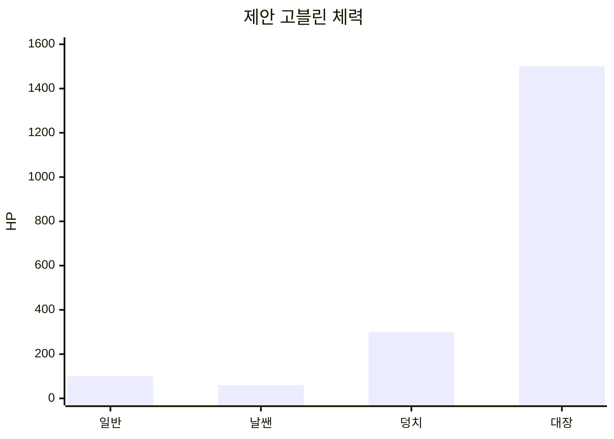
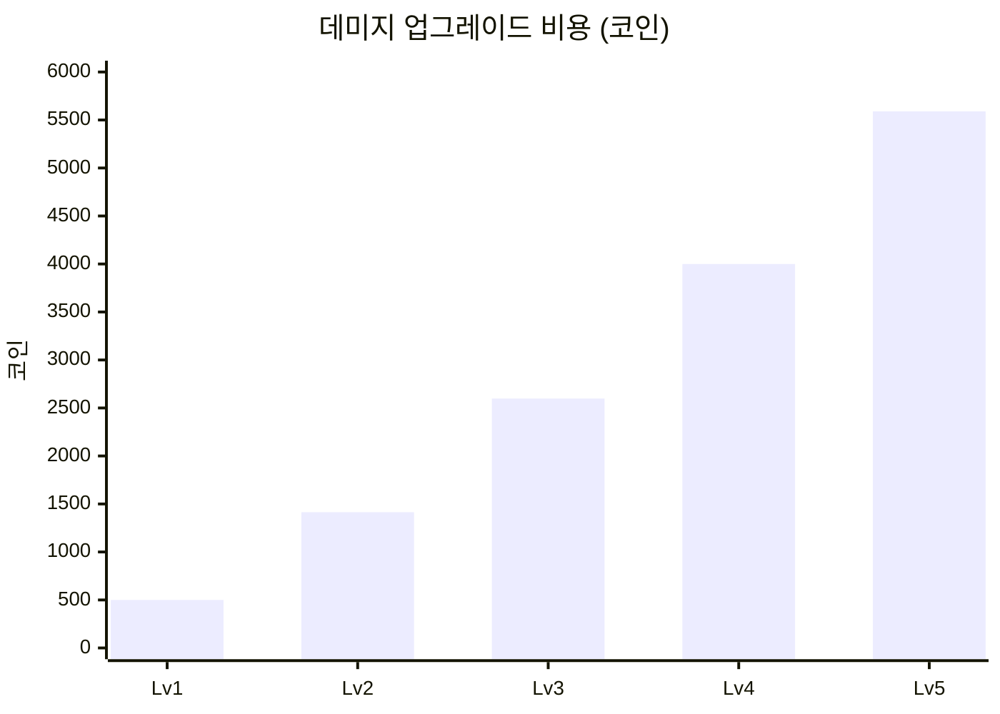
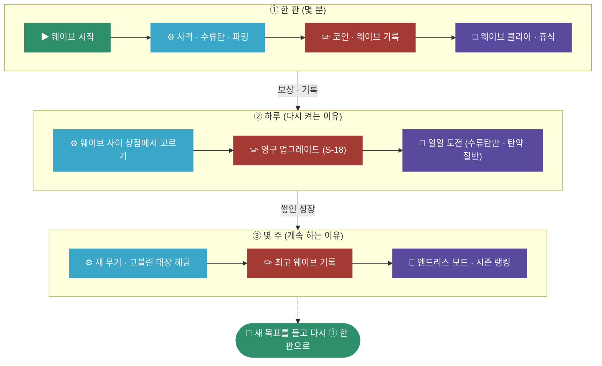

# needFix — 고칠 점 · 부족한 점 · 제안

> 문서 세트: [목차](Proposal.md) · 기획: [컨셉](Concept.md) · [시스템-전투](System_Weapon.md) · [시스템-게임 흐름](System_GameFlow.md) · [전투·개체](Combat_Entity.md) · [레벨 디자인](LevelDesign.md) · [밸런스](Balance.md) · 사업·운영: [사업 검토](Business.md) · [요구사항·로드맵](Requirements.md) · [Business Model](Monetization.md) · [서버·데이터](Server_Data.md) · [리소스](Resources.md) · [로그·지표](Analytics.md) · [QA·출시](QA_Release.md) · [라이브 운영](LiveOps.md) · [사업화·법무](Business_Legal.md) · **needFix**
> 컨셉 ~ 밸런스 문서는 현재 구현만 담고, 바꾸자는 내용은 모두 여기에 모았어요. 반영하면 상태를 **완료**로 바꾸고 컨셉 ~ 밸런스 문서의 값을 고쳐 주세요. 사업 · 운영 문서(계획 · 초안)에서 나온 **정할 것**은 8절에 있어요.

> **문서 정보** · 문서 번호 `D00-FIX` · 버전 v1.0 · 상태 `Review` · 담당 기획자 · 최종 수정 2026-11-21

**변경 이력**

| 버전 | 날짜 | 변경 내용 | 사유 | 결정자 | 영향 범위 |
|---|---|---|---|---|---|
| v0.9 | 2026-11-20 | 기존 문서 (자세한 기록은 git 커밋) | — | 기획자 | — |
| v1.0 | 2026-11-21 | 문서 정보 · 변경 이력 · 문서 번호 추가, 사업 · 운영 문서와 연결, Suggestions에서 이름 변경 | — | 기획자 | 문서만 |

---

## 1. 버그 · 코드와 의도가 다른 부분
| ID | 현재 (코드 근거) | 문제 | 제안 | 관련 | 상태 |
|---|---|---|---|---|---|
| S-01 | 10웨이브 전멸 후 `웨이브 < 10` 조건이 거짓 | 빈 맵에 멈춤, 클리어 화면 없음 | Cleared 상태 → 클리어 창(점수 · 다음 · Home) | 시스템-게임 흐름 §8 #1 | 대기 |
| S-02 | `RestoreHealth`에 상한 없음 | 체력 팩으로 100 초과 (150, 200 …) | `min(health + 50, startingHealth)`, 최대 체력이면 줍지 않음 | 시스템-전투 §5 #13 | 대기 |
| S-03 | `NavMesh.SamplePosition` 결과 검사 없음 | NavMesh가 없는 곳이면 엉뚱한 위치에 생성될 수 있음 | 실패하면 그 회차 생성 건너뛰기 | 시스템-전투 §5 #16 | 대기 |
| S-04 | 탄창 0에서 발사 시 반응 없음 | 왜 안 나가는지 모름 | 빈 탄창 소리 + 재장전 버튼 깜빡임, 옵션으로 자동 재장전 | 시스템-전투 §5 #4 | 대기 |
| S-05 | 예비 0에서 재장전 조용히 실패 | 탄약이 없다는 걸 모름 | "탄약 없음" 안내 + 탄약 팩 위치 표시 | 시스템-전투 §5 #5 | 대기 |
| S-06 | `if fire else if reload` | 발사 버튼을 누른 채면 재장전 안 됨 | 재장전 입력 우선 처리 | 시스템-전투 §5 #6 | 대기 |
| S-07 | 수류탄 쿨다운 없음 | 연타로 연속 투척 | 쿨다운 0.5초 + 버튼 비활성 표시 | 시스템-전투 §5 #7 | 대기 |
| S-08 | 예비 탄약 · 점수 상한 없음 | 무한 누적 | 예비 탄약 상한 (예: 300) | 시스템-전투 §5 #14 | 대기 |
| S-09 | `Scope.zoomFov` 미사용 | 쓰이지 않는 값 | 정리하거나 스코프 카메라 FOV에 연결 | 시스템-전투 §5 #18 | 대기 |
| S-10 | 웨이브 사이 대기 없음 | 재장전 · 파밍할 틈이 없음 | 3초 휴식 + "NEXT WAVE 3, 2, 1" + 탄약 팩 1개 확정 | 시스템-게임 흐름 §8 #2 | 대기 |
| S-11 | 한 웨이브를 한 프레임에 `Instantiate` | 큰 웨이브에서 프레임 멈춤 | 나눠 생성 + 오브젝트 풀링 | 시스템-게임 흐름 §8 #3 | 대기 |
| S-12 | 소리 끔 상태에서 음량 조절 시 소리가 남 · 재시작 시 소리 끔이 풀림 | 설정이 지켜지지 않음 | `isSoundOn`이 false면 volume 0 유지, `Load()`에서 `Settings_SoundOn`도 읽기 | 시스템-게임 흐름 §8 #10 · 11 | 대기 |
| S-13 | 최고 점수 · 웨이브 저장 없음 | 기록 경쟁이 없음 | `PlayerPrefs` 저장, 게임오버 창에 BEST | 시스템-게임 흐름 §8 #12 | 대기 |
| S-14 | 백그라운드 전환 처리 없음 | 모바일에서 앱 전환 중에도 진행 | `OnApplicationPause`에서 설정 창 열기 | 시스템-게임 흐름 §8 #13 | 대기 |

```
S-10  웨이브 사이
  now  : [ W1 ......... ][ W2 ............ ][ W3 ...
  plan : [ W1 ......... ][rest 3s][ W2 ............ ][rest 3s][ W3 ...
```

## 2. 밸런스 · 부족한 기능 제안
### S-15 웨이브 증가 곡선

현재 10웨이브 5,120마리 · 누적 10,230마리 · 필요 탄약 40,920발 (밸런스 §4).

**제안 웨이브 구성** (종류는 S-16)
| 웨이브 | 단계 | 일반 | 날쌘 | 덩치 | 대장 | 합계 | 의도 |
|---|---|---|---|---|---|---|---|
| 1 | 학습 | 8 | – | – | – | 8 | 조준 · 사격 적응 |
| 2 | 학습 | 12 | – | – | – | 12 | 첫 재장전 |
| 3 | 성장 | 12 | 4 | – | – | 16 | 빠른 적 등장 |
| 4 | 성장 | 14 | 8 | – | – | 22 | 탄약 팩 파밍 필요 |
| 5 | 1차 위기 | 12 | 6 | 2 | – | 20 | 덩치 등장 → 수류탄 사용 |
| 6 | 성장 | 18 | 10 | 2 | – | 30 | 측면 스폰 개방 |
| 7 | 위기 | 20 | 12 | 4 | – | 36 | |
| 8 | 위기 | 24 | 16 | 4 | – | 44 | |
| 9 | 최고조 | 28 | 18 | 6 | – | 52 | |
| 10 | 보스 | 20 | 12 | 6 | 1 | 39 | 대장에 집중 |

**[타임라인] 5웨이브 안 시간대별 스폰 (제안)**

```mermaid
gantt
  title 5웨이브 스폰
  dateFormat x
  axisFormat %S초
  section 스폰 A
  일반 3 :milestone, a1, 0, 0ms
  날쌘 3 :milestone, a2, 10000, 0ms
  section 스폰 B
  일반 3 :milestone, b1, 0, 0ms
  일반 3 :milestone, b2, 5000, 0ms
  덩치 2 :crit, milestone, b3, 16000, 0ms
  section 스폰 C
  일반 3 :milestone, c1, 5000, 0ms
  날쌘 3 :milestone, c2, 10000, 0ms
```

> 읽는 법: 줄 = 스폰 지점, 마름모 = 그 시각에 나오는 고블린. 16초에 덩치가 정면(B)에 합류해요. 왼쪽 → 오른쪽이 시간이에요. 막대 = 이어지는 동안, 마름모 = 그 순간. 빨간 막대는 위험하거나 못 움직이는 시간이에요.

### S-16 고블린 종류 나누기 (현재 3종 데이터 수치가 같음)

**[막대그래프] 제안 고블린 체력**

> 읽는 법: 제안 값이에요. 막대가 높을수록 체력이 많아요.

| ID | 이름 | 체력 | 공격 / 간격 | 속도 | 점수 | 처치 탄수 | 역할 |
|---|---|---|---|---|---|---|---|
| `MOB_N` | 일반 | 100 | 20 / 0.5초 | 2.0 | 100 | 4 | 기본 물량 |
| `MOB_R` | 날쌘 | 60 | 10 / 0.5초 | 3.5 | 80 | 3 | 거리 벌리기 방해 |
| `MOB_B` | 덩치 | 300 | 35 / 0.8초 | 1.4 | 300 | 12 | 수류탄 사용 유도 |
| `MOB_K` | 대장 | 1500 | 50 / 1.0초 | 1.2 | 2000 | 60 | 10웨이브 보스 |

```
   N         R          B            K
   o         o         (o)          (@)
  /|\       /|>       /[ ]\        /[  ]\
  / \       / \       /   \        /    \
 1.0x      0.8x       1.5x          2.0x
```
> 수류탄 데미지가 100이라 덩치(300) · 대장(1500)을 넣으면 수류탄으로는 한 번에 처치되지 않아요. 수류탄 데미지도 같이 정해야 해요.

### S-17 고블린 공격 예고 · 피격 반응

**[타임라인] 고블린 공격: 현재 vs 제안**

```mermaid
gantt
  title 고블린 공격 예고
  dateFormat x
  axisFormat %S.%L초
  section 현재
  피해 20 (예고 없음) :crit, milestone, n1, 0, 0ms
  피해 20 :crit, milestone, n2, 500, 0ms
  section 제안
  예고 (팔 들기 · 빨간 테두리) :p1, 0, 300ms
  타격 :crit, p2, 300, 100ms
  후딜 (이동 정지) :p3, 400, 400ms
```

> 읽는 법: 제안에서는 0.3초 예고 뒤에 맞고, 공격 뒤 0.4초는 반격 기회예요. 왼쪽 → 오른쪽이 시간이에요. 막대 = 이어지는 동안, 마름모 = 그 순간. 빨간 막대는 위험하거나 못 움직이는 시간이에요.

| 항목 | 현재 | 제안 |
|---|---|---|
| 공격 예고 | 없음 | 0.3초 팔 드는 동작 + 빨간 테두리 |
| 공격 사거리 | 트리거 콜라이더 크기 | 숫자로 명시 (예: 1.2m) |
| 피격 반응 | 없음 | 짧은 넉백 + 흰색 번쩍임 |
| 후딜 | 없음 | 공격 후 잠시 이동 정지 |

### S-18 업그레이드 경제 (장기 루프)
코인(현재는 점수 +200만)을 판이 끝나도 남는 재화로.

| ID | 업그레이드 | 단계당 효과 | 최대 | 비용 공식 |
|---|---|---|---|---|
| `UPG_DMG` | 소총 데미지 | +3 | 5단계 | `500 × 단계^1.5` |
| `UPG_MAG` | 탄창 크기 | +5 | 5단계 | `400 × 단계^1.5` |
| `UPG_RLD` | 재장전 속도 | -0.15초 | 4단계 | `600 × 단계^1.6` |
| `UPG_GRN` | 시작 수류탄 | +1 | 3단계 | `800 × 단계^1.8` |

**[막대그래프] 데미지 업그레이드 비용 (제안)**

> 읽는 법: 단계가 오를수록 비용이 빠르게 커져요 (500 × 단계^1.5).

## 3. 확인 · 결정이 필요한 항목
| ID | 내용 | 필요한 것 |
|---|---|---|
| S-19 | 맵 전체 배치(엄폐물 · 플레이어 시작 위치) | `Play` 씬 탑다운 캡처를 레벨 디자인에 추가 |
| S-20 | 게임 정식 이름 · 한 줄 소개 · 타깃 유저 · 레퍼런스 게임 | 기획자가 정해서 컨셉에 추가 (README의 "한 줄 소개: 직접 작성" 칸) |
| S-21 | 실제 명중률 · 한 판 평균 시간 | 플레이 테스트로 측정 → 탄약 수급(밸런스 §3)과 S-15 곡선 기준점으로 사용 |
| S-22 | 화면 배치(버튼 · HUD 위치) | 플레이 화면 캡처를 컨셉에 추가 |

---

## 4. 실무에서 쓸 때 아쉬운 점
위 1 ~ 3절은 게임 내용, 이 절은 **문서를 실무 팀(개발 · 아트 · QA · 사업)과 함께 쓸 때** 부족한 점이에요. **상태** 칸은 기획서 기준를 적용한 결과예요.

| 아쉬운 점 | 왜 문제인가 | 제안 | 상태 |
|---|---|---|---|
| 문서 정보 · 변경 이력이 없음 | 팀원마다 다른 버전을 보고 이야기하게 됨 | 문서 맨 위에 작성자 · 버전 · 날짜 · 변경 내용 표 | ✅ 반영 — 모든 문서 맨 위 문서 정보 · 변경 이력 |
| 기획 의도(왜)가 없음 | 구현 설명서로 읽혀서, 수치를 바꿀 때 판단 기준이 없음 | 각 시스템 첫머리에 "의도 1 ~ 2줄 → 규칙 → 예외" 순서 | ✅ 반영 — [컨셉](Concept.md) 기획 의도 (시스템 첫머리 의도는 문서마다 다시 확인) |
| UI 와이어프레임 · 맵 도면이 없음 | UI · 아트 · 레벨 담당이 위치와 크기를 알 수 없음 | Figma 와이어프레임, 씬 탑다운 캡처에 번호 표시 | ✅ 반영 — 시스템 · 레벨 문서의 [와이어프레임] · [도면] |
| 리소스 목록(ID)이 없음 | 아트 · 사운드 발주와 진행 확인이 어려움 | `FX_` · `SFX_` · `UI_` ID와 담당 · 상태가 있는 표 | ✅ 반영 — [리소스](Resources.md) (라이선스 확인은 F-03) |
| 예외 처리가 테스트 케이스로 이어지지 않음 | QA가 같은 내용을 다시 정리해야 함 | 예외 처리 표에 "확인 방법 · 기대 결과" 칸 추가 → 그대로 QA 체크리스트 | ✅ 반영 — [QA · 출시](QA_Release.md) §3 테스트 케이스 |
| 확인 · 결정 항목에 담당 · 기한이 없음 | 누가 언제 정하는지 몰라 계속 "대기" | 3절 표에 담당 · 기한 칸 추가 | ✅ 반영 — 8절 표에 담당 · 기한 칸 |
| 데이터 원본 형식 (예전 지적: CSV만 있음) | 기획 문서와 엔진이 다른 값을 볼 수 있음 | **JSON을 원본**으로 (결정됨), 검증 규칙(JSON Schema)으로 범위 검사 | ✅ JSON 전환 완료 · 검증 규칙은 F-04 |
| 성공 기준(KPI)이 없음 | 고친 뒤 좋아졌는지 판단할 숫자가 없음 | 한 판 평균 시간 · 재시작률 · D1 / D7 재접속률 목표를 먼저 정하기 | ✅ 반영 — [사업 검토](Business.md) §4 · [로그](Analytics.md) (목표값은 가정) |
| 성능 예산이 없음 | 6웨이브 320마리를 한 프레임에 생성 (S-11) → 모바일에서 멈춤 위험 | 동시 최대 고블린 수 · 목표 FPS를 기획 단계에서 정하기 | 🔶 일부 — [QA](QA_Release.md) §4 제안, 결정은 F-09 |
| 게임 정식 이름이 없음 | 문서 · 빌드 · 스토어에서 부를 이름이 없음 (S-20) | 이름 확정 후 문서 · 프로젝트 이름 통일 | ⏳ 대기 — F-01 |

## 5. 기획 · 흐름 평가와 방향

**잘된 점**

- 탄창 25발 · 재장전 1.8초로 **언제 재장전할지** 판단이 생겨요.
- 수류탄(반경 6m · 100 피해)이 몰려오는 적을 한 번에 정리하는 쾌감을 줘요.
- 아이템 파밍(2 ~ 7초마다, 5초 뒤 사라짐)이 움직임을 만들어요.
- 코드 구조(상속 · 인터페이스 · 이벤트)가 깔끔해 기능 추가가 쉬워요 (시스템-게임 흐름 부록 B).

**아쉬운 점** (근거 = 이 문서 세트의 수치)

| 아쉬운 점 | 근거 | 플레이어가 느끼는 것 |
|---|---|---|
| 웨이브가 2배씩 늘어 끝까지 갈 수 없음 | 10웨이브 5,120마리, 누적 탄약 40,920발 ÷ 분당 약 100발 = 약 409분 (밸런스 §4) | 어느 순간 벽에 막혀 "불공평하다"고 느낌 |
| 고블린 3종 수치가 같음 | Goblin Data 3개 같은 값 (S-16) | 적이 늘기만 하고 다양해지지 않음 |
| 클리어 · 휴식이 없음 | 10웨이브 후 멈춤 (S-01), 웨이브 사이 대기 없음 (S-10) | 숨 돌릴 틈 · 성취의 순간이 없음 |
| 판이 끝나면 남는 것이 없음 | 점수 · 웨이브 저장 없음 (S-13), 코인 = 점수 +200만 | 다음 판을 할 이유가 약함 |

**한 판 흐름 평가**

- Intro → Play → 게임오버 → Restart / Home 흐름과 설정 · 일시정지는 잘 갖춰져 있어요.
- 웨이브 사이에 쉬는 시간이 없어(S-10) **준비 → 전투 → 정비** 리듬이 생기지 않아요. 휴식 3초 + 상점이 리듬을 만들어요.
- 게임오버가 유일한 끝이라, 성공 경험(클리어 화면)이 필요해요 (S-01).

**방향 제시** — 우선순위 순서

| 순서 | 방향 | 관련 제안 |
|---|---|---|
| 1 | 웨이브 증가를 완만한 곡선으로 (2배 → 선형 + 보스) | S-15 |
| 2 | 고블린 역할 나누기 (빠름 · 단단함 · 원거리 · 대장) | S-16 · S-17 |
| 3 | 웨이브 사이 휴식 · 정비 | S-10 |
| 4 | 코인을 남는 재화로: 업그레이드 | S-18 |

## 6. 계속 플레이하게 만드는 성장 설계 (제안)
이미 S-18에 업그레이드 경제가 있어요. 여기에 **판 안의 선택**(웨이브 사이 상점)과 **판 밖의 목표**(무기 해금 · 모드)를 더하면 "한 판 더"가 생겨요.

**[구성도] 재방문 루프 (제안)**

> 읽는 법: 위 ① 한 판에서 얻은 보상 · 기록이 ② 하루 목표로, ② 하루 목표가 ③ 몇 주짜리 성장으로 이어지고, 맨 아래처럼 새 목표를 들고 다시 ① 한 판으로 돌아와요. 칸 안은 왼쪽 → 오른쪽 순서예요. 초록 = 시작, 파랑 = 하는 일, 빨강 = 쌓이는 값, 보라 = 보이는 보상이에요.

| 단계 | 장치 | 플레이어에게 주는 이유 | 만드는 데 필요한 것 |
|---|---|---|---|
| ① 한 판 | 웨이브 클리어 연출 · 휴식 3초 · 상점 (탄약 / 수류탄 / 체력) | 준비 → 전투 → 정비 리듬, 판 안의 선택 | S-10 · 상점 UI |
| ② 하루 | 영구 업그레이드, 일일 도전 규칙 | 조금씩 강해지는 체감 · 매일 다른 규칙 | S-18 · 저장 (S-13) |
| ③ 몇 주 | 무기 해금 (샷건 · 저격총 — 다른 운영 방식) | 같은 맵을 다르게 플레이 | `GunData` 추가 (구조가 이미 지원) |
| ③ 몇 주 | 10웨이브 클리어 후 엔드리스 · 최고 웨이브 랭킹 | 끝난 뒤에도 목표 | S-01 · S-15 |

**확인할 숫자 (KPI)**

- 평균 도달 웨이브 · 웨이브별 이탈률 (어디서 막히는지)
- 실제 명중률 · 한 판 평균 시간 (S-21)
- 업그레이드 구매 횟수 · D7 재접속률

## 7. 최종 방향 · 실행 계획
> 위 1 ~ 6절을 바탕으로, 이 게임이 가장 잘될 방향과 무엇부터 할지 정리한 최종 계획이에요.

**최종 방향**
**3분 안팎의 짧은 웨이브마다 "정비(탄약 · 수류탄 · 체력) → 몰려오는 고블린 소탕"을 반복하는 고밀도 모바일 웨이브 슈터**. 긴 파밍 · 성장보다 한 판 안의 웨이브 클리어 성취감과 수류탄 · 소총 손맛이 중심이에요.

**정리된 결정**

| 항목 | 위 절의 내용 | 최종 결정 | 이유 |
|---|---|---|---|
| S-15 웨이브 곡선 | 10웨이브 · 합계 279마리 | **한 판 2 ~ 4분**을 목표로, 실제 한 판 시간(S-21) 측정 후 웨이브 수(5 ~ 7) 또는 웨이브당 마릿수를 줄이기 | 모바일 3인칭 조준으로 279마리는 한 판이 길어져요 |
| S-16 고블린 종류 | 일반 · 날쌘 · 덩치 · 대장 4종 | **일반 · 날쌘 · 덩치 3종 먼저**, 대장은 보류. 덩치 체력은 수류탄(100)으로 여러 마리를 쓸어 내는 손맛이 살도록 플레이 테스트로 조정 | 덩치 300 · 대장 1500이면 수류탄이 "광역 정리"가 아니라 "체력 깎기"가 돼요 |
| S-18 업그레이드 비용 | 스탯마다 다른 지수(^1.5 · ^1.6 · ^1.8) | **2 ~ 3개 핵심 스탯**만, 초반은 싸고 후반에 뛰는 단순한 계단식으로 시작해 기록으로 다듬기 | 1인 개발에서 지수 4개를 동시에 맞추는 건 시간이 많이 들어요 |
| 6절 리텐션 | 무기 해금(샷건 · 저격총) · 엔드리스 · 최고 웨이브 랭킹 | **보류**. 웨이브 사이 휴식 · 보급(S-10) + 최고 기록 저장(S-13) + 판 뒤 업그레이드 진입(S-18)만 | 무기마다 반동 · 탄 퍼짐 · 이펙트 · 밸런스를 새로 맞춰야 해서 본체가 늦어져요 |

**추가 제안**

| ID | 내용 | 근거 |
|---|---|---|
| S-23 | 모바일 조작 충돌 방지: 버튼 배치 · 터치 영역 정리, 조준 보정(약한 자동 조준 여부) 결정 | 이동 스틱 · 시점 드래그 · 버튼이 겹쳐 오입력이 흔해요 (S-06 확장) |
| S-24 | 10웨이브 클리어 보상: 코인 보너스 또는 업그레이드 1회분 | 보상이 없으면 클리어가 "끝"으로만 느껴져요 (S-01 보완) |
| S-25 | 스폰 공정성: 플레이어와 최소 거리 · 지점별 쿨다운, 등 뒤 · 화면 밖 한꺼번에 생성 금지 | 대처하기 전에 맞는 상황 방지 (S-11 보완) |

**실행 우선순위** (1인 개발 · 짧은 기간)

| 순서 | 할 일 | 관련 제안 |
|---|---|---|
| 1 | 게임 루프 완결 · 버그 봉쇄 (클리어 화면 · 체력 상한 · NavMesh · 발사/재장전 · 수류탄 쿨다운 · 소리 설정 · 백그라운드) | S-01 ~ S-07 · S-12 · S-14 |
| 2 | 웨이브 호흡 · 적 역할: 나눠 생성 · 풀링, 웨이브 사이 3초 휴식 · 보급, 일반 / 날쌘 / 덩치 3종 + 피격 반응 | S-10 · S-11 · S-15(간소화) · S-16 · S-17 · S-25 |
| 3 | 재도전 최소 골격: 최고 점수 · 웨이브 저장 + 2 ~ 3개 스탯 업그레이드 | S-13 · S-18(간소화) · S-24 |

## 8. 기획서 기준 적용 후 정할 것
> 2026-11-21에 사업 · 운영 문서 9종(사업 검토 ~ 사업화 · 법무)을 추가하면서 나온 **정할 것 · 보완할 것**이에요. 정하면 상태를 **완료**로 바꾸고 관련 문서의 `Draft`를 `Review`로 올려 주세요.

| ID | 내용 | 왜 필요한가 | 관련 문서 | 담당 | 기한 | 상태 |
|---|---|---|---|---|---|---|
| F-01 | 게임 정식 이름 · 한 줄 소개 확정 (S-20) | 스토어 · 상표 · 사업계획서 모두 이름이 있어야 시작 | [사업 검토](Business.md) · [사업화 · 법무](Business_Legal.md) | 대표 | 알파 전 | 대기 |
| F-02 | 경쟁작 3개 선정 · 스토어 평점 · 리뷰 장단점 정리 | 차별점 · 가격을 근거 있게 정하기 위해 | [사업 검토](Business.md) §3 | 기획자 · 대표 | 알파 전 | 대기 |
| F-03 | **교재 · 출처 불명 리소스 교체 여부** (`Woman` · `Zombie` · `Uzi` 모델, 좀비 소리, 고블린 모델 등) | 수업 예제 에셋은 상업 출시가 막혀 있을 수 있음 → 출시 차단 사유 | [리소스](Resources.md) · [사업화 · 법무](Business_Legal.md) | 아티스트 · 대표 | 베타 전 | ⚠️ 대기 |
| F-04 | JSON 검증 규칙(JSON Schema) 만들기 — `Balance/schema/*.schema.json` + 커밋 전 자동 검사 | 범위를 벗어난 값(예: 확률 5 = 500%)을 빌드 전에 잡기 | [밸런스](Balance.md) | 개발자 | 베타 전 | 대기 |
| F-05 | 설정 저장 키 통일 (`Settings_*` vs UI 에셋의 `SoundEnabled` · `MasterVolume`) | 두 곳이 따로 저장해 소리 설정이 엇갈릴 수 있음 (S-12와 같이) | [서버 · 데이터](Server_Data.md) §2 | 아티스트 · 대표 | 알파 | 대기 |
| F-06 | 서버 · BaaS 도입 시점과 도구 (Firebase · PlayFab · UGS), 원격 설정 사용 여부 | 코인 · 결제가 들어가면 기기 저장만으로는 조작을 못 막음 | [서버 · 데이터](Server_Data.md) · [라이브 운영](LiveOps.md) | 개발자 | 베타 전 | 대기 |
| F-07 | 중복 에셋 정리 (`Audios/` ↔ `tps에 필요 재료/Clip*`, TextMesh Pro 예제 폰트) | 빌드 용량 · 라이선스 점검 범위 줄이기 | [리소스](Resources.md) | 아티스트 · 대표 | 베타 | 대기 |
| F-08 | 분석 도구 선택 · 안 쓰는 `com.unity.analytics` 패키지 정리 | 로그를 심을 도구가 정해져야 REQ_112 시작 | [로그 · 지표](Analytics.md) | 개발자 | 베타 전 | 대기 |
| F-09 | 최소 사양 기기 · 목표 FPS · 동시 최대 고블린 수 확정 | 성능 예산이 없으면 S-11 완료 기준을 판정할 수 없음 | [QA · 출시](QA_Release.md) §4 | QA · 개발자 | 알파 | 대기 |
| F-10 | BM 확정 — 광고 네트워크 선택, 상품 3종 가격, 전면 광고 빈도 | 상점 · 광고 구현 시작 조건 | [Business Model](Monetization.md) | 기획자 · 대표 | 베타 전 | 대기 |
| F-11 | 타깃 연령 (아동 포함 여부) 결정 | 광고 SDK 설정 · 스토어 가족 정책 · 등급 설문이 달라짐 | [사업화 · 법무](Business_Legal.md) | 기획자 · 대표 | 출시 준비 전 | 대기 |
| F-12 | 사업자 형태 (개인 · 법인)와 등록 시점 — 다른 게임 · 서비스와 같은 사업자로 갈지 | 스토어 조직 계정 · 정산 · 세금이 여기에 달려 있음 | [사업화 · 법무](Business_Legal.md) | 대표 | 출시 준비 전 | 대기 |
| F-13 | 출시 목표일 · 소프트 런칭 국가 | 일정표 · 마케팅 계획의 기준 | [사업 검토](Business.md) §6 · [요구사항](Requirements.md) | 대표 · 기획자 | 알파 후 | 대기 |
