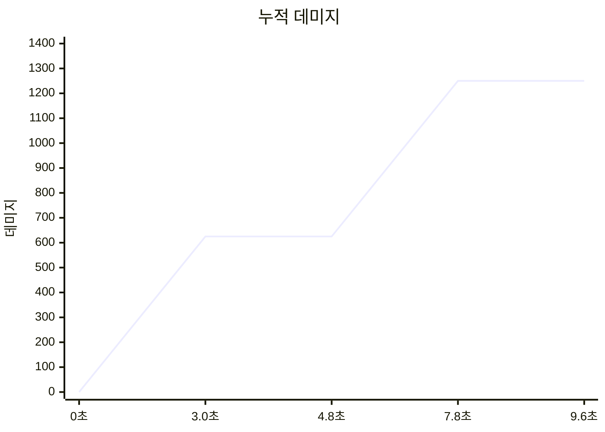
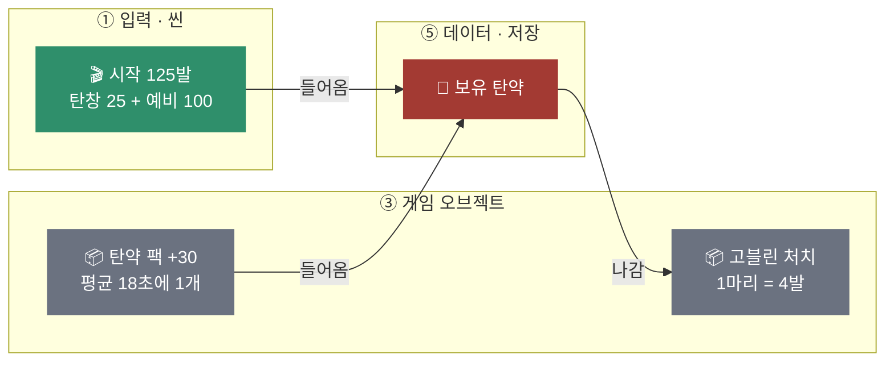
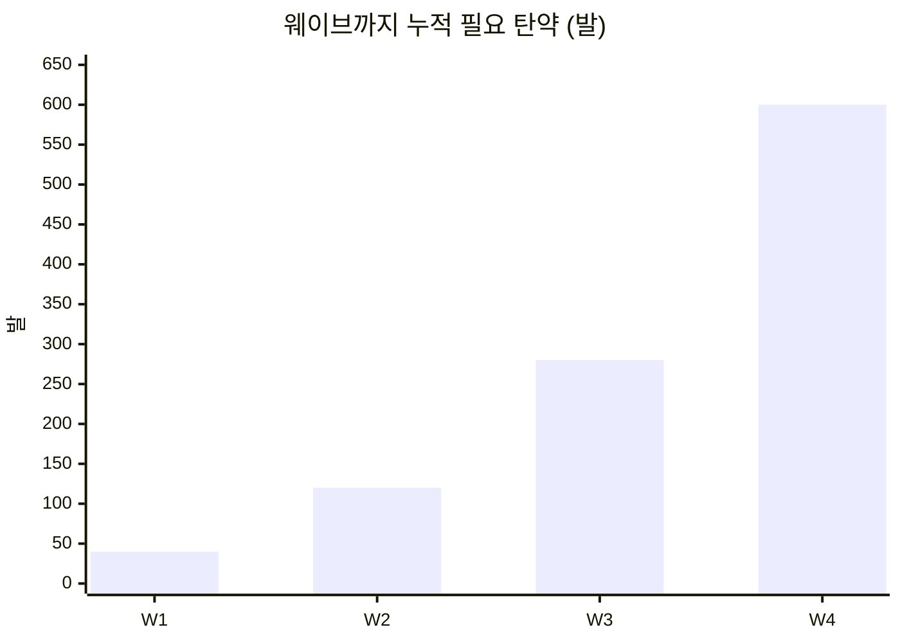

# 밸런스 · 데이터

> 문서 세트: [목차](common_Index.md) · 기획: [컨셉](planner_Concept.md) · [시스템-전투](planner_System_Weapon.md) · [시스템-게임 흐름](planner_System_GameFlow.md) · [전투·개체](planner_Combat_Entity.md) · [레벨 디자인](designer_LevelDesign.md) · **밸런스** · 사업·운영: [사업 검토](owner_Business.md) · [요구사항·로드맵](planner_Requirements.md) · [Business Model](planner_Monetization.md) · [서버·데이터](developer_Server_Data.md) · [리소스](designer_Resources.md) · [로그·지표](planner_Analytics.md) · [QA·출시](tester_Release.md) · [라이브 운영](operator_LiveOps.md) · [사업화·법무](owner_Legal.md) · [needFix](common_needFix.md)
> 데이터 파일 (JSON · Unity `JsonUtility`로 바로 읽는 구조): [`weapon.json`](planner_Balance/weapon.json) · [`goblin.json`](planner_Balance/goblin.json) · [`item.json`](planner_Balance/item.json) · [`wave.json`](planner_Balance/wave.json)
> 값은 `Play` 씬 · 프리팹 · ScriptableObject에 저장된 실제 값 기준

> **문서 정보**

| 문서 번호 | 버전 | 상태 | 책임자 | 협업 | 최종 수정 | 관련 문서 |
|---|---|---|---|---|---|---|
| `D06-BAL` | v1.1 | `Review` | 밸런스 기획자 | — | 2026-11-23 | [밸런스 JSON](planner_Balance) · [Business Model](planner_Monetization.md) |

**변경 이력**

| 버전 | 날짜 | 변경 내용 | 사유 | 결정자 | 영향 범위 |
|---|---|---|---|---|---|

---

## 1. 무기 (`weapon.json`)
| ID | 이름 | 데미지 | 연사 간격 | 탄창 | 예비 | 재장전 | DPS | 탄창 비우는 시간 | 지속 DPS |
|---|---|---|---|---|---|---|---|---|---|
| `WPN_001` | 소총 | 25 | 0.12초 | 25 | 100 | 1.8초 | **208.3** | 3.0초 | **130.2** |
| `GRN_001` | 수류탄 | 100 (반경 6m) | – | 시작 3 | 최대 100 | – | – | – | – |

```
DPS        = 데미지 ÷ 연사 간격               = 25 ÷ 0.12 = 208.3
지속 DPS   = 탄창 데미지 ÷ (탄창 시간 + 재장전) = 625 ÷ (3.0 + 1.8) = 130.2
```

**[선그래프] 누적 데미지 (탄창 2개)**


> 재장전이 전체 화력을 37% 줄임 (208 → 130).

## 2. 고블린 (`goblin.json`)
| ID | 데이터 | 체력 | 공격 | 간격 | 속도 | 점수 | 처치 탄수 | 처치 시간 | 플레이어에게 주는 DPS | 플레이어 처치 타수 |
|---|---|---|---|---|---|---|---|---|---|---|
| `MOB_001~003` | Goblin Data · 1 · 2 (같은 값) | 100 | 20 | 0.5 | 2.0 | 100 | 4 | 0.36초 | 40 | 5 |

```
처치 탄수   = 올림(체력 ÷ 25) = 4
처치 시간   = (처치 탄수 - 1) × 0.12초 = 0.36초    (첫 발은 바로 나감)
플레이어 처치 타수 = 올림(100 ÷ 20) = 5 → 2.0초 (0, 0.5, 1.0, 1.5, 2.0)
수류탄     = 100 ≥ 체력 100 → 반경 안 고블린 처치
```

**[타임라인] 선 쓰러짐 비교 (고블린 1마리 vs 플레이어)**

```mermaid
gantt
  title 처치 시간 비교
  
  dateFormat x
  axisFormat %S.%L초
  section 소총 → 고블린 (4발)
  처치까지 0.36초 :active, k1, 0, 360ms
  1발 :milestone, a1, 0, 0ms
  2발 :milestone, a2, 120, 0ms
  3발 :milestone, a3, 240, 0ms
  4발 처치 :milestone, a4, 360, 0ms
  section 고블린 → 플레이어 (5타)
  처치까지 2.0초 :crit, k2, 0, 2000ms
  1타 :milestone, b1, 0, 0ms
  2타 :milestone, b2, 500, 0ms
  3타 :milestone, b3, 1000, 0ms
  4타 :milestone, b4, 1500, 0ms
  5타 처치 :milestone, b5, 2000, 0ms
```


## 3. 아이템 (`item.json`)
| ID | 이름 | 효과 | 확률 | 수명 |
|---|---|---|---|---|
| `ITM_AMMO` | 탄약 팩 | 예비 +30 | 25% | 5초 |
| `ITM_HP` | 체력 팩 | 체력 +50 (상한 없음) | 25% | 5초 |
| `ITM_GRN` | 수류탄 팩 | 수류탄 +5 (최대 100) | 25% | 5초 |
| `ITM_COIN` | 코인 | 점수 +200 | 25% | 5초 |

```
아이템 평균 생성 간격 = (2 + 7) ÷ 2 = 4.5초
종류별 평균 간격      = 4.5 ÷ 25% = 18초    -> 탄약 팩 분당 약 3.3개 = 약 100발
연속 사격 소비        = 탄창 25발 ÷ (3.0 + 1.8초) × 60 = 분당 최대 약 312발
```

**[구성도] 탄약 흐름**


## 4. 웨이브 (`wave.json`)

**[막대그래프] 웨이브까지 누적 필요 탄약 (발)**


| 웨이브 | 마리 수 | 누적 | 이번 웨이브 필요 탄약 (모두 명중) | 누적 필요 탄약 |
|---|---|---|---|---|
| 1 | 10 | 10 | 40 | 40 |
| 2 | 20 | 30 | 80 | 120 |
| 3 | 40 | 70 | 160 | 280 |
| 4 | 80 | 150 | 320 | 600 |
| 5 | 160 | 310 | 640 | 1,240 |
| 6 | 320 | 630 | 1,280 | 2,520 |
| 7 | 640 | 1,270 | 2,560 | 5,080 |
| 8 | 1,280 | 2,550 | 5,120 | 10,200 |
| 9 | 2,560 | 5,110 | 10,240 | 20,440 |
| 10 | 5,120 | 10,230 | 20,480 | 40,920 |

```
필요 탄약 = 마리 수 × 4발     (빗나감 0, 수류탄 사용 0 기준)
시작 탄약 125발 → 2웨이브까지(누적 120발)는 아이템 없이 가능, 3웨이브(누적 280발)부터 탄약 팩 필요
10웨이브 누적 40,920발 ÷ 탄약 팩 분당 약 100발 = 약 409분
```
