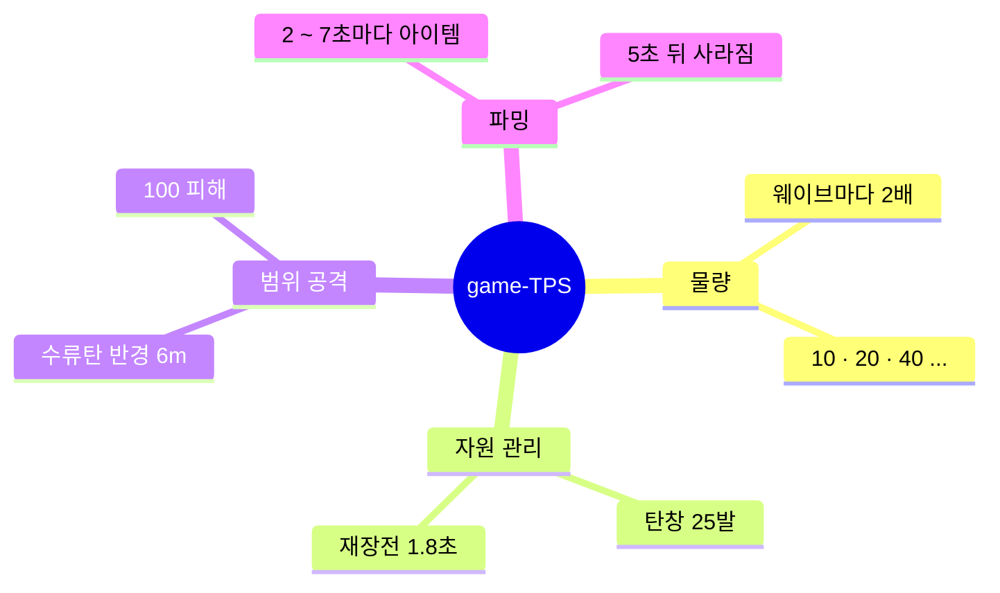
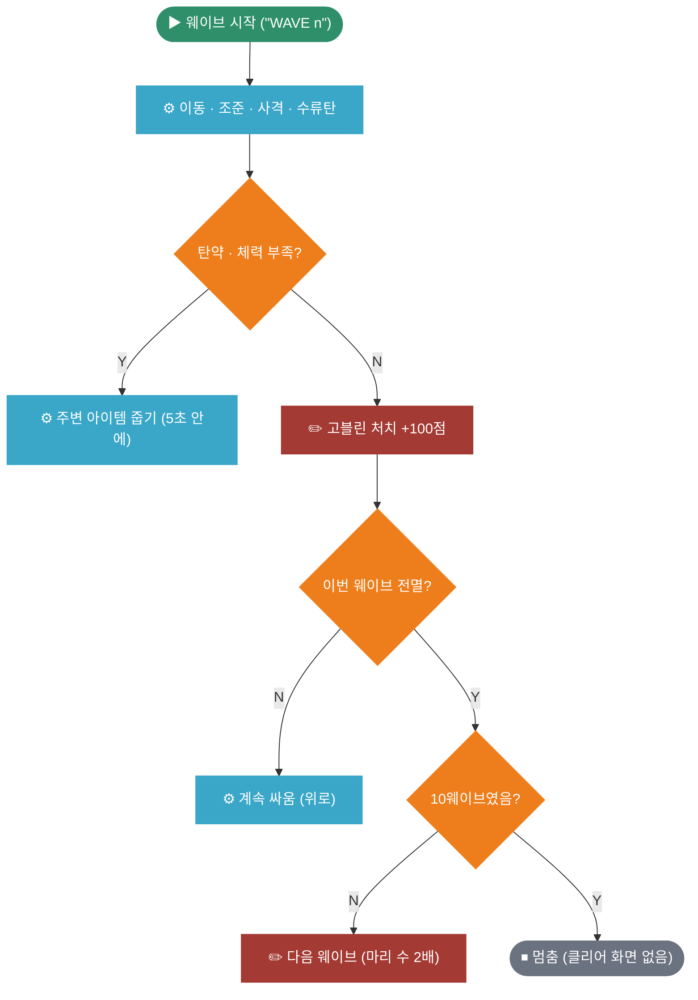
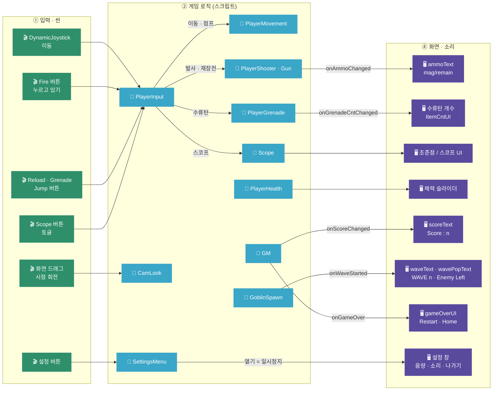

# 게임 컨셉 — game-TPS

> 문서 세트: [목차](common_Index.md) · 기획: **컨셉** · [시스템-전투](planner_System_Weapon.md) · [시스템-게임 흐름](planner_System_GameFlow.md) · [전투·개체](planner_Combat_Entity.md) · [레벨 디자인](designer_LevelDesign.md) · [밸런스](planner_Balance.md) · 사업·운영: [사업 검토](owner_Business.md) · [요구사항·로드맵](planner_Requirements.md) · [Business Model](planner_Monetization.md) · [서버·데이터](developer_Server_Data.md) · [리소스](designer_Resources.md) · [로그·지표](planner_Analytics.md) · [QA·출시](tester_Release.md) · [라이브 운영](operator_LiveOps.md) · [사업화·법무](owner_Legal.md) · [needFix](common_needFix.md)

> **문서 정보**

| 문서 번호 | 버전 | 상태 | 책임자 | 협업 | 최종 수정 | 관련 문서 |
|---|---|---|---|---|---|---|
| `D01-CONCEPT` | v1.1 | `Review` | 기획자 | — | 2026-11-23 | [사업 검토](owner_Business.md) · [요구사항·로드맵](planner_Requirements.md) |

**변경 이력**

| 버전 | 날짜 | 변경 내용 | 사유 | 결정자 | 영향 범위 |
|---|---|---|---|---|---|

---

## 기획 의도
> 기획자가 정한 방향임. 아래 "개요"부터는 지금 코드 · 씬에 구현된 내용임.

| 항목 | 내용 |
|---|---|
| 한 줄 정의 | 몰려오는 고블린 웨이브를 소총과 수류탄으로 막아내는 모바일 3인칭 웨이브 슈터 |
| 기획 의도 (핵심 재미) | 탄창 25발 · 재장전 1.8초로 "언제 재장전할까" 판단 + 몰려오는 적을 수류탄 한 방으로 정리하는 쾌감 + 아이템을 주우러 움직이는 긴장 |
| 타깃 | 짧은 시간 액션을 원하는 모바일 미드코어 슈팅 유저 |
| 플랫폼 · 제약 | 모바일(조이스틱 · 화면 드래그 · 버튼), 동시 적 수에 따른 성능 예산 필요 |
| 레퍼런스 · 차별점 | 웨이브 디펜스 슈터(좀비 모드 류) · 모바일 TPS 조작 → **웨이브마다 물량이 늘고 필드에서 탄약을 주워야 하는 자원 관리** |

## 개요
| 항목 | 내용 | 근거 |
|---|---|---|
| 장르 | 3인칭 슈팅(TPS) · 웨이브 디펜스 | `GoblinSpawn`, `Gun` |
| 플랫폼 | 모바일 (조이스틱 · 화면 버튼 · 드래그 시점), PC 키보드 · 마우스 테스트 | `PlayerInput`, `CamLook` |
| 엔진 | Unity 6 (6000.6.3f1) · C# · NavMesh · Cinemachine · TextMesh Pro | `ProjectSettings`, `Scope` |
| 씬 | `Intro` → `Play` (`Main`은 빌드에서 꺼져 있음) | 빌드 설정 |

## 재미 요소 (코드에서 확인되는 것)
| 요소 | 내용 | 근거 |
|---|---|---|
| 물량 | 웨이브마다 고블린 수 2배 (10, 20, 40 …) | `GoblinSpawn.SpawnWave` |
| 자원 관리 | 탄창 25발 · 재장전 1.8초 동안 사격 불가 | `Gun Data` |
| 범위 공격 | 수류탄: 반경 6m 안 고블린에 100 피해 (고블린 체력 100) | `Grenade` 프리팹 |
| 파밍 | 2 ~ 7초마다 주변에 아이템, 5초 뒤 사라짐 | `ItemSpawn` |

**[타임라인] 탄창 한 사이클**

```mermaid
gantt
  title 탄창 한 사이클
  dateFormat x
  axisFormat %S초
  section 소총
  연사 25발 (DPS 208) :active, a1, 0, 3000ms
  재장전 1.8초 (사격 불가) :crit, a2, 3000, 1800ms
  연사 25발 :active, a3, 4800, 3000ms
  재장전 1.8초 :crit, a4, 7800, 1800ms
```


**수류탄 (위에서 본 모습)**
```
            . - - - - - .
          /   g   g   g   \
         |  g     *     g  |     * = 폭발 지점 · 반경 6m 안 g(고블린)에 100 피해 = 처치
          \   g   g   g   /
            ' - - - - - '
                  P              P = 플레이어 (자기 수류탄에 피해 없음)
```

**[마인드맵] 재미 요소 한눈에**


## 코어 루프

**[흐름도] 코어 루프**


## 화면 · 조작 요소
화면 내 위치는 씬 캡처 첨부 필요 (담당: 기획자). 아래는 코드 · 씬 기준 요소 목록. 아래는 코드 · 씬에 있는 요소 목록임.
**[구성도] 화면 · 조작 요소 연결 (버튼 → 스크립트 → 화면)**


**HUD - UIM**
 - scoreText   "Score : n"
 - waveText    "Wave : n" / "Enemy Left : m"
 - ammoText    "mag/remain"
 - wavePopText "WAVE n"
 - 체력 슬라이더
 - 수류탄 개수 (ItemCntUI)
 - 조준점 / 스코프 UI
 - gameOverUI (Restart · Home)

**Input - PlayerInput / CamLook**
 - DynamicJoystick : 이동
 - 화면 드래그 : 시점 회전
 - Fire 버튼 (누르고 있기)
 - Reload · Grenade · Jump 버튼
 - Scope 버튼 (토글)
 - 설정 버튼 (SettingsOpenButton)

| 입력 | 모바일 | PC 테스트 |
|---|---|---|
| 이동 | 조이스틱 | Vertical / Horizontal 축 |
| 시점 | 드래그 (감도 0.2) | 마우스 (감도 3), 위아래 -40 ~ 70도 |
| 발사 | Fire 버튼 누르고 있기 | F 누를 때마다 |
| 재장전 · 수류탄 · 점프 · 스코프 | 각 버튼 | R · G · Space · 마우스 오른쪽 |

## 개발 현황
| 구분 | 내용 |
|---|---|
| 구현됨 | 이동 · 2단 점프 · 사격 · 재장전 · 스코프 · 수류탄 · 고블린 AI · 웨이브 · 아이템 4종 · 설정(음량 · 소리 · 일시정지) · 씬 이동 |
| 구조 | 이벤트(`static event Action`)로 매니저 간 직접 호출 제거, 상속(`LivingEntity`) · 인터페이스(`IDamageable`, `IItem`, `IPop`, `IBlink`) · ScriptableObject 데이터 |
| 다음 할 일 | [needFix](common_needFix.md) |
