# 시스템 — 게임 흐름 (씬 · 웨이브 · 게임오버 · 설정)

> 문서 세트: [목차](common_Index.md) · 기획: [컨셉](planning_Concept.md) · [시스템-전투](planning_System_Weapon.md) · **시스템-게임 흐름** · [전투·개체](planning_Combat_Entity.md) · [레벨 디자인](planning_LevelDesign.md) · [밸런스](planning_Balance.md) · 사업·운영: [사업 검토](owner_Business.md) · [요구사항·로드맵](planning_Requirements.md) · [Business Model](planning_Monetization.md) · [서버·데이터](dev_Server_Data.md) · [리소스](design_Resources.md) · [로그·지표](planning_Analytics.md) · [QA·출시](qa_QA_Release.md) · [라이브 운영](ops_LiveOps.md) · [사업화·법무](owner_Business_Legal.md) · [needFix](common_needFix.md)
> 관련 코드: `GM.cs` · `GoblinSpawn.cs` · `UIM.cs` · `SM.cs` · `SceneChange.cs` · `SettingsMenu.cs` · `SettingsData.cs`

> **문서 정보** · 문서 번호 `D03-FLOW` · 버전 v1.0 · 상태 `Review` · 담당 기획자 · 클라이언트 개발자 · 최종 수정 2026-11-21 · 관련 문서 [레벨 디자인](planning_LevelDesign.md) · [서버·데이터](dev_Server_Data.md)

**변경 이력**

| 버전 | 날짜 | 변경 내용 | 사유 | 결정자 | 영향 범위 |
|---|---|---|---|---|---|
| v0.9 | 2026-11-20 | 기존 문서 (자세한 기록은 git 커밋) | — | 기획자 | — |
| v1.0 | 2026-11-21 | 문서 정보 · 변경 이력 · 문서 번호 추가, 사업 · 운영 문서와 연결 | — | 기획자 | 문서만 |

---

## 0. 한눈에 보는 시스템 구조

**[구성도] 이벤트 연결 (누가 알리고 누가 듣나)**
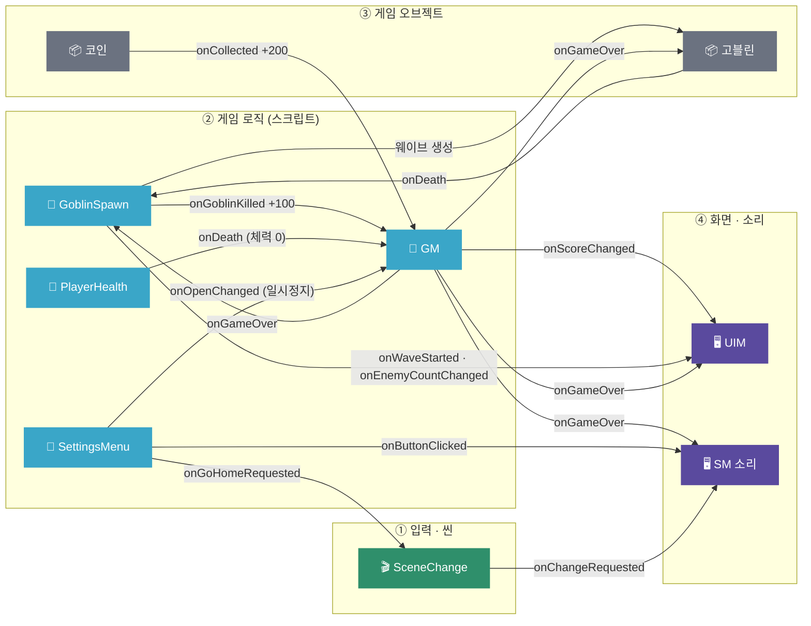

## 1. 화면 흐름
빌드 씬: `0 Intro` → `1 Play` (`Main` 씬은 빌드에서 꺼져 있음)

**[상태도] 화면 전환**
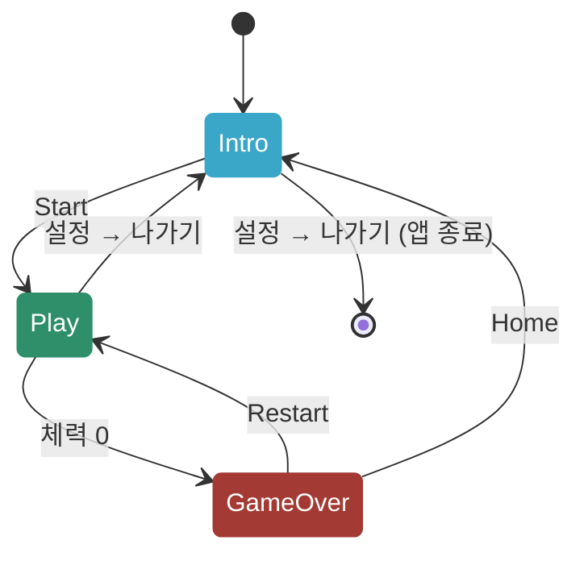

**[와이어프레임] 플레이 화면 (HUD 기준 1280 × 720)**
```
+----------------------------------------------------------------+
|                                                                |
|                                                                |
|                                                                |
|                                                                |
|                                                                |
|---------------------------                                     |
|:        ----             :                                     |
|:        --B-             :                         ---         |
|:---------------          :-------                  -C-         |
|:       G      :          ::   -I-            ---               |
|:---------------          ::  J  :            -D-  ----         |
|:            A            :-------                 : E:         |
|:                         :                   ---  ----         |
|:                         :                   -F-               |
|:                         :-----------                          |
|:                         :     H    :                          |
|:                         :-----------                          |
|---------------------------                                     |
+----------------------------------------------------------------+
```

| 표시 | 요소 | 하는 일 | 씬 이름 · 화면 위치 (x, y 픽셀, 왼쪽 아래 = 0) |
|---|---|---|---|
| A | 이동 조이스틱 영역 | 이동 | `MoveJoystick` · -473 ~ 527, -508 ~ 492 |
| B | 스코프 버튼 | 스코프 켜기 · 끄기 | `ScopeButton` · 206 ~ 256, 419 ~ 469 |
| C | 발사 버튼 | 누르고 있으면 연사 | `FireButton` · 1037 ~ 1087, 371 ~ 421 |
| D | 수류탄 버튼 | 던지기 | `GrenadeButton` · 917 ~ 967, 305 ~ 355 |
| E | 점프 버튼 | 2단 점프 | `JumpButton` · 1033 ~ 1083, 239 ~ 289 |
| F | 재장전 버튼 | 재장전 | `ReloadButton` · 921 ~ 971, 181 ~ 231 |
| G | 웨이브 · 남은 적 | "Wave : n / Enemy Left : m" | `WaveText` · 20 ~ 320, 313 ~ 391 |
| H | 점수 | "Score : n" | `ScoreText` · 522 ~ 752, 63 ~ 143 |
| I | 조준점 | 화면 가운데 | `Crosshair` · 632.5 ~ 647.5, 352.5 ~ 367.5 |
| J | 설정 | 설정 창 (열면 일시정지) | `Settings` · 561 ~ 661, 268 ~ 368 |

화면 나머지 영역을 드래그하면 시점이 돌아가요 (`CamLook`). 체력바는 플레이어 머리 위에 따로 떠 있어요 (`HealthCanvas`).

## 2. Play 씬 상태 머신

**[상태도] Play 씬 상태 머신**
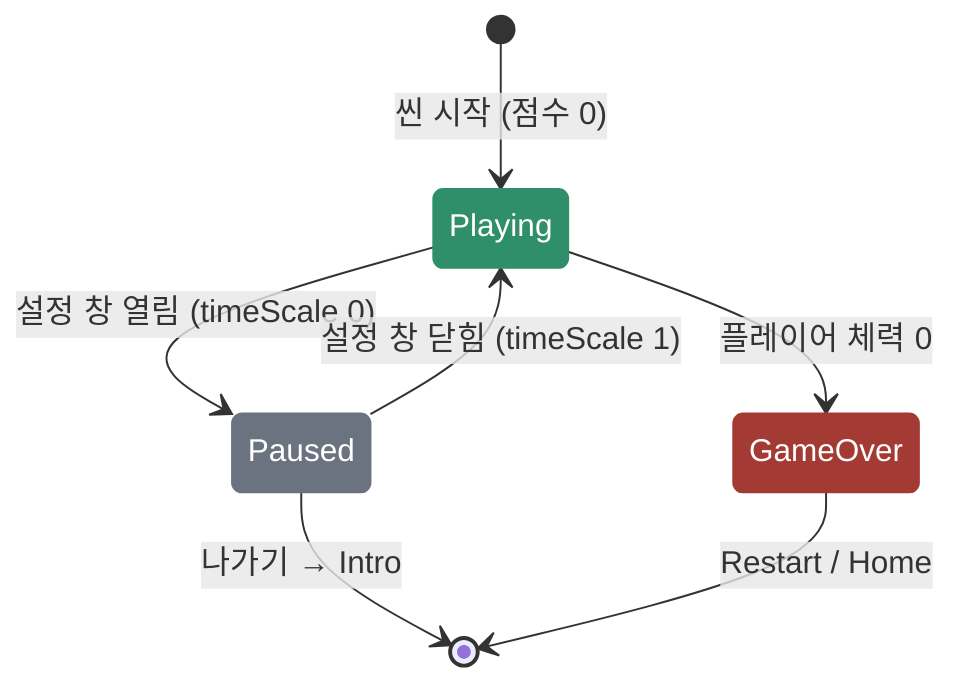

| 상태 | 입력 | 고블린 | 점수 | 시간 |
|---|---|---|---|---|
| Playing | 정상 | 추적 · 공격 | 쌓임 | 1배 |
| Paused | 전부 0 (`PlayerInput`) | 멈춤 | – | 0배 (`Time.timeScale`) |
| GameOver | 전부 0 | 정지 + 대기 동작, 공격 · 공격음 없음 | 더 안 쌓임 | 1배 |

## 3. 웨이브 로직 (`GoblinSpawn`)

**[흐름도] 웨이브**
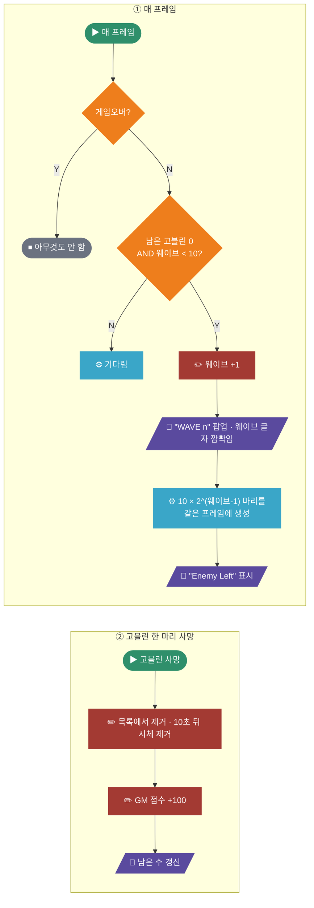

```
now : [ W1 ......... ][ W2 ............ ][ W3 ...      (웨이브 사이 대기 없음)
```

> 세부 조건(코드 기준)은 [부록 A-1](#a-1-웨이브-로직-goblinspawn)에 있어요.

## 4. 게임오버 로직

**[흐름도] 체력 0부터**
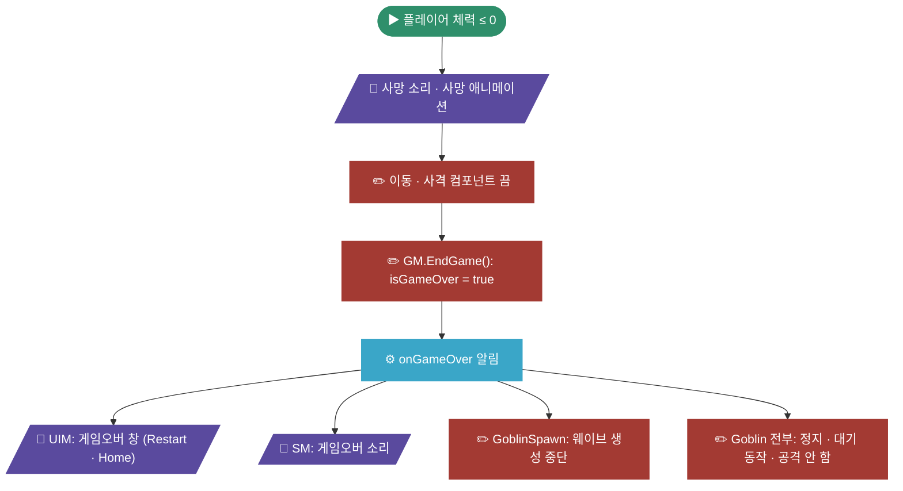

> 세부 조건(코드 기준)은 [부록 A-2](#a-2-게임오버-로직)에 있어요.

## 5. 설정 · 일시정지 로직

**[흐름도] 설정 창**
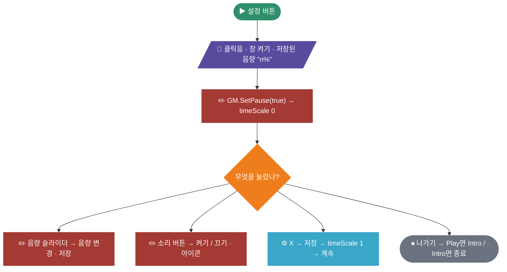

요소: X(닫기) · 음량 슬라이더 + "70%" 글자 · 소리 버튼(아이콘 on/off) · 나가기 버튼

> 세부 조건(코드 기준)은 [부록 A-3](#a-3-설정--일시정지-로직)에 있어요.

## 6. 씬 이동 로직 (`SceneChange`)

**[흐름도] Start · Restart · Home**
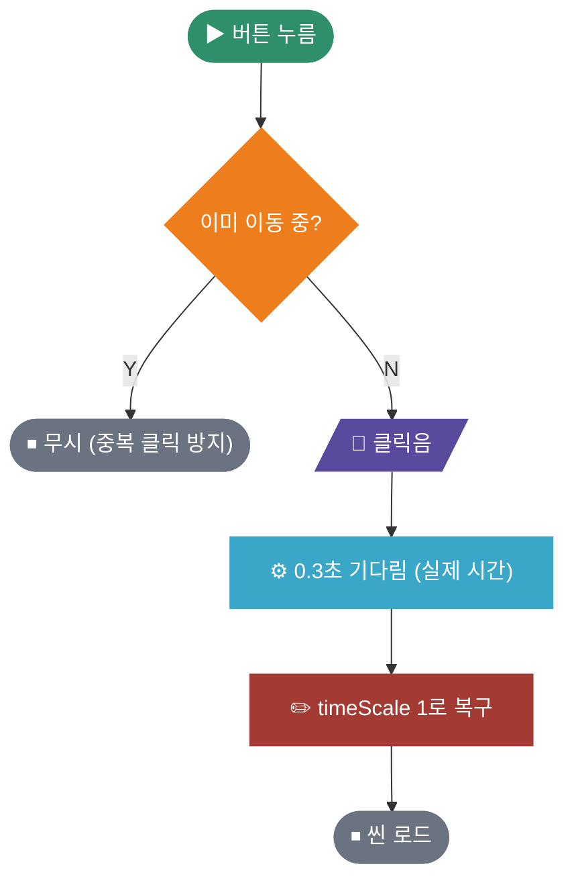

> 세부 조건(코드 기준)은 [부록 A-4](#a-4-씬-이동-로직-scenechange)에 있어요.

## 7. 이벤트 연결표
그림은 맨 위 **[구성도] 이벤트 연결**을 보세요. 아래는 같은 내용을 정확한 이름으로 정리한 표예요.

| 이벤트 | 보내는 쪽 | 받는 쪽 |
|---|---|---|
| `LivingEntity.onDeath` (인스턴스 이벤트) | PlayerHealth · Goblin | GM (게임오버) · GoblinSpawn (처치 처리) |
| `GM.onScoreChanged(int)` | GM | UIM (점수 글자 톡 · 깜빡임) |
| `GM.onGameOver` | GM | UIM, SM, GoblinSpawn, Goblin |
| `GoblinSpawn.onWaveStarted(int)` | GoblinSpawn | UIM |
| `GoblinSpawn.onEnemyCountChanged(int, int)` | GoblinSpawn | UIM |
| `GoblinSpawn.onGoblinKilled` | GoblinSpawn | GM (+100) |
| `Gun.onAmmoChanged(int, int)` | Gun | UIM, ItemCntUI |
| `PlayerGrenade.onGrenadeCntChanged(int)` | PlayerGrenade | ItemCntUI |
| `Coin.onCollected(int)` | Coin | GM (+200) |
| `SettingsMenu.onOpenChanged(bool)` | SettingsMenu | GM (일시정지) |
| `SettingsMenu.onButtonClicked` | SettingsMenu | SM (클릭음) |
| `SettingsMenu.onGoHomeRequested` | SettingsMenu | SceneChange |
| `SceneChange.onChangeRequested` | SceneChange | SM (클릭음) |

> 각 스크립트는 알림만 보내고, 필요한 쪽이 구독해요. UI를 바꿔도 게임 규칙 코드는 건드리지 않아요.

## 8. 예외 처리 (Edge Case) — 현재 동작
**[구성도] 예외 처리 지도 — 게임 흐름**
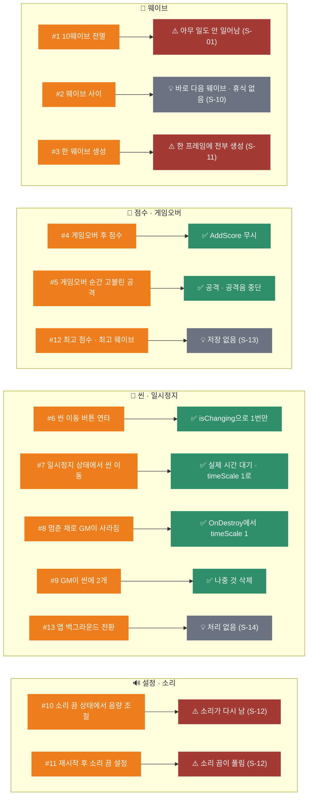

| # | 상황 | 현재 동작 | 상태 |
|---|---|---|---|
| 1 | 10웨이브 전멸 | 조건(`웨이브 < 10`)이 거짓 → 아무 일도 안 일어남 | ⚠️ → [S-01](common_needFix.md) |
| 2 | 웨이브 사이 | 마지막 고블린이 죽은 다음 프레임에 바로 다음 웨이브 | → [S-10](common_needFix.md) |
| 3 | 한 웨이브 생성 | 한 프레임에 전부 `Instantiate` (6웨이브 320마리) | ⚠️ → [S-11](common_needFix.md) |
| 4 | 게임오버 후 점수 | `isGameOver`면 `AddScore` 무시 | ✅ |
| 5 | 게임오버 순간 고블린 공격 | 공격 · 공격음 중단 | ✅ |
| 6 | 씬 이동 버튼 연타 | `isChanging`으로 1번만 | ✅ |
| 7 | 일시정지 상태에서 씬 이동 | 실제 시간으로 대기, 이동 전 timeScale 1 | ✅ |
| 8 | 멈춘 채로 GM이 사라짐 | `OnDestroy`에서 timeScale 1 | ✅ |
| 9 | GM이 씬에 2개 | 나중 것 삭제 | ✅ |
| 10 | 소리 끔 상태에서 음량 조절 | `SetMasterVolume`이 volume을 바꿔 소리가 다시 남 | ⚠️ → [S-12](common_needFix.md) |
| 11 | 재시작 후 소리 끔 설정 | `Load()`가 음량만 읽고 `Settings_SoundOn`은 안 읽음 | ⚠️ → [S-12](common_needFix.md) |
| 12 | 최고 점수 · 최고 웨이브 | 저장 없음 | → [S-13](common_needFix.md) |
| 13 | 앱 백그라운드 전환 (모바일) | 처리 없음 | → [S-14](common_needFix.md) |

---

## 부록 A. 세부 조건 (코드 기준)
본문 흐름도의 조건을 코드 그대로 적은 개발 참고용이에요. 기획 내용은 본문에 있어요.

### A-1. 웨이브 로직 (`GoblinSpawn`)
```
매 프레임
├─ IF 게임오버 → 아무것도 안 함
└─ IF 남은 고블린 = 0 AND 웨이브 < 10
    ├─ 웨이브 +1 → onWaveStarted(웨이브) → UI "WAVE n" 페이드 팝업(0.5 · 1.5 · 0.5초) + 웨이브 글자 깜빡임
    ├─ 생성 수 = 10 × 2^(웨이브-1)
    ├─ 생성 수만큼 반복 (같은 프레임)
    │   ├─ 고블린 데이터 3종 중 랜덤, 스폰 지점 3곳 중 랜덤
    │   ├─ 생성 + 스폰 이펙트(NavMesh 바닥에, 3초 뒤 제거)
    │   └─ 사망 알림 구독
    └─ onEnemyCountChanged(웨이브, 남은 수) → UI "Wave : n / Enemy Left : m"

고블린 사망
├─ 목록에서 제거, 10초 뒤 시체 제거
├─ onGoblinKilled → GM 점수 +100
└─ onEnemyCountChanged
```

### A-2. 게임오버 로직
```
PlayerHealth 체력 ≤ 0 → Die()
├─ 사망 소리 · 사망 애니메이션, 이동 · 사격 컴포넌트 끔
└─ onDeath → GM.EndGame()
    ├─ isGameOver = true (이후 AddScore 무시)
    └─ onGameOver 알림 (구독자가 각자 처리)
        ├─ UIM: 게임오버 창과 자식(글자 · Restart · Home) 전부 켬
        ├─ SM: 게임오버 소리
        ├─ GoblinSpawn: 웨이브 생성 중단
        └─ Goblin(전체): 길 찾기 중단 · 그 자리 정지 · 대기 애니메이션 · 공격 중단
```

### A-3. 설정 · 일시정지 로직
```
설정 버튼 → SettingsMenu.Open()
├─ 클릭음 알림 → 창 켜기 → 저장된 음량을 슬라이더에 (알림 없이) 반영 → "n%" 표시
└─ onOpenChanged(true) → GM.SetPause(true) → timeScale 0

음량 슬라이더 → SettingsData.SetMasterVolume(v) → 0~1로 제한 → AudioListener.volume → PlayerPrefs
소리 버튼    → SetSoundOn(!현재) → 꺼짐이면 volume 0 → 아이콘 교체
X 버튼       → 저장 → onOpenChanged(false) → timeScale 1
나가기       → 저장 → Play 씬: Intro로 / Intro 씬: 앱 종료
```

### A-4. 씬 이동 로직 (`SceneChange`)
```
Start / Restart / Home 버튼
├─ IF 이미 이동 중 → 무시 (중복 클릭 방지)
└─ ELSE → onChangeRequested 알림(SM 클릭음) → 0.3초 실제 시간 대기(멈춘 상태에서도 동작)
         → timeScale 1로 복구 → 씬 로드
```

## 부록 B. 코드 구조 (상속 · 인터페이스 · 이벤트 · 호출)
개발자와 구조를 맞출 때 보는 참고 자료예요. 게임 규칙은 본문 §0 ~ §8에 있어요.

`Assets/Scripts`의 스크립트 34개(클래스 29 · 인터페이스 4 · static 1)가 어떻게 이어지는지 코드 기준으로 그렸어요. 외부 에셋(조이스틱 · UI 팩)은 빼고 이 프로젝트 코드만 담았어요.

| 연결 방식 | 코드 모양 | 이 게임에서 |
|---|---|---|
| 상속 | `class Goblin : LivingEntity` + `virtual` / `override` | `LivingEntity` → `PlayerHealth`, `Goblin` |
| 인터페이스 | `class Coin : IItem` + `GetComponent<IItem>()` | `IDamageable` · `IItem` · `IPop` · `IBlink` |
| 이벤트 (Action) | `public static event Action<int> onX;` → `onX?.Invoke()` / `+=` 구독 | 13개 (§7 표) |
| 직접 호출 · 참조 | 필드 · `GetComponent<T>()` · 싱글톤 `GM.ins` | 입력 → 이동 · 사격 · 수류탄 |
| 데이터 | `ScriptableObject` · `static class` · `PlayerPrefs` | `GunData` · `GoblinData` · `SettingsData` |

### B-1. 핵심 구조

**[클래스 다이어그램] 핵심 구조 — 플레이어 · 생명체 · 무기 · 아이템 · 매니저**
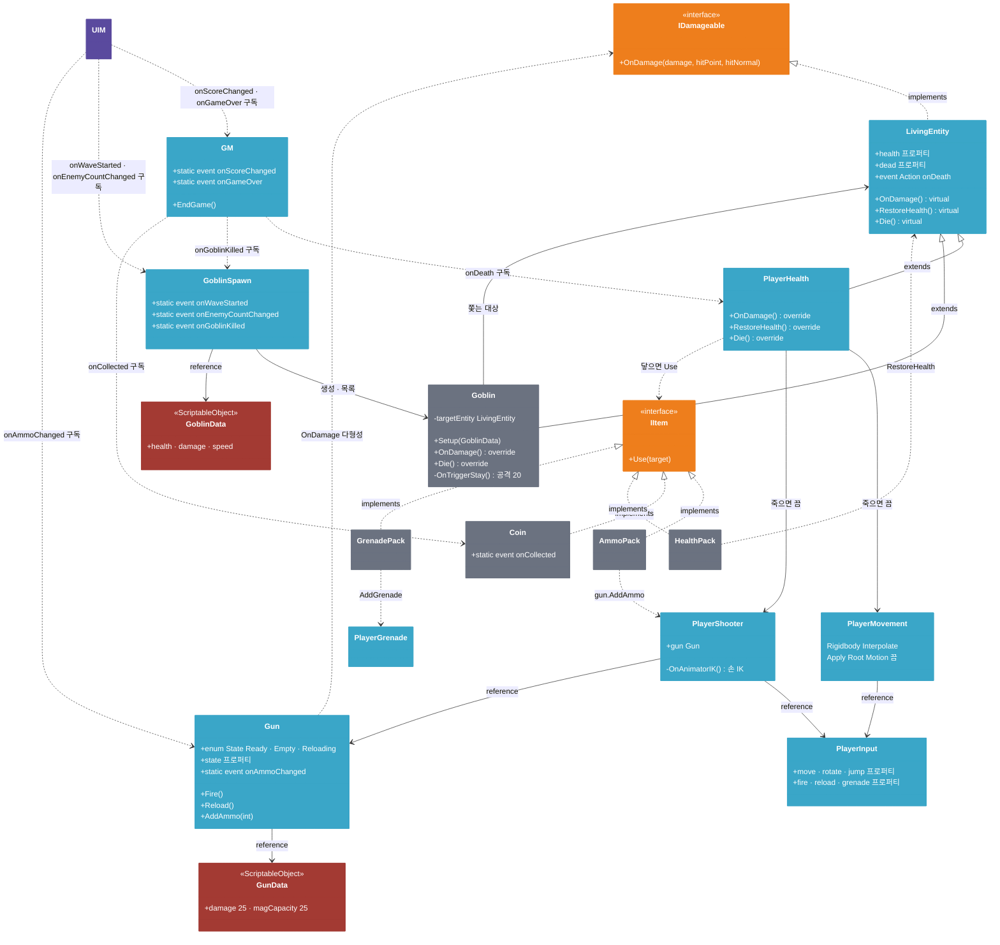

### B-2. 전체 흐름 (한 장 요약)

**[구성도] 코드 전체 흐름 — 한 장 요약**
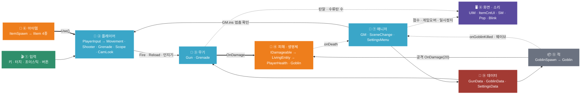

### B-3. 대표 흐름 따라가기

**[시퀀스 다이어그램] 총 한 발 → 고블린 처치 → 점수 표시**
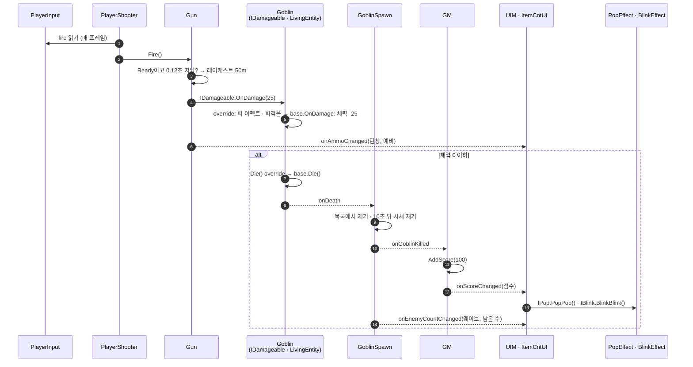
