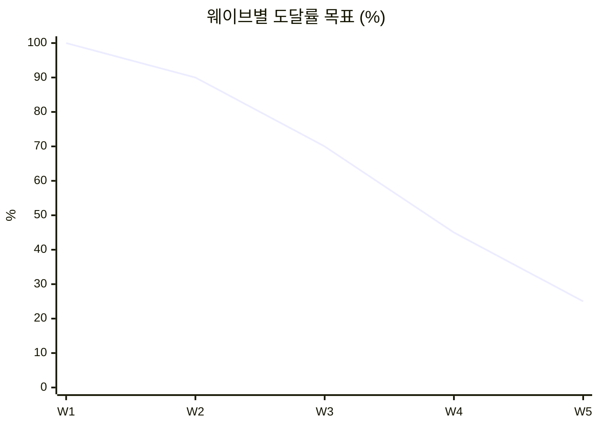

# 로그 · 지표 설계 — game-TPS

> 문서 세트: [목차](../Proposal.md) · 기획: [컨셉](Concept.md) · [시스템-전투](System_Weapon.md) · [시스템-게임 흐름](System_GameFlow.md) · [전투·개체](Combat_Entity.md) · [레벨 디자인](LevelDesign.md) · [밸런스](Balance.md) · 사업·운영: [사업 검토](../대표/Business.md) · [요구사항·로드맵](Requirements.md) · [Business Model](Monetization.md) · [서버·데이터](../개발/Server_Data.md) · [리소스](../디자인/Resources.md) · **로그·지표** · [QA·출시](../QA/QA_Release.md) · [라이브 운영](../운영/LiveOps.md) · [사업화·법무](../대표/Business_Legal.md) · [needFix](../needFix.md)

> **문서 정보** · 문서 번호 `D10-LOG` · 버전 v1.0 · 상태 `Draft` · 담당 기획자 · 클라이언트 개발자 · 최종 수정 2026-11-21 · 관련 문서 [사업 검토](../대표/Business.md) · [Business Model](Monetization.md)

**변경 이력**

| 버전 | 날짜 | 변경 내용 | 사유 | 결정자 | 영향 범위 |
|---|---|---|---|---|---|
| v1.0 | 2026-11-21 | 최초 작성 | — | 기획자 | — |

---

## 1. 목적
출시 후 **무엇을 측정할지** 정하는 문서예요. 로그는 개발 중에 같이 심어야 해서 베타 전에 확정해요.
> 지금 구현: 로그 없음. `Packages/manifest.json`에 `com.unity.analytics` 3.8.2(예전 Unity Analytics)가 들어 있지만 코드에서 쓰지 않아요. 어떤 도구를 쓸지 [F-08](../needFix.md#8-정할-것)에서 정해요 (Firebase Analytics · Unity Gaming Services Analytics · GameAnalytics 등).

## 2. 이름 규칙
- 이벤트: `evt_대상_동작` (소문자 · 밑줄). 파라미터: `snake_case`
- 모든 이벤트에 자동으로 붙는 값: `app_version`, `platform`, `session_id`
- **개인정보(이름 · 이메일 · 전화번호)는 넣지 않아요.**

## 3. 이벤트 목록
| 이벤트 | 발생 시점 (코드 위치 제안) | 파라미터 | 확인할 지표 |
|---|---|---|---|
| `evt_session_start` | 앱 시작 (`Intro` 씬) | first_open(bool) | DAU · D1 · D7 재접속률 |
| `evt_run_start` | `Play` 씬 시작 | run_id, upgrade_levels | 하루 판 수 |
| `evt_wave_start` | `GoblinSpawn.onWaveStarted` | run_id, wave, enemy_count | 웨이브별 도달률 (어디서 막히는지) |
| `evt_run_end` | `GM.onGameOver` · 클리어 | run_id, result(over / clear), wave, score, play_sec, kills, coin_earned | 한 판 평균 시간 ([S-21](../needFix.md)) · 코인 수급 ([Business Model](Monetization.md) §3) |
| `evt_shot_stats` | 판 끝 1회 | run_id, shots, hits | 실제 명중률 ([S-21](../needFix.md)) → 탄약 수급 조정 |
| `evt_grenade_use` | `PlayerGrenade` 투척 | run_id, wave, kills_by_grenade | 수류탄 손맛 (한 번에 몇 마리) |
| `evt_item_pickup` | `IItem.Use` | item_id, wave | 아이템 수급 · 놓치는 비율 |
| `evt_upgrade_buy` | 상점 구매 | upgrade_id, level, coin_after | 업그레이드 속도 |
| `evt_ad_offer` · `evt_ad_reward` | 광고 버튼 노출 · 보상 지급 | placement([AD_REVIVE](Monetization.md) / [AD_COIN_X2](Monetization.md)), wave | 지면별 시청률 |
| `evt_purchase` | 결제 완료 | product_id, price, currency | 결제 전환율 · ARPPU |
| `evt_settings_change` | 설정 저장 | sound_on, volume | 소리 끄는 비율 |
| `evt_perf_drop` | FPS가 3초 이상 25 아래 | wave, enemy_alive, device_model | 성능 문제 기기 ([S-11](../needFix.md)) |

## 4. 지표 ↔ 이벤트 연결
| 지표 ([사업 검토](../대표/Business.md) §4) | 계산 |
|---|---|
| D1 · D7 재접속률 | 처음 연 날 기준 `evt_session_start` 1일 · 7일 뒤 다시 있는 비율 |
| 한 판 평균 시간 | `evt_run_end.play_sec` 평균 |
| 웨이브별 이탈 | `evt_wave_start` 웨이브 n 수 ÷ 웨이브 1 수 |
| 광고 시청률 | `evt_ad_reward` 사용자 수 ÷ DAU |
| 결제 전환율 | `evt_purchase` 사용자 수 ÷ DAU |

**[선그래프] 웨이브별 도달률 목표 (예시)**

## 5. 완료 기준
- 베타 빌드에서 위 이벤트가 분석 도구 화면(DebugView 등)에 모두 들어온다.
- 개인정보처리방침에 분석 도구 · 광고 SDK를 처리 위탁 · 국외 이전 항목으로 적었다 ([사업화 · 법무](../대표/Business_Legal.md)).
