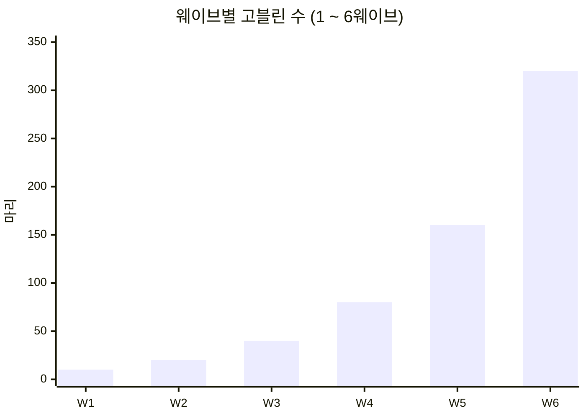
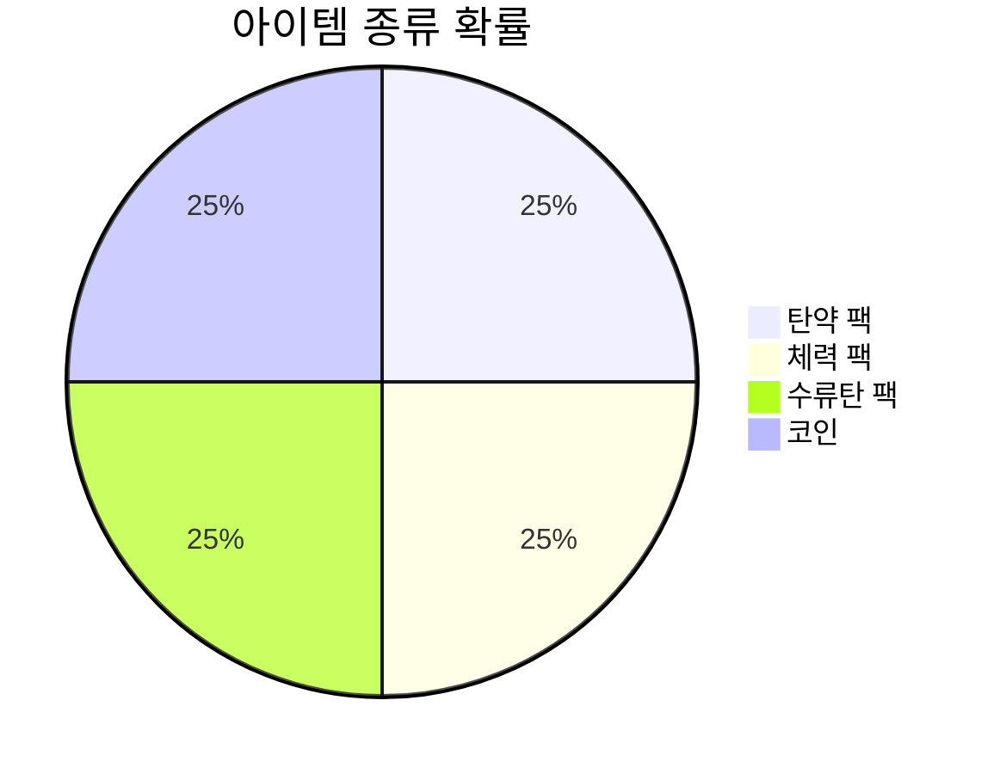

# 레벨 디자인 — Play 씬 · 10웨이브

> 문서 세트: [목차](../Proposal.md) · 기획: [컨셉](Concept.md) · [시스템-전투](System_Weapon.md) · [시스템-게임 흐름](System_GameFlow.md) · [전투·개체](Combat_Entity.md) · **레벨 디자인** · [밸런스](Balance.md) · 사업·운영: [사업 검토](../대표/Business.md) · [요구사항·로드맵](Requirements.md) · [Business Model](Monetization.md) · [서버·데이터](../개발/Server_Data.md) · [리소스](../디자인/Resources.md) · [로그·지표](Analytics.md) · [QA·출시](../QA/QA_Release.md) · [라이브 운영](../운영/LiveOps.md) · [사업화·법무](../대표/Business_Legal.md) · [needFix](../needFix.md)
> 데이터: [`Balance/wave.json`](Balance/wave.json)

> **문서 정보** · 문서 번호 `D05-LEVEL` · 버전 v1.0 · 상태 `Review` · 담당 레벨 디자이너 · 최종 수정 2026-11-21 · 관련 문서 [밸런스](Balance.md)

**변경 이력**

| 버전 | 날짜 | 변경 내용 | 사유 | 결정자 | 영향 범위 |
|---|---|---|---|---|---|
| v0.9 | 2026-11-20 | 기존 문서 (자세한 기록은 git 커밋) | — | 레벨 디자이너 | — |
| v1.0 | 2026-11-21 | 문서 정보 · 변경 이력 · 문서 번호 추가, 사업 · 운영 문서와 연결 | — | 레벨 디자이너 | 문서만 |

---

## 1. 씬 구성
| 항목 | 내용 | 근거 |
|---|---|---|
| 씬 | `Play` (NavMesh Surface 베이크됨) | 빌드 설정, `Scenes/Play/` |
| 스폰 | `[Spawners]` 아래 `SpawnPoint1 ~ 3` | `Play.unity` |
| 아이템 | 플레이어 반경 5m, 2 ~ 7초마다 | `ItemSpawn` |
| 목표 | 10웨이브 버티기 (클리어 화면은 없음) | `GoblinSpawn.maxWave` |

## 2. 스폰 지점
`[Spawners]` 기준 로컬 위치 — 세 지점이 같은 줄(z 같음) 위에 있어요.

```
x:   -19.66                  0          7.39
       SP3 ----------------- SP1 ------ SP2        <- [Spawners] 로컬 x 좌표 (y 0, z 0)
       |<------- 19.66 ----->|<- 7.39 ->|
```
> 맵 전체 배치(엄폐물 · 플레이어 시작 위치)는 씬 탑다운 캡처로 넣어 주세요 → [S-19](../needFix.md)

**[도면] Play 씬 — 플레이어 시작 · 고블린 스폰 지점 (위에서 본 모습)**
```
z 11.8
  ........................................................
  .....3................................1...........2.....
  ........................................................
  ........................................................
  ........................................................
  ........................................................
  ........................................................
  ........................................................
  ........................................................
  ........................................................
  ........................................................
  ........................................................
  ........................................................
  ........................................................
  ........................................................
  ........................................................
  ......................................P.................
  ........................................................
z -1.1   x -22.4 ~ 10.1  (오른쪽 = +x, 위 = +z)
```

| 표시 | 무엇 | 씬 이름 | 월드 좌표 (x, z) |
|---|---|---|---|
| P | 플레이어 시작 | `Player` | 0, 0 |
| 1 | 고블린 스폰 1 | `SpawnPoint1` | 0, 10.7 |
| 2 | 고블린 스폰 2 | `SpawnPoint2` | 7.4, 10.7 |
| 3 | 고블린 스폰 3 | `SpawnPoint3` | -19.7, 10.7 |

세 스폰 지점은 플레이어 앞쪽(+z) 10.7m 줄에 있어요. 아이템은 플레이어 주변 반경 5m 안에 생겨요 (시스템-전투 §4-4). 엄폐물 · 건물 배치는 씬 캡처가 필요해요 ([S-19](../needFix.md)).

## 3. 스폰 테이블 (`wave.json`)
| 규칙 | 값 |
|---|---|
| 시작 조건 | 남은 고블린 0 → 즉시 다음 웨이브 |
| 마리 수 | `10 × 2^(웨이브-1)` |
| 생성 방식 | 한 프레임에 전부, 스폰 3곳 중 랜덤, 데이터 3종 중 랜덤 (수치 같음) |
| 최대 웨이브 | 10 |

| 웨이브 | 1 | 2 | 3 | 4 | 5 | 6 | 7 | 8 | 9 | 10 |
|---|---|---|---|---|---|---|---|---|---|---|
| 마리 수 | 10 | 20 | 40 | 80 | 160 | 320 | 640 | 1,280 | 2,560 | 5,120 |
| 누적 | 10 | 30 | 70 | 150 | 310 | 630 | 1,270 | 2,550 | 5,110 | 10,230 |

## 4. 난이도 곡선
> 바꾸자는 곡선 · 웨이브 구성은 [S-15 ~ S-17](../needFix.md)

**[막대그래프] 웨이브별 고블린 수 (1 ~ 6웨이브)**


## 5. 아이템 배치
| 항목 | 값 |
|---|---|
| 생성 위치 | 플레이어 반경 5m 안 랜덤 점 → NavMesh 위 + 0.5m |
| 간격 | 2 ~ 7초 랜덤 (평균 4.5초) |
| 종류 | 탄약 · 체력 · 수류탄 · 코인 균등 랜덤 |
| 수명 | 5초 |

**[원그래프] 아이템 종류 확률**


