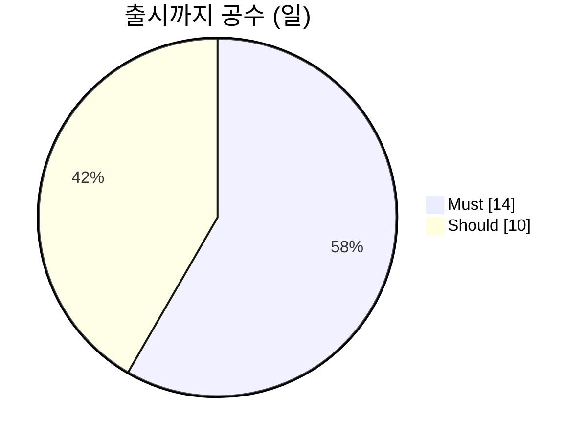

# 요구사항 · 로드맵 — game-TPS

> 문서 세트: [목차](../Proposal.md) · 기획: [컨셉](Concept.md) · [시스템-전투](System_Weapon.md) · [시스템-게임 흐름](System_GameFlow.md) · [전투·개체](Combat_Entity.md) · [레벨 디자인](LevelDesign.md) · [밸런스](Balance.md) · 사업·운영: [사업 검토](../대표/Business.md) · **요구사항·로드맵** · [Business Model](Monetization.md) · [서버·데이터](../개발/Server_Data.md) · [리소스](../디자인/Resources.md) · [로그·지표](Analytics.md) · [QA·출시](../QA/QA_Release.md) · [라이브 운영](../운영/LiveOps.md) · [사업화·법무](../대표/Business_Legal.md) · [needFix](../needFix.md)

> **문서 정보** · 문서 번호 `D02-REQ` · 버전 v1.0 · 상태 `Draft` · 담당 기획자 · 최종 수정 2026-11-21 · 관련 문서 [needFix](../needFix.md)

**변경 이력**

| 버전 | 날짜 | 변경 내용 | 사유 | 결정자 | 영향 범위 |
|---|---|---|---|---|---|
| v1.0 | 2026-11-21 | 최초 작성 | — | 기획자 | — |

---

## 1. 목적
**무엇을 · 언제까지 · 어떤 기준으로 완료**할지 정하는 문서예요. 일정과 범위를 자를 때의 기준이에요.
- 우선순위: `Must`(없으면 출시 불가) · `Should`(중요하지만 미룰 수 있음) · `Could`(여유 있으면) · `Won't`(이번엔 안 함)
- 마일스톤: **알파**(루프 완결) → **베타**(콘텐츠 · 수익화 연결) → **출시**
- 상태: `완료` · `진행` · `대기`. 완료 기준을 통과해야 `완료`예요.
- 공수는 1인 개발 기준 추정이에요. 실제 걸린 날로 계속 고쳐요.

## 2. 이미 구현된 것 (출발점)
| ID | 기능 | 근거 문서 | 상태 |
|---|---|---|---|
| `REQ_001` | 이동 · 점프 · 시점 (조이스틱 · 드래그 · PC 테스트 키) | [컨셉](Concept.md) | 완료 |
| `REQ_002` | 소총 사격 · 재장전 · 스코프 | [시스템-전투](System_Weapon.md) | 완료 |
| `REQ_003` | 수류탄 (반경 6m · 100 피해) | [시스템-전투](System_Weapon.md) | 완료 |
| `REQ_004` | 고블린 AI (NavMesh 추적 · 공격) | [전투 · 개체](Combat_Entity.md) | 완료 |
| `REQ_005` | 웨이브 진행 (최대 10) · 아이템 4종 | [시스템-게임 흐름](System_GameFlow.md) | 완료 |
| `REQ_006` | 설정 (음량 · 소리 · 일시정지) · 씬 이동 | [시스템-게임 흐름](System_GameFlow.md) | 완료 (버그 [S-12](../needFix.md)) |

## 3. 출시까지 할 일
| ID | 기능 | 우선순위 | 마일스톤 | 공수 | 관련 | 상태 |
|---|---|---|---|---|---|---|
| `REQ_101` | 10웨이브 클리어 화면 (점수 · 다시 · Home) | Must | 알파 | 1일 | [S-01](../needFix.md) · [S-24](../needFix.md) | 대기 |
| `REQ_102` | 버그 봉쇄: 체력 상한 · NavMesh 검사 · 빈 탄창 반응 · 재장전 우선 · 수류탄 쿨다운 | Must | 알파 | 2일 | [S-02](../needFix.md) ~ [S-07](../needFix.md) | 대기 |
| `REQ_103` | 소리 설정 유지 · 백그라운드 시 일시정지 | Must | 알파 | 0.5일 | [S-12](../needFix.md) · [S-14](../needFix.md) | 대기 |
| `REQ_104` | 나눠 생성 + 오브젝트 풀링, 동시 최대 고블린 수 제한 | Must | 알파 | 2일 | [S-11](../needFix.md) · [S-25](../needFix.md) | 대기 |
| `REQ_105` | 웨이브 사이 3초 휴식 · 보급 | Must | 베타 | 1일 | [S-10](../needFix.md) | 대기 |
| `REQ_106` | 고블린 3종 (일반 · 날쌘 · 덩치) + 공격 예고 · 피격 반응 | Must | 베타 | 4일 | [S-16](../needFix.md) · [S-17](../needFix.md) | 대기 |
| `REQ_107` | 웨이브 곡선 간소화 (한 판 2 ~ 4분) | Must | 베타 | 1일 + 테스트 | [S-15](../needFix.md) · [S-21](../needFix.md) | 대기 |
| `REQ_108` | 최고 점수 · 웨이브 저장 | Must | 베타 | 0.5일 | [S-13](../needFix.md) | 대기 |
| `REQ_109` | 영구 업그레이드 2 ~ 3종 (코인 → 남는 재화) | Should | 베타 | 3일 | [S-18](../needFix.md) · [Business Model](Monetization.md) | 대기 |
| `REQ_110` | 보상형 광고 (부활 1회 · 코인 2배) | Should | 베타 | 2일 | [Business Model](Monetization.md) | 대기 |
| `REQ_111` | 광고 제거 · 스타터 팩 인앱결제 | Should | 출시 | 3일 | [Business Model](Monetization.md) · [서버](../개발/Server_Data.md) | 대기 |
| `REQ_112` | 로그 이벤트 심기 | Must | 베타 | 1일 | [로그](Analytics.md) | 대기 |
| `REQ_113` | 모바일 조작 정리 (버튼 배치 · 조준 보정) | Should | 베타 | 2일 | [S-23](../needFix.md) | 대기 |
| `REQ_114` | 개인정보처리방침 · 이용약관 링크, 오픈소스 · 에셋 고지 화면 | Must | 출시 | 1일 | [사업화 · 법무](../대표/Business_Legal.md) | 대기 |
| `REQ_201` | 무기 해금 (샷건 · 저격총) | Won't | — | — | needFix §6 | 보류 |
| `REQ_202` | 엔드리스 모드 · 시즌 랭킹 | Won't | — | — | needFix §6 | 보류 (서버 필요) |
| `REQ_203` | 대장 고블린 (보스) | Won't | — | — | needFix §7 | 보류 |

**[원그래프] 출시까지 할 일 공수 (Must vs Should)**

## 4. 완료 기준 (Given / When / Then)
| ID | 완료 기준 |
|---|---|
| `REQ_101` | Given 10웨이브의 마지막 고블린을 처치하면 / When 1초 뒤 / Then 클리어 창이 뜨고 점수 · BEST가 보이며 다시 · Home 버튼이 동작한다 |
| `REQ_102` | Given 체력 100 / When 체력 팩을 주우면 / Then 체력은 100을 넘지 않고, 최대 체력이면 팩이 남는다 |
| `REQ_103` | Given 소리 끔으로 저장 / When 앱을 다시 켜면 / Then 소리는 꺼진 채 시작한다. 앱을 내렸다 올리면 설정 창이 열린 채 멈춰 있다 |
| `REQ_104` | Given 가장 큰 웨이브 / When 생성할 때 / Then 목표 기기([QA](../QA/QA_Release.md))에서 30 FPS 아래로 떨어지지 않는다 |
| `REQ_105` | Given 웨이브 전멸 / When 다음 웨이브 전 / Then 3초 카운트다운과 탄약 팩 1개가 나온다 |
| `REQ_107` | Given 내부 플레이 테스트 10판 / When 평균 시간을 재면 / Then 2 ~ 4분 안에 든다 |
| `REQ_110` | Given 게임오버 / When "광고 보고 부활"을 끝까지 보면 / Then 체력 50%로 같은 자리에서 부활하고, 한 판에 1번만 쓸 수 있다 |
| `REQ_111` | Given 결제 완료 / When 앱이 결제 중 꺼져도 / Then 다음 실행 때 상품이 지급된다 ([서버](../개발/Server_Data.md) §4) |

## 5. 마일스톤
| 마일스톤 | 들어가는 것 | 통과 조건 |
|---|---|---|
| 알파 | REQ_101 ~ 104 | 10웨이브까지 버그 없이 한 판이 끝까지 돈다 |
| 베타 | REQ_105 ~ 110, 112, 113 | 한 판 2 ~ 4분, 로그 수집, 광고 테스트 모드 동작 |
| 출시 | REQ_111, 114 + [QA · 출시](../QA/QA_Release.md) | 치명 버그 0, 스토어 심사 통과 |
