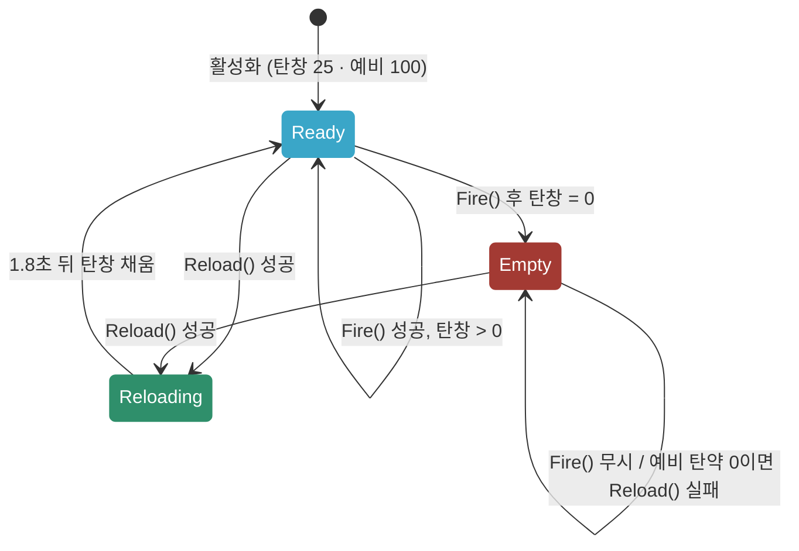
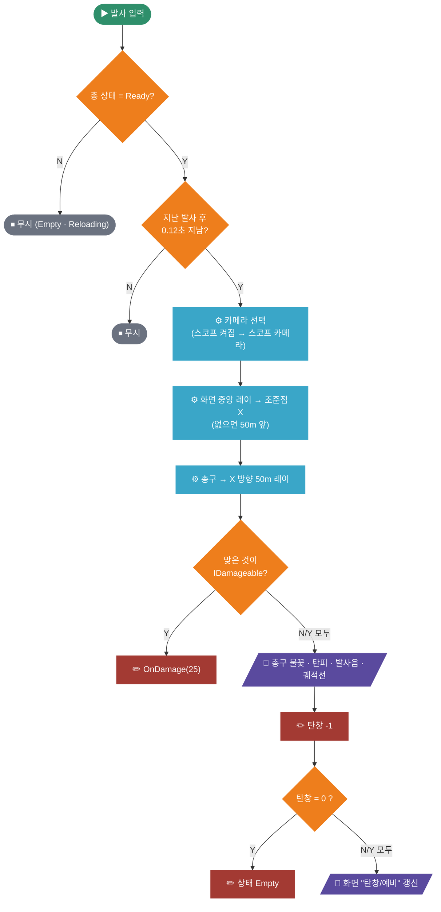
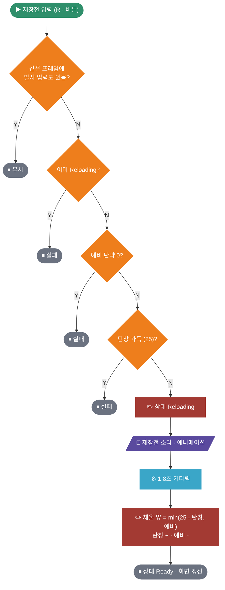
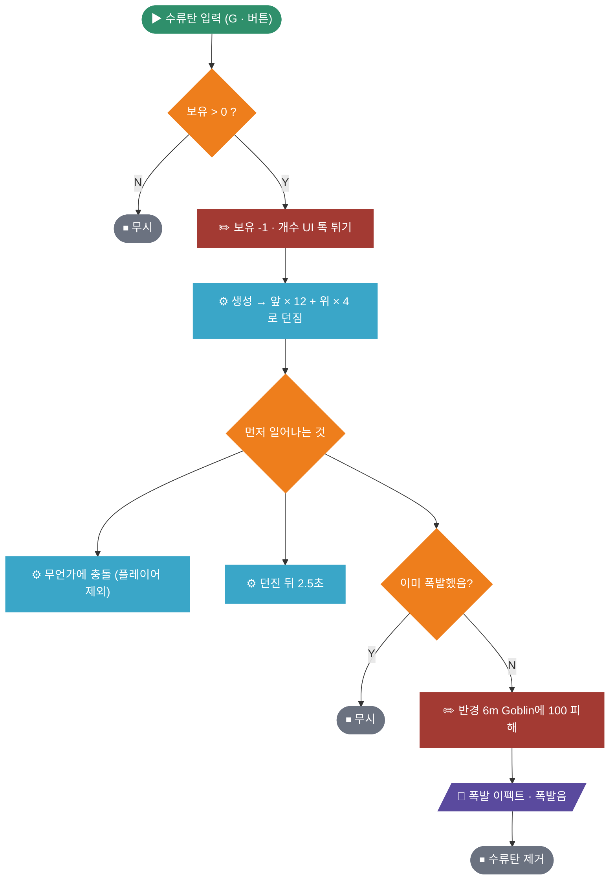
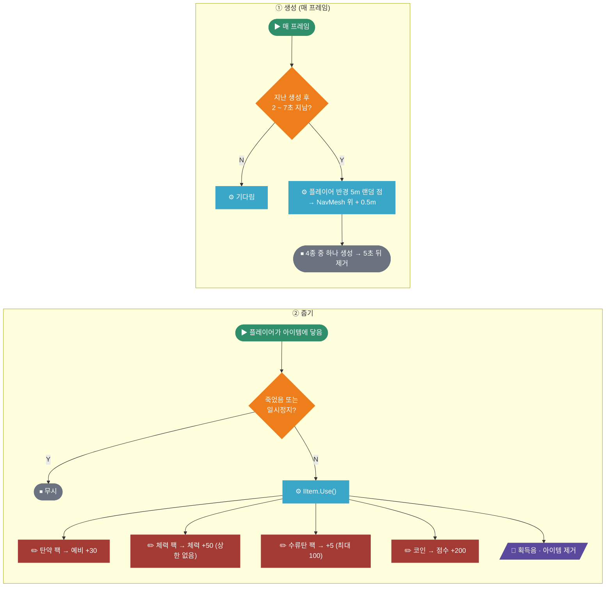
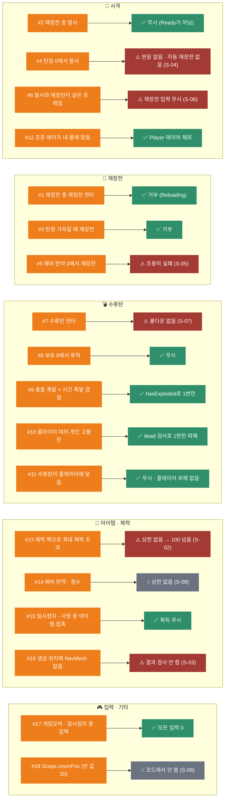

# 시스템 — 전투 (사격 · 재장전 · 수류탄 · 스코프 · 아이템)

> 문서 세트: [목차](../Proposal.md) · 기획: [컨셉](Concept.md) · **시스템-전투** · [시스템-게임 흐름](System_GameFlow.md) · [전투·개체](Combat_Entity.md) · [레벨 디자인](LevelDesign.md) · [밸런스](Balance.md) · 사업·운영: [사업 검토](../대표/Business.md) · [요구사항·로드맵](Requirements.md) · [Business Model](Monetization.md) · [서버·데이터](../개발/Server_Data.md) · [리소스](../디자인/Resources.md) · [로그·지표](Analytics.md) · [QA·출시](../QA/QA_Release.md) · [라이브 운영](../운영/LiveOps.md) · [사업화·법무](../대표/Business_Legal.md) · [needFix](../needFix.md)
> 관련 코드: `Gun.cs` · `PlayerShooter.cs` · `PlayerInput.cs` · `PlayerGrenade.cs` · `Grenade.cs` · `Scope.cs` · `ItemSpawn.cs` · `PlayerHealth.cs` · `Item/*.cs`

> **문서 정보** · 문서 번호 `D03-WEAPON` · 버전 v1.0 · 상태 `Review` · 담당 기획자 · 클라이언트 개발자 · 최종 수정 2026-11-21 · 관련 문서 [전투·개체](Combat_Entity.md) · [밸런스](Balance.md)

**변경 이력**

| 버전 | 날짜 | 변경 내용 | 사유 | 결정자 | 영향 범위 |
|---|---|---|---|---|---|
| v0.9 | 2026-11-20 | 기존 문서 (자세한 기록은 git 커밋) | — | 기획자 | — |
| v1.0 | 2026-11-21 | 문서 정보 · 변경 이력 · 문서 번호 추가, 사업 · 운영 문서와 연결 | — | 기획자 | 문서만 |

---

## 0. 한눈에 보는 시스템 구조

**[구성도] 스크립트 연결 — 전투**

```mermaid
flowchart LR
  subgraph L1["① 입력 · 씬"]
    IN["🎬 PlayerInput<br/>버튼 · 키보드"]:::scene
  end
  subgraph L2["② 게임 로직 (스크립트)"]
    SH["📜 PlayerShooter"]:::script
    G["📜 Gun"]:::script
    PG["📜 PlayerGrenade"]:::script
    SC["📜 Scope"]:::script
    IS["📜 ItemSpawn"]:::script
    PH["📜 PlayerHealth"]:::script
    GM["📜 GM"]:::script
  end
  subgraph L3["③ 게임 오브젝트"]
    GB["📦 고블린"]:::obj
    GR["📦 수류탄"]:::obj
    IT["📦 아이템 4종"]:::obj
  end
  subgraph L4["④ 화면 · 소리"]
    UI["🖥️ UIM · ItemCntUI"]:::ui
  end
  IN -->|"① fire · reload"| SH
  SH -->|"② Fire() · Reload()"| G
  G -->|"③ OnDamage(25)"| GB
  IN -->|"① grenade"| PG
  PG -->|"② 투척"| GR
  GR -->|"③ 반경 6m 100 피해"| GB
  IN -->|"① scope"| SC
  IS -->|"2~7초마다"| IT
  IT -->|"탄약 +30"| G
  IT -->|"체력 +50"| PH
  IT -->|"수류탄 +5"| PG
  IT -->|"코인 +200"| GM
  G -->|"onAmmoChanged"| UI
  PG -->|"onGrenadeCntChanged"| UI
  classDef scene fill:#2F8F6B,color:#fff,stroke:#2F8F6B
  classDef script fill:#3AA6C8,color:#fff,stroke:#3AA6C8
  classDef obj fill:#6B7280,color:#fff,stroke:#6B7280
  classDef ui fill:#5A4A9E,color:#fff,stroke:#5A4A9E
  classDef data fill:#A33A33,color:#fff,stroke:#A33A33
```


## 1. 개요
| 기능 | 한 줄 설명 | 수치 출처 |
|---|---|---|
| 사격 | 화면 중앙 조준점이 가리키는 곳으로 레이캐스트 발사 | `ScriptableData/Play/Gun Data.asset` |
| 재장전 | 1.8초 동안 사격 불가, 예비 탄약에서 탄창 채움 | `Gun Data` |
| 수류탄 | 앞으로 포물선 투척, 부딪히거나 2.5초 뒤 폭발 | `Grenade` 프리팹, `Play` 씬 `PlayerGrenade` |
| 스코프 | 스코프 카메라 켜기 + 스코프 UI, 조준점 UI 숨김 | `Scope` |
| 아이템 | 플레이어 주변에 2 ~ 7초마다 생성, 5초 뒤 사라짐 | `Play` 씬 `ItemSpawn` |

## 2. 입력 → 행동
| 입력 (모바일 / PC) | 판정 방식 | 행동 |
|---|---|---|
| Fire 버튼 누르고 있기 / `F` 누른 순간 | 버튼은 누르는 동안 매 프레임, F는 누른 프레임만 | `Gun.Fire()` (연사 간격 0.12초로 제한) |
| Reload 버튼 / `R` | 누른 순간 한 프레임 | `Gun.Reload()` |
| Grenade 버튼 / `G` | 누른 순간 한 프레임 | `PlayerGrenade.ThrowGrenade()` |
| Scope 버튼(토글) / 마우스 오른쪽 누르기 | 상태 유지 | `Scope.Apply(on)` |
| 게임오버 · 일시정지 중 | 모든 입력 0 / false | 행동 없음 |

## 3. 총 상태 머신

**[상태도] 총 상태 머신**


```
mag    [=========================] 25   Ready
mag    [=======                  ]  7   Ready
mag    [                         ]  0   Empty  -> 발사 눌러도 반응 없음 (재장전 필요)
mag    [....reloading 1.8s.......]      Reloading
mag    [=========================] 25   Ready  (예비 탄약에서 채운 만큼 이동)
```

## 4. 작동 로직
### 4-1. 사격 `Gun.Fire()`

**[흐름도] 한 발 쏘기**


**조준 레이 두 번 쏘기 (위에서 본 모습)**
```
   C -------------------------------------> X
                                          ^
   G -------------------------------------+
   P

C = 카메라: 화면 중앙(0.5, 0.5)으로 레이, Player 레이어 제외
X = 조준점: 맞은 곳 (없으면 50m 앞)
G = 총구: 조준점 방향으로 실제 발사 레이 (최대 50m)
스코프 켜짐 -> C 대신 스코프 카메라 기준
```

> 세부 조건(코드 기준)은 [부록 A-1](#a-1-사격-gunfire)에 있어요.

### 4-2. 재장전 `Gun.Reload()`

**[흐름도] 재장전**


> 세부 조건(코드 기준)은 [부록 A-2](#a-2-재장전-gunreload)에 있어요.

### 4-3. 수류탄

**[흐름도] 수류탄 던지기부터 폭발까지**


**투척 궤적 (옆에서 본 모습)**
```
              .  -  -  .
          .               .        힘 = 앞 x 12 + 위 x 4 (Impulse)
       .                     .
   P                           *   바닥 · 고블린에 닿는 즉시 폭발 (늦어도 2.5초)
 ------------------------------------
```

> 세부 조건(코드 기준)은 [부록 A-3](#a-3-수류탄)에 있어요.

### 4-4. 아이템 생성 · 획득

**[흐름도] 아이템 생성과 줍기**


**생성 범위 (위에서 본 모습)**
```
          . - - - - .
        /     A       \        반경 5m 안 랜덤 점 -> NavMesh 위 + 0.5m
       |   H     P     |       2 ~ 7초마다 1개, 5초 뒤 사라짐
        \         G   /
          ' - - - - '

A = 탄약 +30 · H = 체력 +50 · G = 수류탄 +5 · C = 코인 +200 (4종 균등 랜덤)
```

> 세부 조건(코드 기준)은 [부록 A-4](#a-4-아이템-생성--획득)에 있어요.

## 5. 예외 처리 (Edge Case) — 현재 동작
**[구성도] 예외 처리 지도 — 전투**


| # | 상황 | 현재 동작 | 상태 |
|---|---|---|---|
| 1 | 재장전 중 재장전 연타 | `Reloading`이면 거부 | ✅ |
| 2 | 재장전 중 발사 | `Ready`가 아니면 무시 | ✅ |
| 3 | 탄창 가득일 때 재장전 | 거부 | ✅ |
| 4 | 탄창 0에서 발사 | 반응 없음 (소리 · 안내 없음, 자동 재장전 없음) | ⚠️ → [S-04](../needFix.md) |
| 5 | 예비 탄약 0에서 재장전 | 조용히 실패 | ⚠️ → [S-05](../needFix.md) |
| 6 | 발사 입력과 재장전이 같은 프레임 | 재장전 입력 무시 | ⚠️ → [S-06](../needFix.md) |
| 7 | 수류탄 연타 | 쿨다운 없음 | ⚠️ → [S-07](../needFix.md) |
| 8 | 보유 수류탄 0에서 투척 | 무시 | ✅ |
| 9 | 충돌 폭발과 시간 폭발이 겹침 | `hasExploded`로 1번만 | ✅ |
| 10 | 콜라이더가 여러 개인 고블린 | `dead` 검사로 1번만 피해 | ✅ |
| 11 | 수류탄이 플레이어에 닿음 | 충돌 무시, 플레이어 피해 없음 | ✅ |
| 12 | 조준 레이가 플레이어 몸에 맞음 | Player 레이어 제외 | ✅ |
| 13 | 체력 팩으로 최대 체력 초과 | `RestoreHealth`에 상한 없음 | ⚠️ → [S-02](../needFix.md) |
| 14 | 예비 탄약 · 점수 | 상한 없음 | → [S-08](../needFix.md) |
| 15 | 일시정지 · 사망 중 아이템 접촉 | 획득 무시 | ✅ |
| 16 | 아이템 생성 위치에 NavMesh 없음 | `SamplePosition` 결과를 검사하지 않음 | ⚠️ → [S-03](../needFix.md) |
| 17 | 게임오버 · 일시정지 중 입력 | `PlayerInput`이 모든 값 0 | ✅ |
| 18 | `Scope.zoomFov` (씬 값 20) | 코드에서 사용하지 않음 (스코프 카메라로 대체) | → [S-09](../needFix.md) |

## 6. UI 피드백
| 이벤트 | 화면 | 소리 |
|---|---|---|
| 발사 | 총구 불꽃 · 탄피 · 궤적선 | 발사음 |
| 탄 수 변경 | `mag/remain` 글자 | – |
| 재장전 | 상체 재장전 애니메이션 | 재장전음 |
| 수류탄 개수 변경 | 개수 글자 톡 튀기 (`IPop`) | – |
| 체력 감소 | 체력바 깜빡임 (`IBlink`) | 피격음 |
| 체력 회복 | 체력바 톡 튀기 | 획득음 |

---

## 부록 A. 세부 조건 (코드 기준)
본문 흐름도의 조건을 코드 그대로 적은 개발 참고용이에요. 기획 내용은 본문에 있어요.

### A-1. 사격 `Gun.Fire()`
```
발사 입력 발생
├─ IF 총 상태 ≠ Ready            → 무시 (Empty · Reloading)
├─ IF 마지막 발사 후 0.12초 미만  → 무시 (연사 간격)
└─ ELSE
    ├─ 조준 카메라 선택: 스코프 켜짐 → 스코프 카메라 / 꺼짐 → 메인 카메라
    ├─ 화면 중앙(0.5, 0.5)으로 레이 → Player 레이어 제외하고 맞은 지점 = 조준점 (없으면 50m 앞)
    ├─ 총구 → 조준점 방향으로 50m 레이캐스트
    │   ├─ IF 맞은 대상에 IDamageable 있음 → OnDamage(25)
    │   └─ 궤적 끝 = 맞은 지점 (없으면 50m 앞)
    ├─ 연출: 총구 불꽃 · 탄피 · 발사음 · 궤적선 0.03초
    ├─ 탄창 -1 → IF 탄창 = 0 → 상태 Empty
    └─ onAmmoChanged(탄창, 예비) 알림 → UI 갱신
```

### A-2. 재장전 `Gun.Reload()`
```
재장전 입력 발생
├─ IF 발사 입력이 같은 프레임에 들어옴 → 재장전 입력 무시 (PlayerShooter: if fire else if reload)
├─ IF 상태 = Reloading            → 실패 (false)
├─ IF 예비 탄약 ≤ 0               → 실패
├─ IF 탄창이 이미 가득(25)        → 실패
└─ ELSE → 성공 (true)
    ├─ 상태 Reloading, 재장전 소리, 재장전 애니메이션 트리거
    ├─ (옵션) 상체 애니메이션 레이어 Weight 0 → 1 로 부드럽게
    ├─ 1.8초 대기
    ├─ 채울 양 = min(25 - 탄창, 예비 탄약) → 탄창 += 채울 양, 예비 -= 채울 양
    └─ 상태 Ready, onAmmoChanged 알림
```

### A-3. 수류탄
```
수류탄 입력 발생
├─ IF 보유 수류탄 ≤ 0 → 무시
└─ ELSE
    ├─ 보유 -1 → onGrenadeCntChanged 알림 (UI 숫자 톡 튀기)
    ├─ 투척 지점에서 생성 → 힘 = 앞 × 12 + 위 × 4 (Impulse, 포물선)
    └─ 폭발 조건 (먼저 오는 것 1번만 — hasExploded)
        ├─ 무언가에 충돌 (단, 플레이어 자신은 무시) → 즉시 폭발
        └─ 던진 뒤 2.5초 경과 → 폭발
            ├─ 반경 6 안의 Goblin 레이어 전부 → 살아 있으면 100 데미지
            ├─ 폭발 이펙트 생성(2초 뒤 제거) · 폭발음
            └─ 수류탄 제거
```

### A-4. 아이템 생성 · 획득
```
매 프레임
└─ IF 지난 생성 후 (2 ~ 7초 랜덤) 경과 AND 플레이어 있음
    ├─ 플레이어 주변 반경 5 안 랜덤 점 → NavMesh 위 가장 가까운 점 + 0.5m 위
    ├─ 4종 중 균등 랜덤 1개 생성 → 5초 뒤 제거
    └─ 다음 생성 시간 다시 랜덤

플레이어가 아이템에 닿음 (OnTriggerEnter)
├─ IF 플레이어 사망 OR 일시정지 → 무시
└─ ELSE → IItem.Use() + 획득음
    탄약 +30 / 체력 +50 / 수류탄 +5 (최대 100) / 코인 → 점수 +200
```
